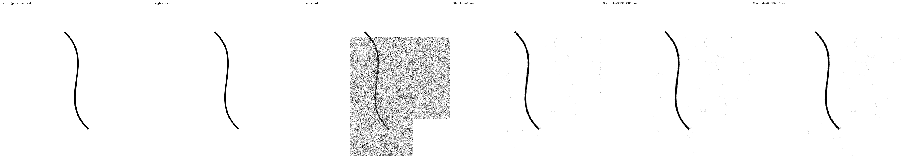
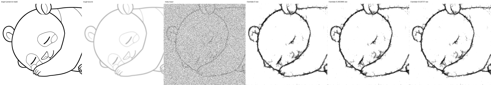
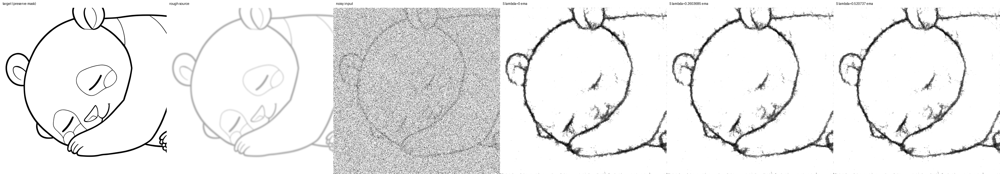
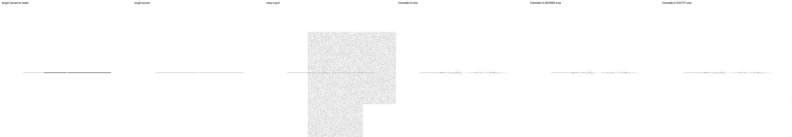
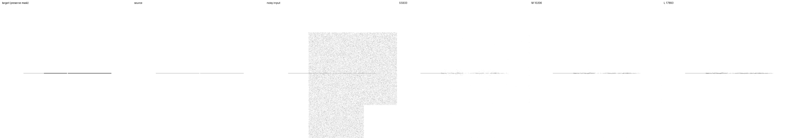

# 境界近傍lossの半係数比較（L1b）

**2026-09-15完了。半係数EMAは線幅改善を一部残して切断増加を抑えたが、解消には至らなかった。**
追加10,000更新、主評価23,430出力、保存・ONNX・実runtime検証を完了した。
rawでは線幅改善が残らず、半係数の全面採用は保留する。

2026-09-15開始。前回の[局所距離場loss比較](boundary-loss-experiment-20260914.md)では、
線幅が改善する一方、EMAで強い重ね描きの切断が増えた。
**係数を0.520737から0.2603685に半減した1条件を追加**し、保存済みの係数0・0.520737と比較する。
前回のdevelopment結果を見て決めた追試であり、未見testではない。

## 学習前に固定する設計

- 新条件は`half`。既存`control`・`boundary`は再学習せず、前回の2,000/10,000更新を再利用する。
- 初期値は3条件ともD1の`geometry20/raw`追加10,000更新時点。今回追加10,000更新で通算50,000相当。
  前回boundaryの最終重みからの継続ではない。optimizerはリセット、EMAは初期rawをコピー。
- `configs/boundary-half.toml`は、前回設定から`loss.boundary_weight`だけを変更。
  モデルS/M/L 5,933 / 10,206 / 17,893 parameters、再帰1〜6段、各段loss係数0、
  micro4×蓄積4、LR 1e-4×sqrt(16)、warmup500、schedule終点100,000を維持する。
- seed46、split42、train891/dev64/final64、生成教師20%、strokes拡張50%、Gaussianとmaskは同じ。
  final64は使わず、合成下描きのみ。Krita・配布モデルは変更しない。
- 補助lossの半径4と演算は変えない。係数は前回校正値の正確な半分で、再校正はしない。

## 既存結果の再利用条件

`scripts/boundary_reuse.py`で以下を検証してから本学習を開始する。

1. 前回の成果物hash・source archive・初期重みを検証する。数値処理sourceと依存lockのhashは前回と一致。
2. training/evaluation scriptは、新CLI選択肢を除いたASTが前回archiveと一致する。
3. 前回の係数0.520737で単独30更新と従来の2条件30更新を再実行。
   データ分割、初期化、全更新のscale/再帰/生成slot/keyが一致し、10/20/30のloss内訳と勾配を比較する。
4. CPUの小型実行では、単独・2条件実行のモデル/optimizer/EMAと中断再開が完全一致することをテストする。
5. 固定評価1,562ケース＋manifestをbyte単位で複製し、初期rawの4,686出力を再評価する。
6. 本学習の全10,000更新でもscale/再帰/生成slot/key、設定、sourceの一致を監査する。

GPUの短い再実行で微小な差が出たため、bit単位の一致とは区別する。
loss内訳はrtol1e-5、gradient normはrtol1e-4、共通atol1e-8で照合し、実測差を保存する。
この許容値は短い再実行差を確認した後、本学習前に固定する。
同一seedでも長期学習の浮動小数点差が増幅されない保証はなく、独立seed比較の代替にはならない。

## 評価・判断

2,000更新で有限性・保護画素の一致・clean F1の崩壊を確認し、通過すれば同じ設定で10,000へ進む。
半係数の初期rawと2,000/10,000のraw/EMA、全S/M/Lを評価する。
512pxのruntime再帰3段、NumPy noise、denoise1回で、前回と同じ評価器を使う。
新規評価23,430出力、再利用する学習後評価37,488出力、合計60,918出力（初期値の重複は数えない）。

主要な問いは、強い重ね描き幾何形状における**線幅改善と切断・消失の折り合い**。
半係数−補助なし、半係数−元係数を、raw/EMA別、S/M/L別に対応比較する。
clean、強いblur、背景残留、誤接続も併記し、F1や線幅だけで採用しない。
前回と同じ元画像/幾何variant単位のbootstrapを使う。学習seedの不確実性は測れない。
幅のprobeは濃さと近傍残留の影響を受け、接続probeも固定queryに限られる。

例示画像は事前にcase256（clean曲線）、479/480（強いblur）、1376（薄い線）を選ぶ。
同じ入力に対する3条件のSと、半係数のS/M/Lを表示する。
最終checkpoint、抽出S/M/L、S ONNX、実runtimeと既存BGRA APIの一致を確認して完了とする。

## 再現

```bash
# 同じ初期値・前回の係数で、短い再実行をそれぞれ行う。
.venv/bin/python scripts/compare_nested_training.py --study boundary_half \
  --config configs/boundary-loss.toml --run-dir runs/boundary-half-20260915/replay-full \
  --stop-after 30 --initialize-from runs/geometry-data-20260914/snapshots/step-10000/geometry20/raw
# 上記を --study boundary_loss / --run-dir .../replay-paired でも実行する。
.venv/bin/python scripts/boundary_reuse.py --root runs/boundary-half-20260915 \
  --reference-root runs/boundary-loss-20260914 \
  --reference-artifacts benchmarks/boundary-loss-20260914-artifacts.json
JAX_PLATFORMS=rocm,cpu XLA_PYTHON_CLIENT_PREALLOCATE=false OPENBLAS_NUM_THREADS=1 \
.venv/bin/python scripts/run_geometry_data.py --study boundary_half \
  --root runs/boundary-half-20260915 --reference-root runs/boundary-loss-20260914
```

本実行前にconfig・preflight・tests・source archive/hashをrun rootへ保存する。
controller/observerの再起動は既存processの終了を確認してから行う。
`summarize_geometry_data.py` / `audit_geometry_data.py`にも`--study boundary_half`を指定する。
結果・実測差・成果物の詳細は以下に記録する。

事前検証は全138テスト成功（CPU204.64秒）。単独と2条件実行の小型3更新で、
モデル・optimizer・EMAが完全一致し、単独実行の中断再開も完全一致した。
実GPUでは半係数・実効batch16・再帰1〜6段の全6更新が有限で、保護領域の教師も一致した。

30更新のGPU再実行で、loss内訳の最大絶対差は約2.8e-7、勾配normを含む最大差は
単独−前回3.4332e-5、2条件再実行−前回2.4140e-5、単独−2条件再実行3.7670e-5。
最大相対差はそれぞれ4.7524e-5、3.2529e-5、7.0379e-5で、上記許容値内だった。
元の2条件実行でも微小差が発生するため、単独実行特有の差と断定しない。
データ分割・初期化・再帰段・生成keyは完全一致、実行/evaluation loopのAST一致も通過した。

## 2,000更新の中間結果

2026-09-15 11:48 UTC、崩壊検知を通過し、同じ設定で10,000更新へ継続した。
初期4,686出力の全指標は前回と完全一致。今回の中間9,372出力も有限で保護画素最大誤差0。
生成教師は32,000枠中6,421（白背景319）、全2,000更新のscale/再帰/生成keyが前回と一致した。

S・強い重ね描き幾何形状の中間値:

| 重み・指標 | 係数0 | 半係数0.2603685 | 元係数0.520737 |
|---|---:|---:|---:|
| raw F1 | .5110 | .5165 | .5190 |
| raw 線幅MAE px | 2.9550 | 2.7954 | 2.7049 |
| raw 切断率 | .3646 | .3667 | .3719 |
| raw 消失率 | .0797 | .0805 | .0824 |
| EMA F1 | .5116 | .5139 | .5154 |
| EMA 線幅MAE px | 2.7597 | 2.6686 | 2.6018 |
| EMA 切断率 | .3703 | .3781 | .3781 |
| EMA 消失率 | .0944 | .0948 | .0948 |

半係数−係数0の線幅差はraw −.1596px、対応付き95%区間[−.1901,−.1269]、
EMA −.0910px [−.1101,−.0709]。幅改善は残るが、EMAの切断は元係数と同じだった。
rawの切断差は +.00208 [0,.00625]、EMAは +.00781 [0,.02083]。
半係数−元係数のraw切断差は −.00521 [−.01563,0]で、確実な改善とは断定しない。
clean F1・強い重ね描き実画像F1は両係数の中間、強いblur実画像F1も中間で補助なしを下回る。
2,000時点の順位から採用を決めず、最終評価まで追う。

中間集計: `benchmarks/boundary-half-20260915-pilot.json`。
記録された学習時間3,564秒、定常更新平均1.151秒。
1条件実行では画像読み込み待ちが目立つため、2条件に比べた実時間短縮を単純な半分と見積もらない。

## 10,000更新の最終結果

### Sの復元F1

編集領域のF1（高いほど良い）。「実画像由来」も合成した下描きであり、実際の下描きではない。

| 重み・評価集合 | 係数0 | 半係数0.2603685 | 元係数0.520737 |
|---|---:|---:|---:|
| raw・clean実画像 | 0.9177 | 0.9147 | 0.9171 |
| raw・clean幾何形状 | 0.8130 | 0.8049 | 0.8120 |
| raw・強いblur・実画像由来 | 0.7797 | 0.7848 | 0.7824 |
| raw・強い重ね描き・実画像由来 | 0.7757 | 0.7753 | 0.7786 |
| raw・強い重ね描き・幾何形状 | 0.5206 | 0.5245 | 0.5283 |
| EMA・clean実画像 | 0.9232 | 0.9246 | 0.9255 |
| EMA・clean幾何形状 | 0.8264 | 0.8315 | 0.8355 |
| EMA・強いblur・実画像由来 | 0.7775 | 0.7743 | 0.7723 |
| EMA・強い重ね描き・実画像由来 | 0.7800 | 0.7825 | 0.7843 |
| EMA・強い重ね描き・幾何形状 | 0.5176 | 0.5209 | 0.5235 |

EMAの半係数−補助なしは、clean実画像 +.00133、95%区間[.00051,.00234]、
clean幾何形状 +.00507 [.00434,.00579]、強い重ね描き実画像 +.00254 [.00095,.00414]。
一方、強いblur実画像は −.00318 [−.00603,−.00087] と低下する。
元係数からは強いblurで +.00200 [.00080,.00330] 回復したが、補助なしには届かなかった。

rawでは半係数のclean実画像 −.00294 [−.00471,−.00163]、clean幾何形状 −.00803
[−.00922,−.00689] と低下。強いblurは +.00508 [.00213,.00857] と改善する。
raw/EMAで傾向が異なり、半係数が常に両端の係数の中間になるわけではない。

### 線幅と接続の折り合い

S・強い重ね描き幾何形状。線幅・消失・接続のprobeは全面編集64ケース、
F1は部分編集も含む128ケースを使う。以下は低いほど良い。

| 重み・指標 | 係数0 | 半係数0.2603685 | 元係数0.520737 |
|---|---:|---:|---:|
| raw・線幅MAE px | 2.887975 | 2.910665 | 2.770143 |
| raw・消失率 | 0.076931 | 0.066819 | 0.067524 |
| raw・切断率 | 0.334896 | 0.320312 | 0.326562 |
| raw・誤接続率 | 0.666667 | 0.687500 | 0.666667 |
| raw・背景MAE | 0.013387 | 0.013745 | 0.013057 |
| EMA・線幅MAE px | 2.824338 | 2.696330 | 2.597797 |
| EMA・消失率 | 0.082259 | 0.082910 | 0.083941 |
| EMA・切断率 | 0.335938 | 0.348437 | 0.371875 |
| EMA・誤接続率 | 0.666667 | 0.625000 | 0.625000 |
| EMA・背景MAE | 0.012617 | 0.012063 | 0.011638 |

EMAの半係数−補助なし:

- 線幅MAE −.1280px、95%区間[−.1513,−.1034]。元係数の改善幅−.2265pxの**約57%**を残した。
- 切断率 +.01250 [0,.02813]。元係数の増加+.03594から、点推定で**約65%**減った。
- 半係数−元係数の切断率は −.02344 [−.04427,−.00521]で、今回の固定suiteでは低下した。
  補助なしとの差の区間が0に接することは、同等性や切断増加の解消を示さない。
- 消失率差 +.000651 [0,.001628]。背景MAEは −.000553 [−.000642,−.000462]と改善。
- 誤接続率は元係数と同じ。補助なしとの差の区間は[−.10417,0]と広い。

rawでは線幅差 +.0227px [−.0064,.0520]で改善を確認できず、
背景MAEも +.000358 [.000262,.000452]と悪化した。
消失率は −.01011 [−.01981,−.00293]、切断率は −.01458 [−.03542,.00625]。
線を残す側へ動いた点推定と、幅・背景の代償を併記する。
clean幾何形状のraw線幅も1.1062→1.1272px、背景MAE .009004→.010258へ悪化した。

これらの区間は元画像/幾何variant単位の対応付きbootstrapで、単一の学習済みモデルに条件付く。
約57%・約65%という比率は点推定の説明で、比率自体の信頼区間を測ったものではない。
短いGPU再実行差や学習seed間の変動はこの区間に含まれない。
線幅probeは濃さと残留も含み、接続probeは固定query・複数閾値による診断に限られる。

### サイズ別の限界

半係数EMAの結果:

| 指標 | S 5,933 | M 10,206 | L 17,893 |
|---|---:|---:|---:|
| clean実画像 F1 | 0.9246 | 0.9264 | 0.9291 |
| clean幾何形状 F1 | 0.8315 | 0.8442 | 0.8624 |
| 強いblur・実画像由来 F1 | 0.7743 | 0.7867 | 0.7963 |
| 強い重ね描き・実画像由来 F1 | 0.7825 | 0.8084 | 0.8113 |
| 強い重ね描き・幾何形状 F1 | 0.5209 | 0.5456 | 0.5579 |
| 強い重ね描き幾何形状 線幅MAE px | 2.6963 | 2.4534 | 2.3320 |
| 強い重ね描き幾何形状 消失率 | 0.0829 | 0.0789 | 0.0750 |
| 強い重ね描き幾何形状 切断率 | 0.3484 | 0.3115 | 0.3094 |
| 強い重ね描き幾何形状 誤接続率 | 0.6250 | 0.7292 | 0.7083 |

M/LでもEMAの線幅は補助なしから約.117/.106px改善した。
ただしMの切断率は +.01979 [.00417,.04062]、Lは +.01250 [−.00104,.02917]。
Mは元係数と同じ切断率で、Sの係数効果をそのまま全サイズへ一般化できない。
raw M/Lは切断率が約.0276下がる一方、線幅誤差は約.103/.096px増えた。
モデルサイズの最小十分値も未確定である。

## 固定例の画像

3条件比較の列は正解、合成下描き、ノイズ入力、S係数0、S半係数、S元係数。
元の検証済み画像から未拡縮の画素を配置し、3条件の入力画素が完全一致することを確認した。
最終画像を見る前に選んだ4例を両重みで作成し、8枚すべてを保存した。



case256の主要な曲線は3条件とも維持する。




case480では全条件で輪郭を拾うものの、内側の細部消失と荒い線・背景残留が残る。
半係数SのF1はraw .6848、EMA .6830。少数画像の見た目を集合全体の順位の代わりにはしない。




case1376は強いtone劣化を受けた隙間付き線、部分編集、ノイズ強度.1。
半係数EMAのS/M/L F1は .0453 / .1825 / .2617。大型でも復元は不十分で、薄い線の問題は残る。
rawも .0672 / .2014 / .2441にとどまる。

## 成果物と完了検証

- 追加10,000更新を完了。初期4,686＋中間9,372＋最終9,372＝**新規23,430出力**。
  全出力有限、保護画素最大誤差0。前回の学習後37,488出力を再利用し、3条件で計60,918出力を比較した。
  複製した初期値を二重に数えず、描画・runtime検証はこの主評価件数に加えない。
- 最終optimizer/checkpoint counterは10000。raw/EMA×再帰1/6段×3サイズの12比較で
  全体と抽出モデルの出力差0。L専用パラメータ変更時もS/Mの全段出力は不変。
- 中間・最終のsnapshot4個、抽出archive6個、S ONNX2個、再開可能な最終checkpoint1個を保存。
  Sの動的形状と512px ONNX比較は成功し、512px最大差2.2650e-6。
- 実runtime再帰3段の8比較で最大差4.5896e-6、保護画素完全一致。
  既存BGRA APIの8条件（raw/EMA×2形状×denoise1/5回）で決定性・強度0・保護画素の保持が一致。
  Kritaの画面操作やDirectMLでの検証ではない。
- 全10,000更新で前回とscale・再帰・生成slot/keyが一致。160,000枠のうち
  生成31,966枚（19.98%、白背景1,571）、既存画像128,034枚。
  固定評価1,563ファイル、初期重み、数値処理sourceと依存lockを監査した。
- 全138テスト成功。今回の学習前にGPU全6再帰段の更新も確認した。
  実行開始後は61ファイルの設定/source hashが不変。主成果物93個のhashを監査し、
  3条件比較8枚と掲載画像5枚のhashを別途保存・確認した。
- 記録された学習時間は17,647秒（約4.90時間）、定常更新平均1.155秒、入力待ち平均.544秒。
  前回の2条件25,341秒から約30%短縮したが、独立した速度benchmarkではない。
  事前再実行・評価・exportなどはこの学習時間に含まない。

実装commit `751f36390e95acd9e5a9f01f2da5174a700b0c61`、
archive `runs/boundary-half-20260915/implementation-source.tar.gz`。
主集計は `benchmarks/boundary-half-20260915.json`、中間は同prefixの`-pilot.json`。
`-runtime.json` / `-bgra.json` / `-illustrations.json` / `-diagnostics.json` / `-panels.json`に追加検証、
`-artifacts.json`に主成果物hash、run rootの`reference-reuse.json`に再利用条件と短い再実行差を保存した。
全設定・checkpoint・固定入力・画像は`runs/boundary-half-20260915/`に保持する。

## 判断と次の優先順位

**半係数EMAは幅と切断の折り合いを改善する候補として残すが、全面採用しない。**
Sでは元係数からの切断減少を確認できたものの、補助なしに対する切断増加の解消は確認できない。
blurの悪化、Mの切断増加、薄い線の復元不足、rawの幅・背景悪化も残る。
係数を半分にすれば全条件が滑らかに中間へ動く、という仮定もrawの結果では成立しなかった。

次は計画L2の接続性を直接扱う補助loss（soft-clDice）の**独立比較**を優先する。
共通D1初期値、生成20%・strokes50%を維持し、補助なしと比較して切断と誤接続・意図した隙間を調べる。
距離場lossとの併用はそれぞれの効果が確認できてから検討する。
その後にN1の強度sampling、複数seed、独立Sの長期比較・収束確認へ進む。
L2/N1、複数seed、独立S長期、final test、実際の下描き評価は今回は実施していない。
Kritaと配布モデルは変更していない。
