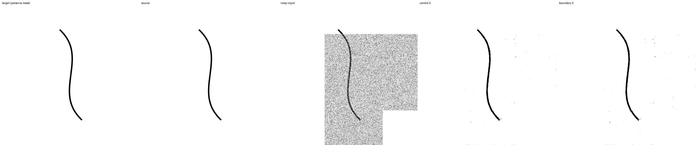
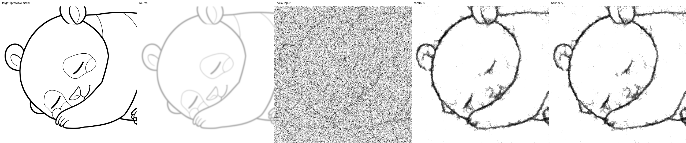
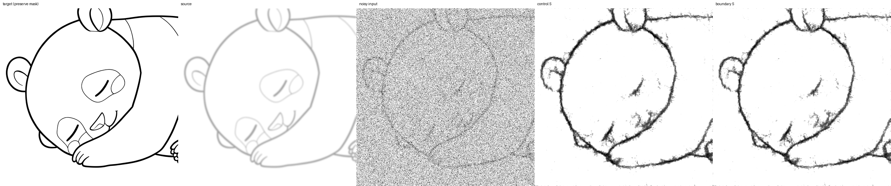
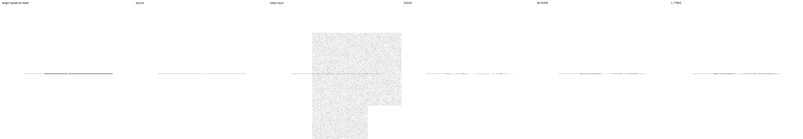

# 境界近傍の距離場loss比較（L1）

**2026-09-15完了。局所距離場lossで線幅誤差を減らせたが、EMAでは切断増加と強いblurのF1低下を伴った。**
両条件とも追加10,000更新、42,174出力の評価と保存・推論検証を完了した。
係数0.520737の全面採用は保留し、次は係数を半分にした1条件を追加して代償を調べる。

2026-09-14開始。前回の [D1比較](geometry-data-experiment-20260914.md) では、
生成線画20%により切断と線の消失が減った一方、強い下描きの線幅誤差・背景残留が増えた。
今回は同じ生成20%と下描き拡張50%を保ち、補助lossだけを変える。
L1は実験IDであり、絶対値誤差のL1 normを意味しない。

## 学習前に固定する設計

比較は `control`（既存loss）と `boundary`（既存loss＋局所距離場loss）。
両方とも `runs/geometry-data-20260914/snapshots/step-10000/geometry20/raw` を共通初期値に使う。
optimizerはリセット、EMAは同じraw重みから初期化。今回10,000更新後は通算50,000更新相当。

- nested S/M/Lは5,933 / 10,206 / 17,893 parameters。内部3段、各block2畳み込み。
- crop512、実効batch16（micro4×蓄積4）、FP32。学習率1e-4×sqrt(16)=4e-4、
  warmup500、schedule終点100,000。再帰1〜6段と各段loss係数0を維持。
- geometry20（生成枠の5%は白背景）、strokes拡張50%、opacity .25〜1、blur sigma0〜2、
  dilation最大2px、displacement最大2px。各段は縮小してから独立Gaussianを加える。
- split42、今回のデータ・ノイズseed46。train891 / dev64 / final64。final64は使用しない。
- 両条件のcrop・生成例・拡張・mask・Gaussian・再帰段は全て一致する。
  lossが異なる比較では学習目的関数を分けるよう、比較runnerの数値関数cacheを変更した。

## 補助lossの定義

[Boundary loss](https://proceedings.mlr.press/v102/kervadec19a.html) は輪郭の距離を
領域上の積分として扱い、[Hausdorff lossの研究](https://arxiv.org/abs/1904.10030) は距離変換や
形態学的処理を用いる。これらを参考にするが、今回は線画のアンチエイリアスを保つための
**局所的なsoft距離場の一致**を試す。原論文のlinear signed-distance lossや厳密なHausdorff距離の
再現ではなく、この線画課題向けの実験的な変更である。

正規化画像からink量 `a = clip((1-image)/2, 0, 1)` を作る。
`D_R(a) = (1/R) Σ[r=0..R−1] (1 − MaxPool_r(a))` とし、`R=4`に固定する。
MaxPoolは正方形の半径rで、二値画像ではRで打ち切り正規化したChebyshev距離に一致する。
同じ演算を灰色のinkに適用し、inkとpaper（1−a）の両方の距離場を比較する。

教師の両距離が1未満になる境界近傍で、予測と教師の距離場の二乗差を平均する。
maskが有効な画素だけを対象にし、画像ごとに対象画素数で正規化してbatch平均を取る。
保護画素にある予測は距離計算前に教師値へ置き換え、予測への勾配を遮断する。
空白・全面黒など境界のない画像と、全画素保護の場合は補助loss0とし、既存lossを残す。

この設計では予測が教師と一致すれば、灰色の境界でも補助lossとその勾配は0になる。
遠い背景や大きな形の誤りは既存lossが扱う。局所範囲に限定するため、全域の接続保証はない。
対象となる各再帰段のloss内部へ追加し、段間の重みと再帰を通る勾配は変えない。
現設定では最も高い解像度に直接lossを与え、下位段には再帰を通じて勾配が流れる。

## 係数校正

学習前にtraining splitの別乱数seed1046で12バッチ（192枠）を読み込み、
生成20%と下描き50%を同じように適用する。各再帰段1〜6に2バッチずつを割り当てる。
この校正だけは読み込んだdataset scaleと再帰深度を独立に割り当て、全深度を必ず確認する。
学習重みは一度も更新せず、development caseや画質順位は係数選びに用いない。

global clipping前の係数1での補助勾配normと既存勾配normの比 `r` を測り、
`λ = min(0.10 / median(r), 0.50 / max(r))` を有効数字6桁で固定する。
測定結果は **λ = 0.520737**、重み付き勾配比の中央値 .1000、最大 .4647。
これは校正バッチ内の値で、学習全体で常に同じ比率になる保証ではない。
`runs/boundary-loss-20260914/calibration.json` に各batch・生成key・loss・勾配norm・cosineを保存する。

## 評価・継続条件

- 前回とbyte単位で同じ固定1,562ケースを使う。既存画像由来と幾何形状由来の合成下描きを分ける。
  繰り返し使うdevelopment suiteであり、新規の未見testではない。
- 初期raw、追加2,000/10,000更新のraw/EMAを全S/M/Lで評価。
  主比較は512px時のruntime再帰3段、NumPy noise、denoise1回に固定する。
- 2,000では全出力有限、保護画素誤差0、clean F1が `min(.30, initialの半分)` 以上なら
  両条件を10,000まで継続する。これは崩壊検知で、品質の採用判定ではない。
- 重点は強い下描きの線幅MAE・背景残留。切断、細線消失、誤接続、mask境界、clean保持を併記し、
  線を消すことで背景や太さの指標だけがよくなる変更を採用しない。
- 元画像または幾何形状variant単位の対応付きbootstrapを使う。単一の学習seedに条件付けた区間で、
  学習seed間の不確実性を表さない。probe評価は全面編集に限るケースを明示する。
- 最終checkpoint、切り出したS/M/L、S ONNX、実runtimeの3段推論、既存BGRA APIと画像を検証する。

## 再現

設定は `configs/boundary-loss.toml`。実行rootは `runs/boundary-loss-20260914`。
実行前にsource archive・commit・設定・各source hashを保存する。

```bash
JAX_PLATFORMS=rocm,cpu XLA_PYTHON_CLIENT_PREALLOCATE=false OPENBLAS_NUM_THREADS=1 \
.venv/bin/python scripts/run_geometry_data.py --study boundary_loss \
  --root runs/boundary-loss-20260914 --reference-root runs/geometry-data-20260914
```

既存controllerが動いている間に再起動しない。停止はrootの`stop`ファイルで完全な更新・保存後に行う。
同じstudy引数を付けて `summarize_geometry_data.py` / `audit_geometry_data.py` で集計・監査する。
Krita・配布モデルは更新せず、合成下描きだけを使う。

事前検証: 全137テスト成功（CPU169.25秒）。正解の灰色境界でloss/勾配0、保護画素の
勾配0、位置ずれ・太線・切断・誤接続への反応、二値画像で打ち切りChebyshev距離との一致を確認。
異なるlossによる更新の差と、モデル・optimizer・EMAを含む中断再開の一致も確認した。
実GPUで両条件×全6再帰段、実効batch16の12更新が成功し、全loss・勾配が有限、
生成教師のslot/keyとmaskが一致、保護領域の教師も入力に完全一致した。

## 2,000更新の中間結果

2026-09-15 01:00 UTC、両条件が崩壊検知を通過し、設定を変えず10,000更新へ継続した。
初期値4,686出力の指標は、前回geometry20 rawの評価と完全一致。
2,000更新の18,744出力（2条件×3サイズ×raw/EMA×1,562）も全て有限、保護画素最大誤差0。
両条件が使った生成教師6,421枚（32,000枠の20.07%、白背景319枚）のslot/keyは全て一致した。

raw Sのcontrol→boundary:

| 指標 | control | boundary |
|---|---:|---:|
| clean実画像 F1 | .9185 | .9216 |
| clean幾何形状 F1 | .8040 | .8167 |
| clean幾何形状 線幅MAE px | 1.2079 | 1.0408 |
| clean幾何形状 切断率 | .0263 | .0271 |
| clean幾何形状 誤接続率 | .4333 | .3833 |
| 強い重ね描き・幾何形状 F1 | .5110 | .5190 |
| 強い重ね描き・幾何形状 線幅MAE px | 2.9550 | 2.7049 |
| 強い重ね描き・幾何形状 消失率 | .0797 | .0824 |
| 強い重ね描き・幾何形状 切断率 | .3646 | .3719 |
| 強い重ね描き・幾何形状 誤接続率 | .6458 | .6250 |
| 強い重ね描き・幾何形状 背景MAE | .01335 | .01243 |

対応付き95%区間はclean幾何形状のF1差 +.01275 [.01095,.01448]、線幅MAE差 −.1671
[−.1883,−.1458]。強い重ね描き幾何形状の線幅MAE差は −.2501 [−.3018,−.1970]、
F1差 +.00805 [.00524,.01071]、背景MAE差 −.000922 [−.001139,−.000710]。
ただし切断率差 +.00729 [0,.01979]、消失率差 +.00265 [−.00087,.00753] を併記する。
線を細らせてよく見える指標だけで採用せず、最終結果で代償を確認する。

EMA Sでも線幅は2.7597→2.6018px、F1 .5116→.5154、背景MAE .01209→.01141となったが、
切断率は .3703→.3781。raw/EMAとも課題を残す。例示case1376の薄い線も両条件で弱い。
中間集計は `benchmarks/boundary-loss-20260914-pilot.json`。

## 10,000更新の最終結果

Sの編集領域F1（高いほど良い）:

| 重み | 集合 | control | boundary |
|---|---|---:|---:|
| raw | clean実画像 | .9177 | .9171 |
| raw | clean幾何形状 | .8130 | .8120 |
| raw | 強いblur・実画像由来 | .7797 | .7824 |
| raw | 強い重ね描き・実画像由来 | .7757 | .7786 |
| raw | 強い重ね描き・幾何形状 | .5206 | .5283 |
| EMA | clean実画像 | .9232 | .9255 |
| EMA | clean幾何形状 | .8264 | .8355 |
| EMA | 強いblur・実画像由来 | .7775 | .7723 |
| EMA | 強い重ね描き・実画像由来 | .7800 | .7843 |
| EMA | 強い重ね描き・幾何形状 | .5176 | .5235 |

raw Sの強い重ね描き幾何形状のF1差は +.00771、対応付き95%区間 [.00447,.01213]。
EMAでは +.00590 [.00262,.00899]。どちらも改善するが、raw cleanの改善は確認できない。
EMAの強いblurは −.00518 [−.00929,−.00170] と悪化する。raw/EMAを一律にまとめない。

### 線幅改善と、その代償

幾何probeのS結果（低いほど良い）:

| 重み | 集合・指標 | control | boundary |
|---|---|---:|---:|
| raw | clean 線幅MAE px | 1.1062 | 1.0555 |
| raw | clean 切断率 | .0313 | .0279 |
| raw | clean 誤接続率 | .4222 | .4167 |
| raw | 強い重ね描き 線幅MAE px | 2.8880 | 2.7701 |
| raw | 強い重ね描き 消失率 | .0769 | .0675 |
| raw | 強い重ね描き 切断率 | .3349 | .3266 |
| raw | 強い重ね描き 誤接続率 | .6667 | .6667 |
| EMA | clean 線幅MAE px | 1.0226 | .9199 |
| EMA | clean 切断率 | .0379 | .0393 |
| EMA | clean 誤接続率 | .4056 | .3944 |
| EMA | 強い重ね描き 線幅MAE px | 2.8243 | 2.5978 |
| EMA | 強い重ね描き 消失率 | .0823 | .0839 |
| EMA | 強い重ね描き 切断率 | .3359 | .3719 |
| EMA | 強い重ね描き 誤接続率 | .6667 | .6250 |

強い重ね描きのraw線幅MAE差は −.1178 [−.1539,−.0829]、EMAは −.2265 [−.2697,−.1812]。
rawでは消失率も −.00941 [−.01882,−.00260] と改善し、切断率差の区間は0を跨ぐ。
一方、EMAは切断率 +.03594 [.01510,.05938]。線幅改善を、接続の改善まで含む成功とは呼べない。
EMAの誤接続率は点推定で下がるが、差の区間は [−.10417,0] と広い。

背景MAEも重みと入力で傾向が異なる:

| 重み・集合 | control | boundary | 差 / 95%区間 |
|---|---:|---:|---|
| raw・clean幾何形状 | .009004 | .009617 | +.000613 [.000507,.000715] |
| raw・強い重ね描き幾何形状 | .013387 | .013057 | −.000329 [−.000460,−.000188] |
| EMA・clean幾何形状 | .006802 | .006323 | −.000480 [−.000571,−.000391] |
| EMA・強い重ね描き幾何形状 | .012617 | .011638 | −.000979 [−.001140,−.000815] |

線幅は法線profile上のインク量を積分した値で、幅・濃さ・近傍の残留を含む。
消失率はprofileのインク量が `max(.1px, 正解の25%)` 未満の割合。
接続率は3閾値の有効queryだけを対象にし、全面編集に限定する下描きprobeはF1と集合が異なる。
これらは固定形状の診断であり、全ての接続や滑らかさを保証しない。

### サイズ・強度の内訳

boundary EMAのサイズ別:

| 指標 | S 5,933 | M 10,206 | L 17,893 |
|---|---:|---:|---:|
| clean実画像 F1 | .9255 | .9276 | .9302 |
| clean幾何形状 F1 | .8355 | .8479 | .8658 |
| 強いblur・実画像由来 F1 | .7723 | .7850 | .7944 |
| 強い重ね描き・実画像由来 F1 | .7843 | .8106 | .8132 |
| 強い重ね描き・幾何形状 F1 | .5235 | .5495 | .5618 |
| 強い重ね描き・幾何形状 線幅MAE px | 2.5978 | 2.3577 | 2.2468 |
| 強い重ね描き・幾何形状 切断率 | .3719 | .3115 | .3146 |
| 強い重ね描き・幾何形状 誤接続率 | .6250 | .7292 | .7083 |

幅を増やすとF1・線幅は改善するが、誤接続は一様に改善しない。Sで十分とは未確定。
rawでも全サイズで線幅MAEが減った。M/Lの比較は内部の小さいprefix状態を持つJAX推論で行う。

Sの強い重ね描き幾何形状のF1はノイズ.1/.5、全体/部分編集の4区分でいずれも改善する。
一方、EMAの強いblur・実画像由来F1は4区分全てで少し下がるため、特定のmaskだけの悪化ではない。
強い重ね描きのraw線種別F1は8種全てで小幅改善する。例: 細線 .3693→.3871、
隙間 .3556→.3609。EMAでは直線が .3797→.3729 に下がるなど差が残る。
これらの内訳は探索的に示し、単一seedのdevelopment評価以上の結論には使わない。

### 比較画像





case480では補助lossによる変化は小さく、内側の細線消失や輪郭の荒さは両条件で残る。
この例ではEMAのF1も改善するが、集合全体ではEMAの強いblurが悪化するため、例だけで判断しない。




case1376（薄い隙間付き線、ノイズ.1、部分編集）はboundary rawのS/M/LでF1 .0672/.1888/.2441、
EMAでは .0599/.1825/.2617。Lでも十分な復元には至らない。
全2条件×raw/EMA×4例のサイズ比較画像は、主評価のF1・MAE・保護画素誤差との一致を確認した。

## 成果物と最終検証

- 両条件10,000更新。初期4,686＋2,000/10,000更新の37,488＝**42,174出力**が全て有限、
  保護画素の最大誤差は0。固定1,563ファイル（cases1,562＋manifest）は前回から不変。
- 最終optimizer counterは両条件とも10000。4モデル（raw/EMA）の再帰1/6段×3サイズ、
  計24比較で全体と抽出モデルの出力差0。L専用変更時も全段S/Mは不変。
- 評価snapshot8個、抽出S/M/L archive12個、S ONNX4個、再開可能な最終checkpoint2個を保存。
- S ONNXの動的形状と512pxで一致を確認し、512px最大差3.5763e-6。
  実runtime3段の16比較は最大差3.8743e-6、保護画素完全一致。
- 既存BGRA APIの16条件（4モデル×2サイズ×denoise1/5回）で決定性・強度0・保護画素が一致。
  これは既存の前後処理を含むAPI検証であり、Krita画面やDirectMLでの確認ではない。
- 両条件の160,000枠で生成例は31,966枚（19.98%、白背景1,571枚）、既存画像128,034枚。
  全10,000更新の選択乱数とkeyを再計算し、両条件の生成例が全て同一であることを確認した。
- 再帰1〜6段の出現数は1,700 / 1,661 / 1,624 / 1,612 / 1,712 / 1,691。
  記録された学習時間は25,341秒（約7.04時間）。各条件の定常更新平均は1.137 / 1.159秒。
  この計測で補助lossの更新時間増加は約2%。独立した速度benchmarkではない。
- 全137テスト、Ruff検査成功。開始後、設定・係数・学習sourceは不変。151個の成果物hashを監査した。

実装commitは `f307424fb66258372cbac3110706be15799af47f`、archiveは
`runs/boundary-loss-20260914/implementation-source.tar.gz`。
主集計は `benchmarks/boundary-loss-20260914.json`、
同prefixの `-runtime.json` / `-bgra.json` / `-illustrations.json` / `-diagnostics.json` に追加検証、
`-artifacts.json` にhashを保存した。設定・checkpoint・評価画像は同名のrun root以下に保持する。

## 次の方針

局所距離場lossには線幅を改善する効果があり、候補として残す。ただし今回の係数を全面採用しない。
校正は勾配の大きさを制御しただけで、幅・切断の最適な折り合いを保証するものではなかった。

次は **係数を半分の0.2603685にした1条件を追加**し、幅改善を残しながらEMAの切断増加を
抑えられるか調べる。共通初期値・seed46・crop・生成例・ノイズ・optimizer・schedule・評価protocolを
今回と同じにし、一致を監査できる場合には、保存済みcontrol/0.520737を対照に再利用する。
異なる初期値から比較し直すより、今回の係数差だけを分離でき、2条件を再学習する費用も省ける。

補助loss半係数、soft-clDice（L2）、強度sampling（N1）、複数seed、独立Sの長期比較、長期収束、
final test、実際の下描き評価は今回未実施。モデルの最小十分サイズは確定していない。
Krita・配布モデルへの変更は行っていない。
