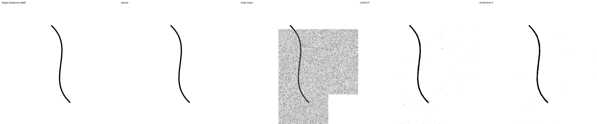
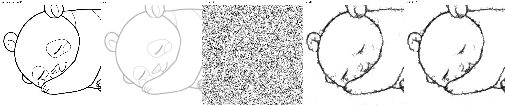
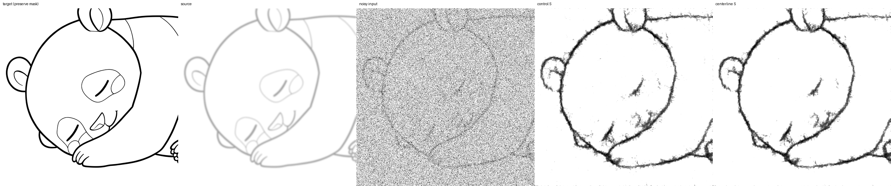
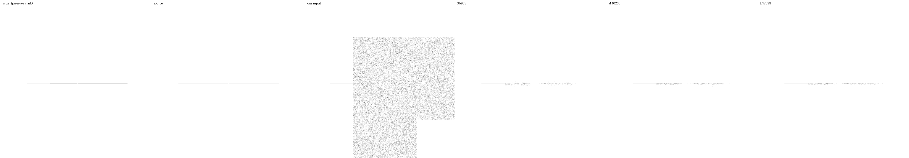

# 灰色線画の中心線loss比較（L2）

**2026-09-16完了。今回の中心線lossは採用を見送る。** 背景残留は減ったが、強い重ね描きの
細線消失が全サイズで増え、EMA S/Mでは切断も増えた。2条件10,000更新と42,174出力の評価、
保存・ONNX・既存API互換性の検証を完了した。

2026-09-15開始。接続性を促す補助lossを単独で比較する。
[距離場lossの半係数比較](boundary-half-experiment-20260915.md)では線幅と切断の両立が未解決だった。
今回は距離場lossを併用せず、同じ初期重みから `control` と `centerline` を新たに学習する。
L2は実験IDであり、二乗誤差のL2 normを意味しない。

## 学習前に固定した設計

共通初期値は `runs/geometry-data-20260914/snapshots/step-10000/geometry20/raw`。
optimizerをリセットし、EMAも同じraw重みから始める。両条件10,000更新、通算50,000更新相当。

- nested S/M/L: 5,933 / 10,206 / 17,893 parameters、チャンネル[4,6,8] / [6,8,12] / [8,12,16]。
  内部3段、各block2畳み込み、fused実行、residual出力。
- crop512、FP32、micro batch4×蓄積4=実効16。LR1e-4×sqrt(16)=4e-4、warmup500、
  schedule終点100,000。空間再帰1〜6、段間loss係数0を維持する。
  直接lossは最高解像度にかかり、下位段にも再帰を通じて勾配が流れる。
- 生成線画20%（その5%は白背景）、strokes拡張50%、opacity .25〜1、blur sigma0〜2、
  dilation最大2px、displacement最大2px。各段で縮小してから独立Gaussianを加える。
- split42、train891 / dev64 / final64。データ・ノイズseed46、final64は使用しない。
- 両条件のcrop・生成例・下描き拡張・mask・Gaussian・再帰段数は同じ。
  以前のcontrolを主比較に再利用せず、新しい対を学習する。

## 原論文から変更した点

[soft-clDice原論文](https://arxiv.org/html/2003.07311v7)のsoft skeletonと、
予測・教師の中心線の被覆を測る考え方を使う。
原論文のsoft-clDiceを灰色の教師へそのまま適用すると、積によるintersectionは完全一致でも
被覆率1にならない。今回はminimum intersectionに変更し、ReLUによる不足量として計算する。
**原論文のsoft-clDiceそのものの再現ではなく、灰色線画向けの実験的な変更である。**

正規化画像のink量を `a=clip((1-image)/2,0,1)` とする。
十字3×3のerosionと正方形3×3のdilationでsoft openingを作り、
`relu(a-opening(a))`を初期中心線にする。erosionと残差のsoft unionをさらに16回繰り返す。
paddingはpoolの対象外とし、丸め誤差による超過だけを `min(skeleton,a)` で抑える。
この有限回数で十分に侵食できない太い領域では、中心線を取り切れない可能性がある。

教師inkをY、予測inkをP、中心線をSy/Sp、編集可能画素をAとすると、画像ごとに

```
precision = 1 - sum(A * relu(Sp-Y)) / (sum(A*Sp) + 1)
recall    = 1 - sum(A * relu(Sy-P)) / (sum(A*Sy) + 1)
loss      = 1 - 2*precision*recall / max(precision+recall, 1e-6)
```

を計算しbatch平均する。平滑化定数は1画素相当。
両画像が二値なら、平滑化付きclDiceの積による比率と一致する。
灰色画像ではminimum intersectionを使うため異なる目的関数になる。
ReLUの不足量として書くことで、灰色の教師と一致したときlossだけでなく勾配も0になる。

形態学的処理の前に保護領域の予測を教師値へ置き換え、集計は編集領域だけで行う。
maskの端を人工的な線の端として作らず、保護領域の予測には勾配を流さない。
有効な教師中心線がない画像（空白、全面黒、全画素保護など）は補助loss0とし、既存lossに任せる。
画素・contrast lossは残す。foregroundだけを扱う有限反復・灰色・部分maskの変更であり、
原論文の二値条件での位相に関する理論保証はこの実験には適用しない。
実装は `src/lineartgen/training/cldice.py`。

## 係数校正と事前検証

学習前にtraining splitのみ、別seed1046の12バッチ（192枠）で勾配を測る。
再帰1〜6に2バッチずつ割り当て、重みは一度も更新しない。
校正ではdataset scaleと再帰深度を独立に割り当て、全深度を確実に含める。
係数1での補助勾配norm / 既存勾配normをrとし、
`λ=min(.10/median(r), .50/max(r))` を有効数字6桁で固定する。

測定結果は **λ=0.0526158**、重み付き勾配比の中央値 .09437、最大 .50000。
今回は最大値の制限が係数を決めた。学習全体で常にこの比率になる保証ではない。
`runs/cldice-loss-20260915/calibration.json` に各バッチのnorm・cosine・生成keyを保存した。
既存の境界lossの係数とは、目的関数の尺度が異なるため大小を直接比較しない。

全146テストが成功（CPU204.52秒）。独立した二値形態学実装との一致、灰色完全一致時の
loss/勾配0、保護領域勾配0、切断・薄い線・ずれ・欠落・誤接続への反応を確認した。
異なるlossでの更新差、モデル・optimizer・EMAを含む中断再開の一致も検証した。
補助loss無効時のloss/勾配は旧commit607726aと3設定で完全一致した。

## 評価と継続条件

固定1,562ケース（manifest込み1,563ファイル）をD1からコピーしてhashを確認する。
これは繰り返し使用しているdevelopment suiteであり、未見testではない。
既存clean線画からの合成下描きと、独立した幾何形状からの合成下描きを分けて集計する。

初期raw、2,000/10,000更新のraw/EMAを全S/M/Lで評価する。
主比較は512px時のruntime再帰3段・NumPy noise・denoise1回。
合計42,174出力。2,000更新時に全出力有限・保護画素誤差0・raw clean F1が
`min(.30, initialの半分)`以上なら設定を変えず10,000更新へ継続する。
この基準は崩壊検知であり、品質の採用基準ではない。

主な確認対象は強い下描きの切断率と細線消失率。誤接続、線幅MAE、背景残留、clean保持、
blur入力、部分編集のmask境界を併記する。線を太らせることで切断だけを改善する変更を
成功と扱わず、raw/EMA・S/M/Lを分けて代償を確認する。
対応付きbootstrapは元画像・幾何形状variant単位。学習seedは1個なので、区間は
その学習済みモデルに条件付けたものでありseed間の不確実性を表さない。

例示画像は学習前にcase256（clean曲線）、479/480（実画像由来のblur）、
1376（薄い隙間付き線、部分編集）を指定する。
過去の実験でも観察したケースなので、新規test例とは扱わない。
checkpoint・S/M/L抽出・S ONNX・既存runtime3段・BGRA APIの検証を行う。
Krita・配布モデルは更新せず、合成下描きだけで進める。

## 再現

設定は `configs/cldice-loss.toml`、実行rootは `runs/cldice-loss-20260915`。
学習前にsource archive・commit・設定・source hash・共通初期値hashを保存する。

```bash
JAX_PLATFORMS=rocm,cpu XLA_PYTHON_CLIENT_PREALLOCATE=false OPENBLAS_NUM_THREADS=1 \
.venv/bin/python scripts/run_geometry_data.py --study cldice_loss \
  --root runs/cldice-loss-20260915 --reference-root runs/geometry-data-20260914
```

稼働中のcontrollerを重複起動しない。停止はrootの`stop`ファイルで更新・保存後に行う。
同じstudyを指定して `summarize_geometry_data.py` / `audit_geometry_data.py` で集計・監査する。

GPU事前検証も完了した。両条件×全6再帰段、実効batch16の12更新でloss・勾配が有限、
更新に成功し、maskと保護領域の教師値が一致した。結果は `preflight.json` に保存した。

## 2,000更新の中間結果

2026-09-16 01:24 UTC、両条件が崩壊検知を通過し、設定を変えず10,000更新へ継続した。
初期4,686出力はD1 geometry20 rawの指標と完全一致。
2,000更新の18,744出力（2条件×3サイズ×raw/EMA×1,562）は全て有限、保護画素誤差0。
両条件の生成例は6,421枚（32,000枠、白背景319枚）で、slot/keyが全て一致した。

Sの強い重ね描き・幾何形状の結果:

| 重み | 指標 | control | centerline |
|---|---|---:|---:|
| raw | F1 | .510974 | .505508 |
| raw | 線幅MAE px | 2.954997 | 2.935707 |
| raw | 消失率 | .079720 | .107693 |
| raw | 切断率 | .364583 | .363021 |
| raw | 誤接続率 | .645833 | .666667 |
| raw | 背景MAE | .013355 | .012097 |
| EMA | F1 | .511571 | .508660 |
| EMA | 線幅MAE px | 2.759652 | 2.724065 |
| EMA | 消失率 | .094434 | .111773 |
| EMA | 切断率 | .370312 | .381771 |
| EMA | 誤接続率 | .625000 | .625000 |
| EMA | 背景MAE | .012087 | .011308 |

rawの消失率差は +.02797、対応付き95%区間 [.01222,.04766]。
EMAでも +.01734 [.00739,.02941]。背景の改善に対して、線を残す目的では悪化が見られる。
rawの切断率差 −.00156 [−.02083,.01667] は明確な改善とは言えない。
EMAの切断率差は +.01146 [約0,.02708]、F1差は −.00291 [−.00542,−.00072]。

clean実画像/幾何形状のF1はraw .91848/.80396→.91959/.80598、
EMA .92345/.82287→.92386/.82344と小幅改善する。
強いblur・実画像由来のF1はraw .77017→.76918、EMA .76856→.76633で、
両者の差の区間は0を跨ぐ。中間段階では接続性改善を確認できず、採用は判断しない。
事前の継続基準は品質向上ではなく崩壊検知なので、10,000更新まで同じ設定で観察する。

記録された学習時間は5,899秒（約1.64時間）。定常更新平均はcontrol1.124秒、
centerline1.575秒で、補助loss側は約40%増。独立した速度benchmarkではない。
中間集計は `benchmarks/cldice-loss-20260915-pilot.json`。

## 10,000更新の最終結果

**今回の灰色中心線lossは採用を見送る。** 背景残留は減るが、強い重ね描きで細線の消失が
raw/EMA・全S/M/Lで増えた。EMA S/Mでは切断も増える。接続性改善という目的は達成できなかった。
これは今回の定義・係数・単一seedでの結果であり、原論文のsoft-clDice全般に対する結論ではない。

Sの編集領域F1（高いほど良い）:

| 重み | 集合 | control | centerline |
|---|---|---:|---:|
| raw | clean実画像 | .917669 | .915845 |
| raw | clean幾何形状 | .812964 | .807488 |
| raw | 強いblur・実画像由来 | .779711 | .780917 |
| raw | 強い重ね描き・実画像由来 | .775739 | .774740 |
| raw | 強い重ね描き・幾何形状 | .520568 | .518451 |
| EMA | clean実画像 | .923243 | .923438 |
| EMA | clean幾何形状 | .826384 | .826553 |
| EMA | 強いblur・実画像由来 | .777484 | .775982 |
| EMA | 強い重ね描き・実画像由来 | .779960 | .780346 |
| EMA | 強い重ね描き・幾何形状 | .517613 | .516114 |

raw clean実画像のF1差は −.001824、対応付き95%区間 [−.003499,−.000307]、
clean幾何形状は −.005476 [−.006505,−.004461]。
EMA cleanの小さな差はいずれも区間が0を跨ぐ。
強い重ね描き幾何形状のF1差はraw −.002117 [−.004004,−.000527]、
EMA −.001499 [−.003997,.000726]。強いblurの差はraw/EMAとも区間が0を跨ぐ。

### 背景・線幅と、消失・切断の代償

Sの強い重ね描き・幾何形状（低いほど良い）:

| 重み | 指標 | control | centerline | 差の95%区間 |
|---|---|---:|---:|---|
| raw | 線幅MAE px | 2.887975 | 2.862988 | [−.05465,.00414] |
| raw | 消失率 | .076931 | .089247 | [.00456,.02188] |
| raw | 切断率 | .334896 | .346354 | [−.00208,.02812] |
| raw | 誤接続率 | .666667 | .666667 | [0,0] |
| raw | 背景MAE | .013387 | .012354 | [−.001154,−.000909] |
| EMA | 線幅MAE px | 2.824338 | 2.731392 | [−.13167,−.05485] |
| EMA | 消失率 | .082259 | .104470 | [.00976,.03710] |
| EMA | 切断率 | .335938 | .360938 | [.00521,.04688] |
| EMA | 誤接続率 | .666667 | .666667 | [0,0] |
| EMA | 背景MAE | .012617 | .011400 | [−.001335,−.001103] |

EMA Sの切断は **+2.50 percentage points**、消失は **+2.22 points**。
線幅MAEは約.093px減るが、線を残すという目的の改善とは言えない。
rawも消失率が+1.23 points増え、線幅差の区間は0を跨ぐ。
誤接続の[0,0]は今回の対応する有効queryが同じ結果だったためであり、一般的な安全性の保証ではない。

線幅は法線profile上のインク量を積分した値で、幅・濃さ・近傍の残留が混ざる。
消失率はprofileのインク量が `max(.1px,正解の25%)` 未満の割合。
接続の判定は3閾値による有限個のqueryで、位相全体の評価ではない。
この集合のF1は128ケース、幅・消失・切断probeは全面編集の64ケース、誤接続は有効な16ケース。
指標ごとの対象の違いを保ったまま比較している。

clean幾何形状でもrawの線幅MAEは1.10624→1.13060pxと悪化、EMAは1.02256→.98657pxと改善する。
背景の平均誤差は全体的に小さくなるが、それだけで線の再現性の改善とは扱わない。
部分編集のmask境界MAEはSの強い重ね描き幾何形状でraw −.000254 [−.000373,−.000151]、
EMA −.000332 [−.000433,−.000245]と減る。保護画素自体は両条件とも完全保持している。

### サイズ・強度の内訳

強い重ね描き・幾何形状のEMA:

| サイズ | loss | F1 | 線幅MAE px | 消失率 | 切断率 | 誤接続率 |
|---|---|---:|---:|---:|---:|---:|
| S 5,933 | control | .517613 | 2.824338 | .082259 | .335938 | .666667 |
| S 5,933 | centerline | .516114 | 2.731392 | .104470 | .360938 | .666667 |
| M 10,206 | control | .541022 | 2.570407 | .078592 | .291667 | .729167 |
| M 10,206 | centerline | .539827 | 2.486146 | .094857 | .319271 | .708333 |
| L 17,893 | control | .553161 | 2.437611 | .073438 | .296875 | .708333 |
| L 17,893 | centerline | .550354 | 2.361900 | .091732 | .313021 | .687500 |

Mの切断率差は +.02760 [.00938,.05000]、Lは +.01615 [0,.03542]。
消失率はM +.01627 [.00636,.02875]、L +.01829 [.00709,.03229]。
raw M/Lの切断は点推定で少し下がるが、差の区間は0を含む。
raw M/Lの消失率はそれぞれ +.00770 [.00257,.01421]、+.00900 [.00225,.01726]で増える。
この副作用はSだけの容量不足では説明できない。F1の改善は全サイズで確認できなかった。

Sの強い重ね描き幾何形状では、raw F1はノイズ.1/.5×全面/部分の4区分で全て少し下がる。
EMAのノイズ.1・部分編集は.568534→.568973と微増するが、ノイズ.5・全面編集は
.464196→.459518となる。特定の区分だけを切り出して成功とは判断しない。
これらの内訳は探索的な診断で、seed間の安定性や未見testの性能はまだ測っていない。

### 比較画像

学習前に指定したケースをそのまま示す。画像はtarget、source、noisy input、control S、centerline Sの順。





case256では背景の細かい残留が減るが、線自体の見た目の差は小さい。
case480では両条件とも内側の細線消失と輪郭の荒さが残る。
この例のS F1はraw .67929→.68015、EMA .67998→.67792で、小さい差にとどまる。




case1376は薄い隙間付き線・ノイズ.1・部分編集。
centerline rawのS/M/L F1は.08856/.19512/.26174、EMAは.04528/.18246/.30164。
rawではこの例だけならcontrolの.05993/.15000/.22603より高いが、全体の消失率は増えている。
改善例・悪化例と集計を区別する。Lでも十分な復元とは言えず、最小十分サイズは未確定。
case479も含め、2条件×raw/EMA×4例のS/M/L比較画像は主評価との数値一致を確認した。

## 成果物と最終検証

2026-09-16 08:17 UTC、学習・評価・保存・互換性検証を完了した。

- 両条件10,000更新。初期4,686＋中間/最終37,488＝**42,174出力**が全て有限、保護画素最大誤差0。
  固定1,563ファイルのhashはD1から不変。
- 両モデルのoptimizer counterは10000。4モデル（2条件×raw/EMA）×再帰1/6×3サイズ、
  計24比較で全体と抽出モデルの出力差0。L専用変更時も全段S/Mは不変。
- 評価snapshot8個、抽出S/M/L archive12個、S ONNX4個、再開可能な最終checkpoint2個を保存。
- S ONNXの動的形状と512pxの一致を検証。512px最大差3.7551e-6。
  実runtime3段の16比較の最大差3.8743e-6、保護画素完全一致。
- BGRA APIの16条件（4モデル×2サイズ×denoise1/5回）で決定性・強度0・保護画素が一致。
  既存の前後処理込みのAPI検証であり、Krita画面やDirectMLでの動作確認ではない。
- 各条件160,000枠のうち生成31,966枚、白背景1,571枚、既存画像128,034枚。
  全10,000更新の生成選択乱数とkeyを再計算し、両条件の一致を確認した。
- 再帰1〜6の出現数は1,700 / 1,661 / 1,624 / 1,612 / 1,712 / 1,691。
  記録された学習時間は29,781秒（約8.27時間）、定常更新平均はcontrol1.130秒、centerline1.580秒。
  更新時間増加は約39.9%。この補助lossは学習時だけで、推論構造・パラメータ数は増えない。
- 全146テストとRuff検査を通過。開始時に固定した61ファイルのhashは不変。
  150個の成果物hashと、報告書へコピーした5画像のhashを確認した。

実装commitは `3f9f98e410c66fd09fb1223de44e9f3cb5729e64`、archiveは
`runs/cldice-loss-20260915/implementation-source.tar.gz`（SHA256
`86e5d20d422e69a0562bc9a76446c7e323f96ba444304304f34d139913782bf8`）。
主集計は `benchmarks/cldice-loss-20260915.json`。
同prefixの `-runtime.json` / `-bgra.json` / `-illustrations.json` / `-diagnostics.json` に追加検証、
`-artifacts.json` / `-report-images.json` にhashを保存した。
設定・checkpoint・ONNX・評価画像は同名run root以下に保持する。

## 次の方針

今回の中心線lossを標準設定へ加えず、L1との併用も進めない。
背景を抑える効果はあるが、細線を残す効果が不足しており、学習費用も増えるためである。
この結果だけではprecision/recallの寄与や有限反復の影響を分離できず、原因を断定しない。
別係数・原論文の二値教師版・中心線成分を分けた比較は今回未実施である。

次は計画N1の**利用域に合わせたノイズ強度sampling**を独立に比較する。
生成20%・strokes50%・補助lossなしを共通の対照にし、低〜中強度の学習頻度だけを変える。
入力の線画情報を使うという利用形式に沿い、.1/.5、全面/部分編集、clean保持を同時に確認する。
現在の対照と新しい条件を同じ初期値・データ列で比較し、高強度への影響も別に測る。
低強度でも薄い線の復元は不十分なので、強度samplingだけで解決するとは仮定しない。

N1/N2、複数seed、独立Sの長期比較、長期収束、final test、実下描き評価は未実施。
今回も合成下描きのみであり、Krita・配布モデルは変更していない。
