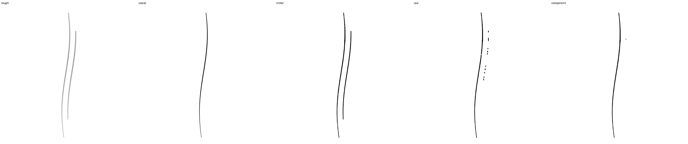
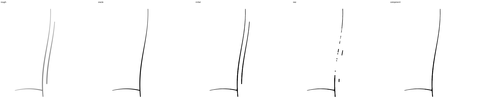
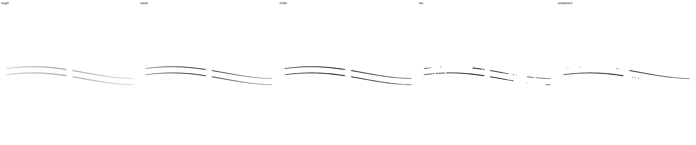

# 広域の経路選択を試すKrita候補

大目標は、手描きラフの重ね書き・迷い線から意図した経路を選び、必要線を保つこと。
画素誤差の低下ではなく、不要線の除去と主線の連続保持を評価した。

Attentionは使わない。配布48kのCNN（12/24/32/48ch、116,045パラメータ）を固定し、
16ch再帰状態とdilation 2/4/8/16/32/64の選択部を加えた。合計139,186パラメータ。
選択部の既存層は累計7,200更新、追加広域層は4,200更新、経路一貫性lossは最後1,200更新。
合成データのみ、再帰1〜6段・各段loss・sqrt(batch) LRを維持した。

最終段で、base線グラフの連結成分内のCNN採否logitを平均し、平均0以上の線を丸ごと残す。
位置・幅・接続を保ち、tile境界を越えて集約する。これは**CNN＋幾何的集約**であり、
CNN単体で画面の構造理解が解決したという主張ではない。

| 固定候補の評価 | 従来48k | 今回 |
|---|---:|---:|
| 開発形状で除去＋主線保持 | 0/144 | 98/144 |
| 未使用確認形状で除去＋主線保持 | 0/144 | 92/144 |
| 未使用確認形状で必要二本線の保持 | 66/72 | 40/72 |
| 従来ラフ評価の除去＋保持 | 52/96 | 52/96 |

確認形状は候補・しきい値固定後に初めて開いた。8形状の倍率3種・濃淡3種を含む条件数であり、
144枚の独立した絵ではない。保持90%以上・不要線残存20%以下を同時達成とする。
太さ・倍率の従来評価はほぼ同等。実手描きや意味的な画面全体の自然さは未検証。

## 目視比較

左から入力、教師、従来48k、選択CNNの直接出力、今回の成分集約。

周辺の継続を手掛かりに不要な平行線を消し、主線を残す例：

直接CNNで途切れる主線を成分全体で残す例：

**失敗例：必要な二本線と意図的な切れ目の多くを消してしまう。**

小さい点状残渣、必要線を丸ごと消す失敗は残る。正しい線と不要枝が同じ成分なら分離できず、
baseが既に切断した線を新たにつなぐこともできない。このため既存版の置換には未採用。

## Kritaで試す

plugin側の `rewrite/context-components-preview-20261108` ブランチの
[成功したActions](https://github.com/White-Green/diffusion_drawing/actions?query=branch%3Arewrite%2Fcontext-components-preview-20261108)
から `diffusion_drawing-context-components-windows-x64-py3.13.zip` を取得する。
Windows x64・内蔵Python 3.13用。KritaのPythonプラグインインポーターで読み込み、再起動する。
プラグイン名は同じなので、インストール先では以前の版を置き換える。従来ZIPを残せば戻せる。
mainと既存releaseは変更しない。

Strength 0.5・Lineart passes 6・Seed 0を出発点とし、同じラフと設定で従来版と比較する。
長い輪郭・迷い線だけでなく、必要な二本線・隙間・太さの強弱が消えないかを見る。
強度や再帰数を変えた品質を、この6段・0.5の評価数値から保証しない。

CIは全段のCNN出力をCPU JAX参照と照合し、成分集約後は評価と同じCPU ONNX参照と照合する。
硬い成分判定は浮動小数点差で1頂点異なることがあったが、保存fixtureの最終画像は一致した。
WindowsでDirectML wheelの同梱を必須とするが、GPUのないCIではCPU fallbackを検証する。
実機DirectMLと実際の描画体験は手動確認の対象。

研究記録は `experiment/cnn-context-20261107` の `docs/cnn-component-results-20261108.md`。
学習重みhashは `9c9f2dda03b133ab01610b636270b4aee5aef30005a43828c4e8f05347d5235d`。
