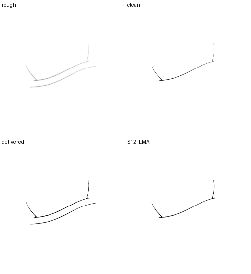
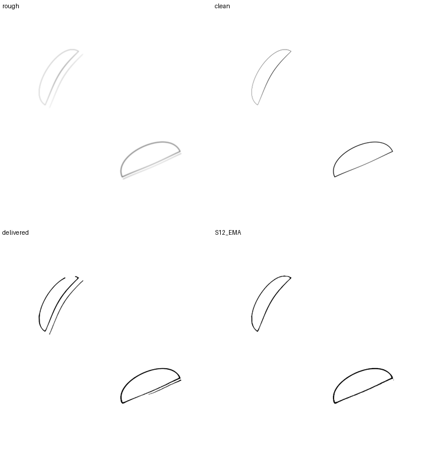
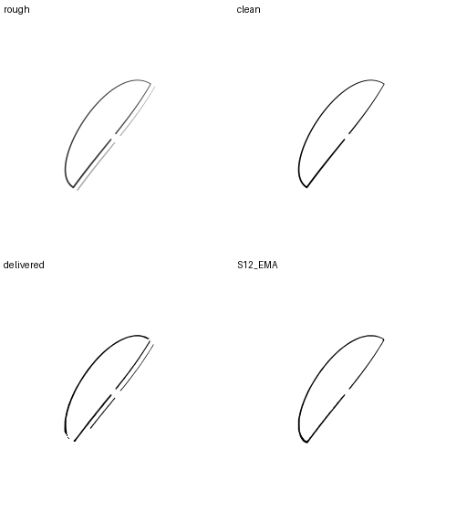
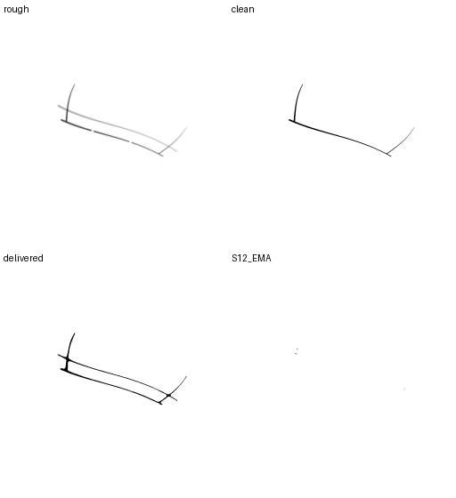
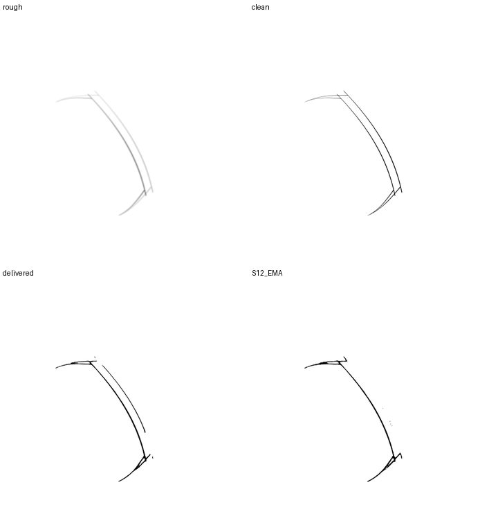
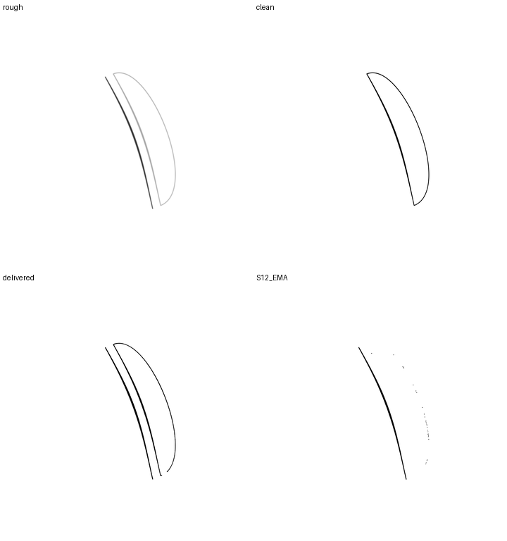
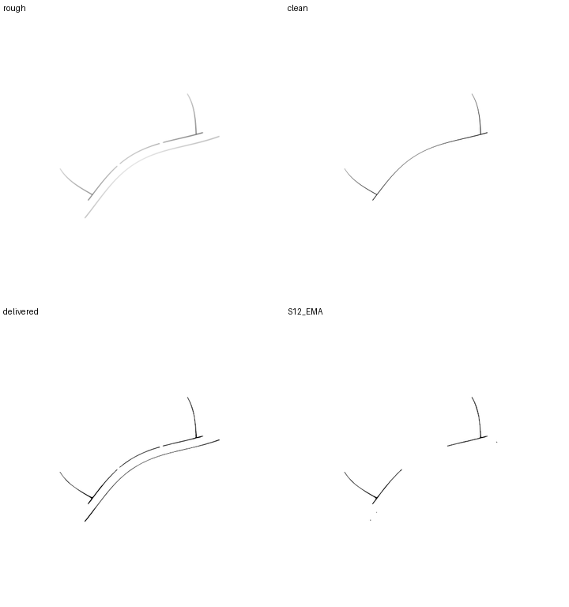
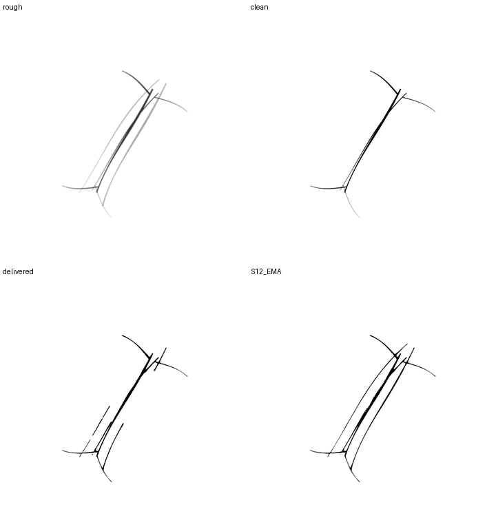
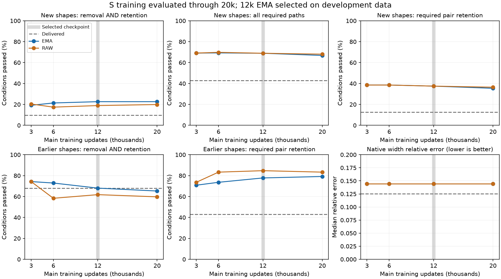

# 大目標への関係：ラフの迷い線を除き、必要な主線・枝を残す

2026-11-17の独立Krita試用版。合成の未使用配置で改善を確認したS12k EMAを使う。
必要線の全消去も残るため、完成版や既存releaseの置換ではない。実手描きへの効果は未確認。

## 入手・比較

[Diffusion DrawingのこのブランチのActions](https://github.com/White-Green/diffusion_drawing/actions?query=branch%3Arewrite%2Fcomponent-learning-preview-20261117)
で成功したWindowsビルドの`diffusion_drawing-component-learning-windows-x64-py3.13.zip`を取得する。
対象はPython 3.13内蔵のWindows x64 Krita。旧ZIPも残しておく。
Kritaを終了・再起動してZIPをインポートし、再度再起動して同梱ランタイムを読み直す。
まず同じ下描きでStrength 0.5 / Lineart passes 6 / Seed 0として従来版と比較する。
Seed 0は手動比較用の固定設定であり、合成評価の全条件に同じ0を使ったという意味ではない。
下描きはカラーラベル1、描き途中の線画は2。生成開始・推論・終了ログは継続して出る。

## 確認した改善と限界

未使用の64合成配置を、choice・倍率0.5/1/2・線画有無で各モデル1,152条件に展開した。
候補・しきい値・ノイズ・推論コードは開封前に固定し、結果を見て選び直していない。

|指標|従来の配布モデル|今回|
|---|---:|---:|
|不要線除去＋全必要経路保持 /810|8 (0.99%)|143 (17.65%)|
|全必要経路保持 /1,152|428 (37.15%)|775 (67.27%)|
|必要二本条件の保持 /384|38 (9.90%)|158 (41.15%)|
|幅相対誤差中央値|0.264489|0.241006|

同時達成は不要線20%以下かつ各必要経路90%以上であり、完全な正解画像という意味ではない。
34/64配置で同時達成条件が純増、52/64配置で必要経路条件が純増した。
保持の純減は2配置にある。個別3,600経路では90%保持へ782本改善・25本悪化。
0.5を超える保持低下は18本/14条件/7配置で、必要な主線・枝・輪郭全体を消す失敗を含む。
この抽出だけでは見落とす視覚的な欠落もあるため、全90%保持低下と被覆率低下、代表例を含む68条件を実際に確認した。

短片の補完、密集した線束、複数配置、交差での同時達成は、それぞれ8/84、3/126、4/84、0/84に留まる。
必要線の全消去、不要線の復活、短片・点の残渣、接合部の塊は残る。
2倍条件の幅誤差中央値は0.176496→0.204673へ悪化。既存native検査の幅誤差も0.125037→0.144386で、
保持平均は改善するものの幅の余裕は小さい。全倍率・太さで改善したとはしない。
実際の手描きの作者意図や、人体・物体の自然さを理解できたという結果ではない。

## 出力例

各図は左上が下描き、右上が正解、左下が従来配布、右下が今回。表示用に縮小しており、画素幅の測定図ではない。
条件別の改善・失敗を示す例であり、全体の成功率は上の表で判断する。

枝を保って長い不要線を消した例（group2）。

離れた二輪郭を残し、それぞれの迷い線を除去した例（group52）。

意図的な隙間を残して迷い線を消した例（group3）。

必要な主線と枝をほぼ全消去した失敗（group14/choice1）。同じgroupのchoice0では成功し、選択は不安定。

必要な二本のうち一本を大部分失った失敗（group20/choice2）。

必要な閉輪郭を消し、不要な線を残した失敗（group28）。

不要線とともに必要主線の中央まで削除した失敗（group23）。

不要線を含めて連続化し、意図した経路だけを選べない例（group26）。

## モデルと学習量

CNN 139,186＋成分readout 1,089＝140,275パラメータ。Attentionは使わない。
CNNの粗い段から16ch状態を引き継ぎ、予測した線グラフの連結成分についてmean/max特徴を集約する。
学習済み小型MLPで成分全体の採否を補正し、しきい値0で線を残す・消す。
線の位置・幅・接続を出力する生成部も親実験で調整した。純粋なCNN出力だけの方式ではなく、グラフ成分集約を含む。
再帰1〜6段、各段loss、sqrt(batch)による学習率、各解像度への縮小後のノイズを維持する。
KritaのBGRA入力形式と、描き途中線画の不透明黒/白の保護を維持する。KritaにJAXは同梱しない。

本学習Sは20,000更新まで学習・評価し、12,000更新のEMAを選んだ。12k→20kでは同時達成が頭打ちとなり、
必要線削除が増えたため早期停止を採用した。当初の30k目安を達成したという報告ではない。
同じ12kから勾配の競合処理を変えて8k継続する比較も改善せず、確認前に同じ12k EMAを固定した。

|パラメータ群|選択した重みの更新履歴|
|---|---|
|encoder 61,072|既存48,000更新|
|decoder/head 54,973|既存48,000＋生成部調整6,000＝54,000|
|選択CNN 23,141|既存層31,200、広域追加層28,200|
|成分readout 1,089|今回12,000|

親runのC/F/S開始時にoptimizerをリセットしており、上表は同じloss・optimizerによる単一連続学習ではない。
独立データ/ノイズ系列は6kまで確認した。独立初期化・独立12kの再現確認ではない。
改善全体をbatch構成やreadoutだけに帰属させず、親runを含む変更群として扱う。

重み・ONNX・readoutと学習履歴のhashはruntime assetsの`spatial-stage-model.json`、
`spatial-stage-source.json`、`component-learning-history.json`に保存している。
各指標・退行経路・画像観察の記録は[評価記録](component-learning-evaluation-20261117.json)を参照。

## 検証範囲

全段CPU JAX/ONNXの神経出力、成分採否、描画BGRAと512px評価sceneを照合した。
prepared runtimeの9条件・公開API、固定seed、blank、黒/白保護、壊れたassetの拒否も確認した。
最終bundleでPython3.12の全314テスト、Python3.13のruntime66テストを通過。
pluginのPython3.13統合テスト30件も通過した。
Windows CIでは同梱依存のみの推論、全段参照、DirectML版同梱、artifact再取得、公式Kritaインポーターを検査する。
CIはGPUを利用できなければCPU fallbackで検証する。実Krita GUIと実Windows GPUでの試用は未確認。
