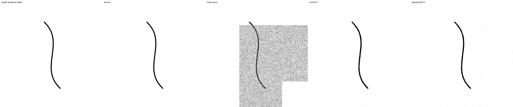
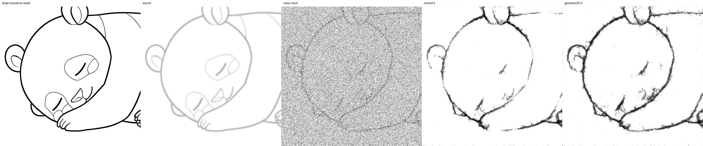
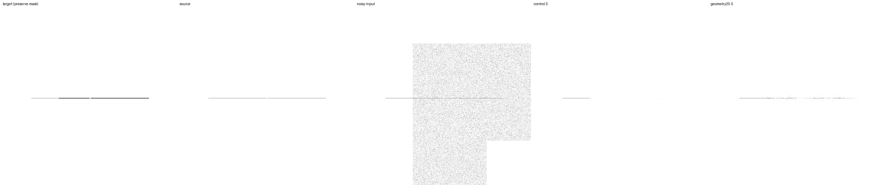
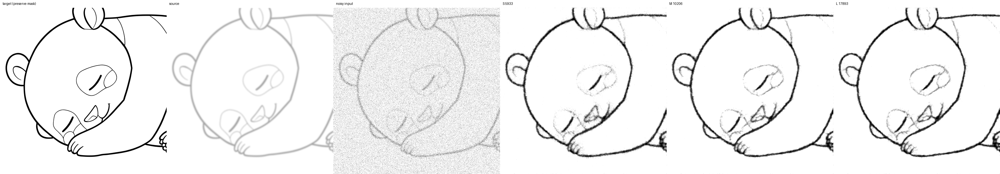
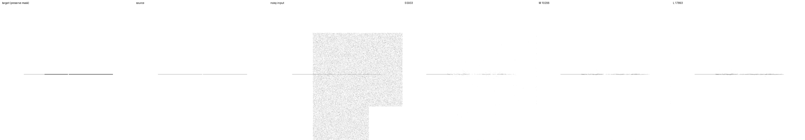

# 幾何形状を教師に加える比較（D1）

2026-09-14完了。**生成線画20%の追加で切断・細線の消失は減ったが、強い下描きの線幅誤差と背景残留が増えた。**
2条件×追加10,000更新、42,174出力の評価とS ONNXの検証まで完了した。
次はL1（境界・距離に基づく補助loss）を優先する。全条件への採用や最小モデルの確定は保留する。

前回の [下描き拡張率比較](sketch-rates-experiment-20260912.md) から、
`p50/raw` の 10,000 更新モデルを共通初期値として使用する。
今回の比較は **既存 clean 線画 100% と、各画像を確率 20% で生成 clean 線画へ置換**。
下描きは既存の合成拡張のみ。実際の下描き収集・Krita への反映は行わない。

## 実行前に固定した条件

- `control` と `geometry20` の2条件。モデル・loss・optimizer・拡張の強さは同一。
- S/M/L は 5,933 / 10,206 / 17,893 parameters。内部3段、各block2畳み込み。
  channels は `[4,6,8]` / `[6,8,12]` / `[8,12,16]`、一方向の依存関係を維持する。
- crop 512、FP32、microbatch4 × 蓄積4。学習率は 1e-4 × sqrt(16) = 4e-4、
  warmup500、schedule終点100,000更新。再帰1〜6段、各段lossの係数0を維持。
- strokes拡張の適用率50%、opacity .25〜1、blur sigma0〜2、dilation最大2px、
  displacement最大2px。縮小後に各段で独立Gaussianを付加。強度0の画素は入力を保持。
- source split42、初期model seed42、今回のcrop/noise seed45。
  train891 / dev64 / final64。final testには触れない。
- p50 raw重みからoptimizerをリセットし、EMAも同じraw重みから開始。
  今回の10,000更新後は、それまでの学習履歴を含め通算40,000更新相当。
- 元画像のcrop列を両条件とも同じように読み込んでから置換する。
  幾何形状用のNumPy乱数はoptimizer step / itemを含む独立namespaceに分離。
  非置換slotの入力、下描き拡張の乱数、mask、Gaussian、再帰段数は揃う。
  置換slotは画像内容が異なるので、同じ乱数でも入力・教師は異なる。

## 学習用の生成器

`src/lineartgen/data/geometry.py` に専用の生成器を実装する。
評価用の `evaluation.line_case`、画像、probe、seedは学習には使わない。
直線・細線・Bezier曲線・角・分岐・交差・近接曲線・意図した隙間・入り抜きの9種。
1画像に1〜4群、長さ・角度・制御点・位置は連続乱数で変える。
線幅は .6〜12px の対数一様（細線は最大1.8px）。4倍で描画して縮小しサブピクセルを表す。
近接曲線は法線方向にずらす。群同士は重なり得る。

生成枠の5%は白背景、全体では約1%になる。
線幅はdataset scaleに応じて変えず、512px出力上の幅を全再帰深度で経験させる。
選ばれたslot、再生成key、線種、path数を各更新のtimingsに保存する。
同じ更新数で比較するが、geometry20が見る既存元画像の累積枚数は少なくなるため併記する。
生成器プレビューは `runs/geometry-data-20260914/generator-preview/`。

## 評価と継続条件

- 同じ固定1,562ケースを前回からbyte単位でコピー。既存元画像由来のclean/合成下描きと、
  学習用とは別実装の固定幾何形状/合成下描きを含む。
  繰り返し利用するdevelopment suiteであり、新規の未見testとは呼ばない。
- 推論は実際の512px時と同じ再帰3段、NumPy noise、denoise1回を主比較とする。
  initial raw、追加2,000/10,000更新のraw/EMAを全S/M/Lで評価。
- 2,000でfinite、保護画素誤差0、clean F1が `min(.30, initialの半分)` 以上なら
  両条件を10,000へ継続する。これは崩壊検知であり品質合格基準ではない。
- clean、強いblur、重ね描き、幾何形状を分け、active ink F1・背景・線幅・細線の消失・
  切断・誤接続・mask境界を比較する。元画像/生成形状variant単位の対応付きbootstrapを使う。
  区間はこの学習済みモデルに条件付けたもので、学習seed間の分散を表さない。
- 最終checkpointのoptimizer step、全サイズ同時計算と切り出しの一致、L専用変更時の
  S/M不変性を監査する。SのONNXをexportし、実際の再帰推論とBGRA入力も確認する。
- 次のloss比較は結果から選ぶ。線幅・位置・細線ならL1境界/距離、切断が支配的ならL2
  soft-clDiceを優先する。誤接続を増やす変更は一律採用しない。

## 再現

設定は `configs/geometry-data.toml`。実行rootは `runs/geometry-data-20260914`。
`training-source.json` に実行前のcommit・source archive・各fileのSHA-256を保存する。
controllerは `scripts/run_geometry_data.py --root runs/geometry-data-20260914`。
同時に別のcontrollerを立ち上げず、中断時は既存processの終了を確認して同じcommandで再開する。
停止要求はrootの `stop` fileで受け付け、全モデルの完全な更新と保存後に止まる。

集計は `scripts/summarize_geometry_data.py`。自動observerは既存controllerのPIDを監視するだけで、
学習を再起動しない。初期値・評価入力・各成果物のhashを検証して結果を保存する。

事前検証: 全129テスト成功（CPU 146.00秒）。実GPUで実効batch16、両条件×再帰1〜6段の
12更新が成功。生成例18枚を含み、勾配normは .656〜14.938、全lossが有限、共通maskと
保護領域の教師の完全一致を確認した。目視確認後の近接曲線・隙間の非接続もテストする。

## 2,000更新の中間結果

両条件で崩壊検知を通過し、設定を変えず10,000更新へ継続した。
共通初期値の再評価4,686出力は、前回p50/rawの指標と全て完全一致。
主比較の2条件×3サイズ×raw/EMA×1,562件＝18,744出力が有限、保護画素最大誤差0。
geometry20は32,000枠中6,362枚を生成教師に置換（19.88%）、うち白背景302枚。

raw Sの途中経過:

| 指標 | control | geometry20 |
|---|---:|---:|
| clean実画像 F1 | .9260 | .9182 |
| clean幾何形状 F1 | .8313 | .7966 |
| 強いblur下描き・実画像 F1 | .6859 | .7664 |
| 強い重ね描き・実画像 F1 | .7969 | .7783 |
| 強い重ね描き・幾何形状 F1 | .3974 | .5066 |
| clean幾何形状・切断率 | .1214 | .0318 |
| clean幾何形状・誤接続率 | .3556 | .4056 |
| clean幾何形状・線幅MAE(px) | .9637 | 1.2567 |

geometry20−controlのclean幾何形状F1差は −.0348、対応付き95%区間 [−.0425,−.0277]。
切断率差 −.0896 [−.1304,−.0543] と同時に線幅MAE差 +.2930 [.2087,.3847] が生じた。
強い重ね描き幾何形状ではF1 +.1093 [.0598,.1647]、切断率 −.2495 [−.3214,−.1750]、
線幅MAE +.5278 [.1276,.9358]。誤接続率の点推定も悪化するが区間は広い。
実画像の強いblur改善の区間は0を跨ぐため、この段階で一般的改善とは断定しない。
EMAでも切断減少と線幅悪化が併存した。

画像case256ではどちらも曲線を保持するが、geometry20に背景の残留が増える。
case480ではgeometry20がblurされた輪郭を残す一方、太さとノイズが増す。
データ追加による線の消失改善と、太線・背景・誤接続の代償を分けて最終結果で判断する。
中間集計は `benchmarks/geometry-data-20260914-pilot.json`。

## 10,000更新の最終結果

raw Sの編集領域F1（高いほど良い）:

| 評価集合 | control | geometry20 | geometry20−control / 95%区間 |
|---|---:|---:|---|
| clean実画像 | .9233 | .9248 | +.0014 [.0001,.0031] |
| clean幾何形状 | .8280 | .8332 | +.0052 [−.0002,.0101] |
| 強いblur下描き・実画像 | .7060 | .7752 | +.0692 [−.0156,.1574] |
| 強い重ね描き・実画像 | .7928 | .7788 | −.0140 [−.0644,.0228] |
| 強い重ね描き・幾何形状 | .4294 | .5135 | +.0841 [.0418,.1310] |

raw Sでは、2,000更新で生じたclean形状のF1低下と線幅悪化は10,000更新で回復した。
ただし強い下描きでは代償が残り、EMAも一律には改善しない。実画像由来の強いblur・
重ね描きは対応付き区間が0を跨ぎ、単一seedの結果から全般的な優劣は決められない。

raw Sの幾何診断（低いほど良い）:

| 評価集合・指標 | control | geometry20 |
|---|---:|---:|
| clean・線幅MAE px | 1.0331 | .9710 |
| clean・切断率 | .1111 | .0604 |
| clean・誤接続率 | .3667 | .3667 |
| 強い重ね描き・線幅MAE px | 2.2475 | 2.7326 |
| 強い重ね描き・線の消失率 | .2406 | .0949 |
| 強い重ね描き・切断率 | .5990 | .3766 |
| 強い重ね描き・誤接続率 | .6042 | .6458 |
| 強い重ね描き・背景MAE（正規化値） | .00739 | .01199 |

強い重ね描きの切断率差は −.2224 [−.2943,−.1521]、線幅MAE差は +.4851 [.1408,.8385]。
誤接続率差 +.0417 の区間は [−.0625,.1464] で広く、「悪化しない」とは確認できない。
線幅は法線profileのインク量から測った値で、太さ・濃さ・近傍の残留線を含む。
消失率はprofileのインク量が `max(.1px, 正解の25%)` 未満の割合。
接続率は3閾値で正解rasterの接続が有効なqueryのみを対象とする。
強い下描きの幾何probeは全面編集だけで計算し、F1と同じケース集合ではない。

線種別のraw S F1を見ると、強い重ね描きの角 .3715→.5854、直線 .1885→.3646、
細線 .2855→.3545、曲線 .5011→.5772 が改善する。一方、意図した隙間 .3667→.3583、
入り抜き .7710→.7635 は改善しない。いずれも各16ケースの探索的な内訳である。
可視profileの位置MAEは .8589→.7970pxだが、隣接profile間の位置変動は .6190→.6785px。
線の可視性が変わるため単純な滑らかさの優劣とは解釈せず、曲率の正確な評価は未実施。

### EMAとモデルサイズ

EMA Sのcontrol→geometry20:

| 評価集合 | control | geometry20 |
|---|---:|---:|
| clean実画像 F1 | .9258 | .9227 |
| clean幾何形状 F1 | .8316 | .8203 |
| 強いblur下描き・実画像 F1 | .7145 | .7775 |
| 強い重ね描き・実画像 F1 | .7984 | .7779 |
| 強い重ね描き・幾何形状 F1 | .4380 | .5125 |
| 強い重ね描き・幾何形状 線幅MAE px | 2.3192 | 2.8499 |
| 強い重ね描き・幾何形状 切断率 | .5849 | .3516 |

EMAではclean形状のF1低下・線幅悪化が残る。rawとEMAのどちらも確認する必要がある。

geometry20 rawのサイズ別:

| 指標 | S 5,933 | M 10,206 | L 17,893 |
|---|---:|---:|---:|
| clean実画像 F1 | .9248 | .9238 | .9245 |
| clean幾何形状 F1 | .8332 | .8375 | .8518 |
| 強いblur下描き・実画像 F1 | .7752 | .7935 | .8028 |
| 強い重ね描き・実画像 F1 | .7788 | .8019 | .8011 |
| 強い重ね描き・幾何形状 F1 | .5135 | .5296 | .5367 |
| 強い重ね描き・幾何形状 線幅MAE px | 2.7326 | 2.6618 | 2.6574 |
| 強い重ね描き・幾何形状 切断率 | .3766 | .3182 | .3099 |
| 強い重ね描き・幾何形状 誤接続率 | .6458 | .7083 | .7292 |

強い重ね描き幾何形状では、geometry20のSがcontrolのL（F1 .4727）を上回る。
この集合ではモデルを大きくする以外の改善余地が確認できたが、サイズ間の順位や最小十分容量を
確定する実験ではない。大きくすると切断が減っても誤接続が増える例があり、平均F1だけで選べない。

### 比較画像

case480では輪郭の残り方は改善するが、線の荒れ・背景残留・内側の細線消失が残る。
case1376（薄くした隙間付き線、ノイズ.1、部分編集）はcontrol全サイズで編集領域F1が0、
geometry20ではS .0229 / M .1300 / L .2260。改善しても復元には不十分な例である。

2条件×raw/EMA×4ケースについてS/M/L画像を生成し、主評価のF1・MAE・保護画素誤差と照合した。
画像は例示であり、画像選択によって主評価の集計対象は変えていない。

## 保存・検証結果

- 初期4,686 + 2,000/10,000更新の計37,488 = **42,174出力**。全て有限、保護画素最大誤差0。
- 2条件のoptimizer counterは共に10000。raw/EMAの4モデル、1/6再帰段×3サイズの
  24照合で入れ子全体と抽出モデルの出力差0。L専用重みを変えても全段のS/Mは不変。
- 評価snapshot8個、S/M/L抽出archive12個、S ONNX4個、再開可能な最終checkpoint2個を保存。
  M/LはJAX archiveで保持し、既存1ch insertのONNX形式への対応は今回行っていない。
- S ONNXの動的形状と512pxの照合に成功。512pxでの最大差1.9073e-6。
  実runtime3段の16照合では最大差2.0266e-6、保護画素は完全一致。
- 既存BGRA APIは4モデル×2サイズ×denoise1/5回の16条件で決定性・強度0・保護領域が一致。
  既存の正規化・量子化・alpha処理に対する確認で、Krita画面やDirectMLでの確認ではない。
- 元のcrop streamを読み込んだ160,000枠のうち、geometry20は32,115枚（20.07%）を置換。
  既存画像127,885枚、生成32,115枚（うち白背景1,515枚）。controlは既存画像160,000枚。
  全10,000更新の選択乱数を独立に再計算し、slotと再生成keyが全て一致した。
- 再帰1〜6段の出現回数は1,655 / 1,690 / 1,648 / 1,662 / 1,657 / 1,688。
  記録された学習時間は計24,922秒（6.92時間）、定常の各条件更新は平均1.135 / 1.138秒。
  これには入力・前処理を含み、評価・初期化・保存などの別区間は含まない。
- 設定・学習sourceのSHA-256は開始時から不変。固定1,563ファイル（case1,562＋manifest）も
  前回から不変。全129テスト成功、Ruff検査成功。

学習実装commitは `a082bbb3d84364e038ae23759308159d2f8af646`、
archiveは `runs/geometry-data-20260914/implementation-source.tar.gz`。
主集計は `benchmarks/geometry-data-20260914.json`。
同prefixの `-runtime.json` / `-bgra.json` / `-illustrations.json` / `-diagnostics.json` に追加照合、
`-artifacts.json` に成果物hashを保存した。追加監査は `scripts/audit_geometry_data.py` で再現できる。

## 次に行う比較

**L1（線の位置・幅を扱う境界／距離場の補助loss）をL2（soft-clDice）より先に試す。**
今回のデータ追加で切断は減ったが、太線・背景・隙間の問題が残り、接続性だけをさらに
強めることが次の最優先とはいえないためである。これは次の仮説であり、lossの効果はまだ未検証。

次の比較ではgeometry20 rawを共通初期値の候補として、同じ生成20%と下描き50%を保ち、
「現行loss」と「現行loss＋小さなL1」の2条件を比較する。係数は本学習前の少数batchで
既存lossに対する勾配の大きさを確認して固定し、再帰段の重みやsqrt(batch)LRは変えない。
保護領域を除く境界近傍の不足と過剰を扱い、単に背景を強く白くするlossにはしない。
現在のcontrolも保存し、線を消すことで背景指標だけが改善していないかを確認する。

20%追加の全面採用、S/M/Lの選定、独立Sとの長期比較、複数学習seed、長期収束、
final test、実際の下描き評価、曲率の厳密な評価は未実施。今回は合成下描きのみで、
Kritaと配布モデルには変更を反映していない。
