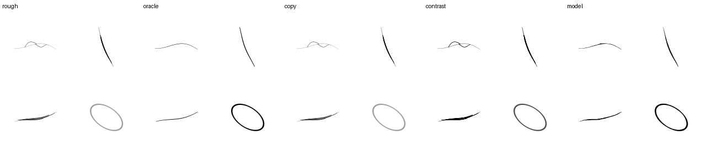
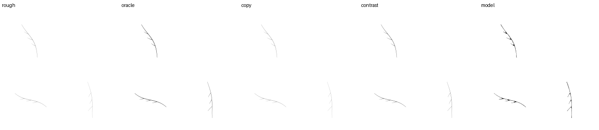
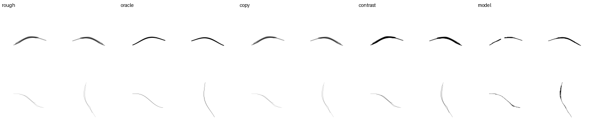
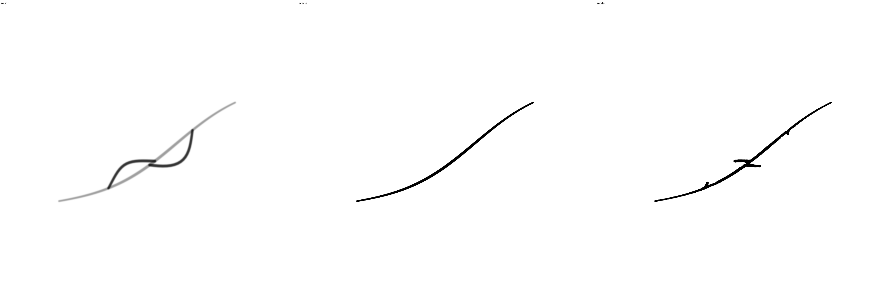
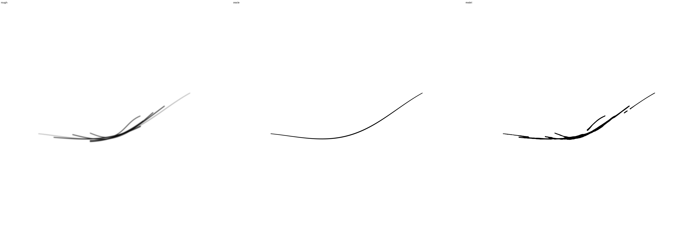
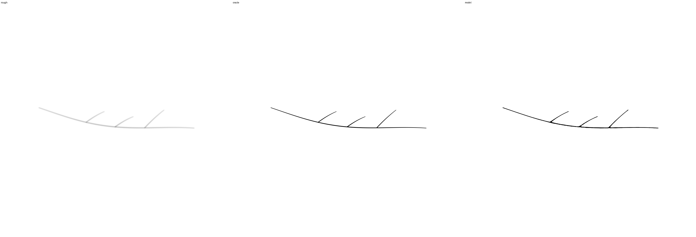
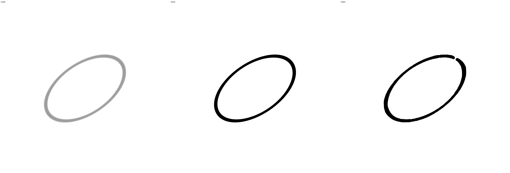

# 重ね書き・迷い線を選別するKrita試用版

目的は、下描きの透明度を写すだけでなく、不要な戻り線を除き、必要な主線や枝を残すこと。
合成例ではその方向の動作を確認できたため、この固定モデルをKritaで試す。
実手描きへの効果はまだ未確認で、完成版ではない。

モデルは116,045パラメータ、累計48,000更新の最終EMA。
学習は合成データのみ。再帰1〜6段、各段loss、sqrt(batch)の学習率を維持した。
経路ごとの不要線分類と、必要な経路の弱い点を重視するlossを使う。
幅は予測値であり、定幅化や出力画像と教師の二乗誤差を改善基準にしていない。

候補固定後に開いた別潜在形状の48配置・6濃淡で、採点可能なcleanup96条件のうち
主線保持90%以上かつ不要線残存20%以下はモデル52、入力コピー5、固定濃度補正0。
主線の単一成分保持は平均99.3%、薄い短枝は97.9%、薄い近接二線は99.5%。
空画像は空。これらは同じ合成生成規則内の確認であり、96個の独立な形状や
実手描きに対する成功率を意味しない。出力24枚を実際に目視した。

半分・等倍・2倍・4倍の144条件も実ONNXで確認し、12枚を目視した。
4倍の迂回線では主線を連続させて大きな迂回を除くが、小さなフックが残る。
密集した重ね線の例は依然弱く、不要線や幅の過剰が残り、主線を切る場合もある。
太い輪郭にも切れ目がある。近傍被覆・単一成分保持が高くても閉じた輪郭の保証にはならない。
こうした欠点を残した試作として採用し、研究の品質目標を全面達成したとは扱わない。

小さい段から全画像の占有・幅情報を渡す。CNN計算だけを512pxの領域と64pxの周辺で
分割するため、画像を小領域ごとに独立して清書する方式ではない。
入力の縮小後にノイズを加え、幅の8px上限は設けない。
KritaのBGRA入力・保護領域・出力レイヤーという利用形式を維持する。

試用はWindows x64 / Krita内蔵Python3.13用の
`diffusion_drawing-intent-cleanup-48000-windows-x64-py3.13.zip`。
プラグインの `rewrite/spatial-preview-20261030` ブランチのActions artifactから取得する。
Strength 0.5、Lineart passes 6、Seed 0が今回の確認条件。更新後はKritaを再起動する。
DirectMLを優先し、利用できない環境ではCPUを使う。CIのCPU fallback確認と
ユーザーのGPU実機動作は区別する。

固定重みのSHA256は `bc8ea33a594740eab7834b776633e9f7d8eda8270033038aa71293f03ea54ab2`。
`assets/spatial-stage-source.json` に確認結果の来歴、`spatial-stage-model.json` に
ONNXのhashを保存した。再帰1〜6の独立CPU JAX参照とLinux ONNXのBGRAは完全一致。
同じ参照を同梱し、Windows ZIPのCIでも照合する。

左から入力、教師、コピー、濃度補正、モデル。戻り線を除去した確認例：

必要な短い枝を含む例：

残る失敗例。左上の主線に切れ目ができる：

以下は4倍画像、左から入力、教師、モデル。大きな迂回は除けるがフックが残る：

密集した重ね線は十分に選別できていない：

枝付き主線は保持できる例がある：

輪郭の切れ目も残る：

ローカル配布検証ではruntime45テスト、plugin30テストを通過した。Linux CPU ZIPを
同梱依存だけで推論し、全再帰深さの独立JAX参照、固定seed、RGB非依存、保護領域、
空画像、入力検証を確認。Krita 5.2.9の固定版インポーターで1,420ファイルの一致も確認した。
Windows版はプラグインCIで同じ手順を実行する。Krita GUIの実描画テストはまだ行っていない。
