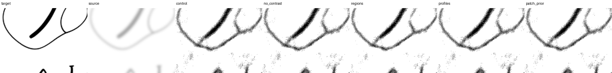
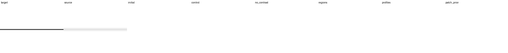
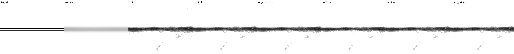

# 線画loss比較：追加10kの結果

5条件すべての追加10,000更新、2k/10k評価、反復・白紙診断、重みの照合と画像確認を完了した。
**領域別lossには灰色のにじみを減らす効果があったが、細線を弱める副作用も残った。**
線断面lossも小さめの同様の傾向、判別器は今回の設定では小さな改善に留まった。
線の消失・誤接続を含む総合的な改善を確認できた候補はなく、配布モデルの更新は見送る。

[条件と再現手順](lineart-loss-experiment-20261006.md)、
[lossの設計](lineart-loss-design-20261006.md)、[2k中間結果](lineart-loss-interim-20261006.md)。
今回の比較は、同じ100k EMAから始めた短い追加学習。ゼロから学習した結果ではない。
最大UNet（126,765 parameters）、同じ合成下描き・ノイズ・mask系列、1学習seedで比較した。
再帰段数、段間loss重み、sqrt(batch)による最大LRのスケーリング、Krita入出力は維持した。
主評価はEMA・再帰3段・denoise1回。以下の差は、特記しなければ同じ追加10k時点の比較。

## にじみと線の保持

強い重ね描き劣化（strokes/strong）の結果。haloは教師の線の外側6px以内に残る余剰不透明度で、
画像全体の灰色画素率ではない。全列とも小さいほどよい。

| 条件 | 実線画由来のhalo | 幾何線画のhalo | 幾何線画のink不足 | 幾何線画の切断率 |
| --- | ---: | ---: | ---: | ---: |
| 現行loss | .14494 | .20443 | 22.29% | 21.61% |
| contrast除去 | .14531 | .20461 | 22.31% | 21.61% |
| 領域別loss | .12077 | .16883 | 23.58% | 23.75% |
| 線断面loss | .13977 | .18587 | 23.14% | 23.18% |
| 判別器 | .14324 | .20254 | 22.30% | 21.61% |

- **領域別loss**：contrast除去に対してhaloが実線画由来で16.9%、幾何で17.5%減少。
  幾何の切断率は+2.14ポイント、ink不足は+1.28ポイント。
- **線断面loss**：haloはそれぞれ3.8%・9.2%減少。切断率は+1.56ポイント、ink不足は+.83ポイント。
- **判別器**：haloはそれぞれ1.4%・1.0%減少。上記の切断率は同じだが、後述の強いblurでは
  消失断面率が増えた。線画品質を大きく変える効果は確認できていない。
- **contrast除去だけ**では、にじみは改善しなかった。今回の症状をこの項だけの問題とは説明できない。

領域別lossはstrokes/strongのactive F1も改善した（実線画 .81798→.82497、幾何 .57238→.58871）。
したがって全ての指標が悪いわけではない。ただし、背景の整理と弱い線の保持を両立できたとはいえない。
現行lossの追加学習だけでも初期モデルからhaloは減っており、補助項の効用は同時点の対照との差で判断する。
rawにも概ね同じ傾向があり、EMAだけの現象ではなかった。

ink不足は教師のink量に対する不足で、消えた線の本数ではない。切断率は不透明度
37.5/50/62.5%の閾値で測った各ケースの平均で、薄くなって閾値を下回る影響も含む。
表示上の白い切れ目だけを数えた値ではない。active F1は編集可能な画素がないケースを除外する。

実線画由来のhaloは60条件中46条件・12元画像で定義される。幾何haloは128条件・32形状群、
切断率は全体編集64条件・32形状群。元画像/形状群単位のbootstrapで、領域別lossの
幾何halo差は−.03579（95%区間 −.03983〜−.03152）、切断率差は+2.14ポイント
（+.52〜+4.06ポイント）。線断面lossの切断率差の区間は0〜+3.65ポイント。
これらは今回の学習済み重みに条件付けた区間で、学習seedの不確実性や多重比較の補正を含まない。

## 弱い入力・部分編集・強いblur

strength .1でも、領域別lossはstrokes/strongのhaloを実線画由来で10.6%、幾何で11.0%減らす。
一方、幾何の切断率は22.08%→23.65%。低いstrengthなら副作用がなくなるわけではない。
部分編集でも同じ方向で、実線画strokes/strongのhaloは .15136→.12536、
ink不足は8.34%→8.80%。全評価の保護画素は完全一致した。

強いblurに対する幾何線画の結果では、弱い線を失う問題がより明確だった。

| 条件 | 消失断面率 | ink不足 | 切断率 |
| --- | ---: | ---: | ---: |
| contrast除去 | 26.55% | 55.68% | 62.14% |
| 領域別loss | 28.51% | 57.62% | 63.80% |
| 線断面loss | 26.83% | 56.62% | 63.28% |
| 判別器 | 27.01% | 55.76% | 62.14% |

領域別lossの消失断面率差は+1.96ポイント（cluster bootstrap 95%区間 +1.04〜+3.02）。
実線画由来の強いblurでもink不足は24.07%→25.91%、active F1は .80187→.79430。
haloの減少だけを採用基準にはできない。

## 画像で確認できたこと

10kでは通常推論の固定14ケースを目視し、うち10ケースを拡大して確認した。
さらにraw3ケース、5回推論4ケース、白紙2ケースを確認。重複を含む比較パネルは計25枚。
assistantによる確認であり、独立した画家の盲検評価やKrita GUIの操作試験ではない。
比較用に保存した55ケース全てを目視した、という意味ではない。

- cleanのcase0/4や、太い線の軽い劣化case576は、全体パネルで概ね教師に沿った復元を確認した。
- case479/480では領域別lossで余分な灰色のかけらが減るが、目の細い輪郭は灰色・ざらつき・
  位置のずれが残る。強いノイズでは輪郭の消失と誤接続が残った。
- case512の強いblur＋部分編集では、編集領域に教師にない枝分かれ状の線が全条件で残る。
- case903の細線は全条件でほぼ消える。case910/911では教師より太く灰色で、線幅が不均一。
- case1294/1295の二本線の合流、case1390/1391の意図した隙間の閉塞は、全条件で未解決。

以下は保存したKrita相当の白背景合成からの切り出し。nearestで2倍表示し、補間による平滑化は加えていない。
画像はrunディレクトリからそのままコピーした。元PNGと切り出し座標のhashはrun内に保存した。

幾何パネルのinitialは追加学習前の100kモデル。sourceの時点で二本線や隙間の情報がかなり
失われている例もあり、これら全てがlossだけで一意に復元可能だったとは主張しない。

## 反復と白紙

固定31ケースの1/2/5回診断では、反復で灰色が減っても構造が正しくなるとは限らなかった。
そのうち実線画由来12ケースでは、contrast除去の1→5回でhaloは .05307→.03377、
ink不足は11.88%→14.69%、active F1は .88550→.86797。
領域別lossでもhalo .04084→.02630に対し、ink不足12.69%→16.16%。
case479は滑らかになるが教師との形の違いが残り、case480/512では誤った線を整理・強調しても
教師の構造には戻らなかった。

一方、選択された幾何19ケースでは反復に伴うF1改善があった。実線画側と混ぜた平均だけでは判断しない。
この反復セットの幾何は部分編集に偏り、追加の全体編集24ケースは1回推論のみ。
反復の大域接続への効用を確定するには、全体編集も含む追加の診断が必要。

白紙strength .5、seed×全体/部分編集の8条件では、5回後の平均表示ink率と最大表示画素数は
現行loss .178% / 736px、領域別loss .121% / 474px、線断面loss .154% / 634px、
判別器 .157% / 654px。領域別lossでも1回の .014% / 101pxから増える。
最大値は各条件集合の最大で、必ずしも同じ画像同士ではない。strength0は全例で完全保存。
目視した固定白紙case6/7はほぼ白く見えるが、最大の異常例ではなく、数値診断を置き換えない。

## 判別器の解釈と次の比較

判別器は6,321 parametersで、更新回数10,000と有限値を確認した。
最後の1k中の保存ログ40batchではreal/fake平均sigmoidは .5327/.4662、lossは1.3057。
1k〜2kの40batchでは .5083/.5005、loss1.3673だった。識別信号は育っているが、
これは学習batchの記述で、未見patchの識別性能を測った結果ではない。
今回の小さな効果から、判別器によるloss全般が無効とは結論しない。

次は以下を優先する。今回の比較中に係数や学習条件を変更して最良条件を選び直すことはしていない。

1. **芯の保持と背景抑制を独立に調整する。** 領域別lossの芯・近傍背景の係数を分離し、
   線断面も芯と裾を別に正規化する。同時に、既知パスに沿う教師inkの不足と、
   別線間の白い通路・意図した隙間へのink侵入を別々に測る。単に線をつなぐ項だけを強めない。
   領域別lossの背景係数を下げる対照も置き、構造項の効用と弱い正則化の効用を区別する。
2. **判別器を先に検証する。** 固定Gとclean教師・人工halo・切断・誤接続の未見patchで、
   どの欠陥を識別できるか調べる。現実装は空間logitを平均してからlogistic lossを計算する。
   空間ごとのlossや芯・端点・交点の抽出を比較する候補とし、いきなりG側の係数だけを上げない。
3. **候補ができた段階で再現性を確認する。** 別の学習seed、事前固定した新しい合成条件、
   全体編集を含む1/2/5回診断を使う。今回のdevelopmentは既に使用済みで、新規最終testではない。
   最大モデルで効果を確認してから入れ子モデルへ戻す。Dを共有して大モデルの出力情報を
   小モデルへ間接的に流す構成にはしない。

## 完了確認と成果物

- CPUの全191テストと、その後に追加した保存ログ・継続判定の4回帰テストが成功。
  実GPUで全5条件×再帰1〜6段の30更新と保存再開を検証済み。
- 全5条件のG/optimizer/EMAと判別器/optimizerが10kまで到達。2k/10kそれぞれで
  推論用raw/EMA全10重みが学習checkpointとparameter単位で完全一致した。
  全状態をrolling保存とは別の `milestone-checkpoints/` にhashを照合して保管した。
- 主評価・反復・白紙・補足画像の16レポート、計36,387予測について、予定ケースの網羅、
  有限値、保護画素、モデルhashを照合した。独立した元画像が36,387枚あるという意味ではない。
  重複する主評価・補足・反復1回の17,046数値項目も一致した（rtol=1e-5、atol=1e-6）。
- 固定ソース129ファイル、全設定、起点重み、評価入力1,562ファイルのhashを最終照合した。
  2k時点の未定義F1に関する制御処理の修正・再開は[中間記録](lineart-loss-interim-20261006.md)に記載。
  この修正による学習・loss・評価計算の変更はない。

runは `runs/lineart-loss-20261006`。数値は `analysis-through-10000.{json,md}`、
数値・重みの最終照合は `completion-audit.json`、目視記録は `visual-review/step-10000/review.json`。
目視と報告までを含む完了記録は `completion.json`。自動処理のstatusは数値評価終了時の状態を保存している。
推論重みは `snapshots/step-10000/{control,no_contrast,regions,profiles,patch_prior}/{ema,raw}`。
学習時専用の判別器を推論モデルに追加する必要はない。今回の採否に基づく配布差し替えは行わない。
