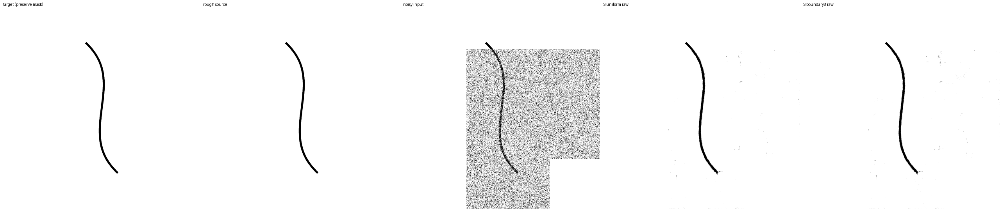
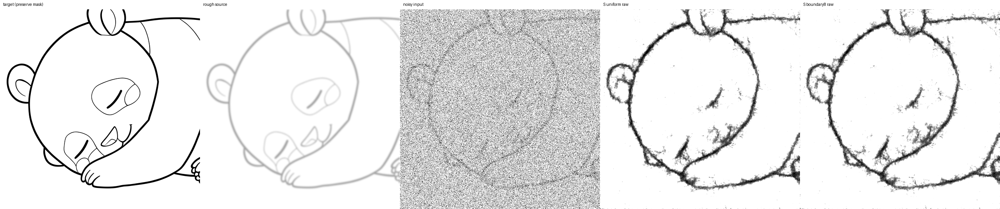

# 矩形maskの境界sampling比較（N2）

2026-09-18完了。boundary8を追加10,000更新まで学習し、保存済みの一様mask対照と比較した。
**今回の8候補から境界ink最大の位置を選ぶ方針は、既定設定に採用しない。**
境界を横切る下描きinkへの学習機会は約1.87倍になったが、境界F1は安定して改善せず、
Sの全面編集では切断がraw/EMAとも増えた。rawの細線消失・幅誤差の減少とは両立している。

[N1の低〜中強度80%案](noise-strength-experiment-20260917.md)は採用せず、
一様強度・補助lossなしの対照から、矩形maskの置き方だけを比較した。
以下に学習前の固定計画、途中結果、最終結果を記す。

## 変えるもの

`control` は従来の画像非依存mask。全面・帯・矩形の比率は各1/3、identityは10%。
`boundary8` では矩形だけについて、同じ幅・高さを持つ8位置から、境界を横切る
下描きのinkが最も多い位置を選ぶ。候補0は従来の位置、残り7つは画像内の整数位置を一様に選ぶ。
同点は最初の候補を選ぶので、白背景のmaskは変わらない。

scoreは下描きから `clip((1-source)/2,0,1)` を計算し、矩形辺の両側で隣接する
2画素のinkの小さい方を辺に沿って合計する。画像外との辺は0。
これは両側に線がある箇所のsampling用proxyで、接続性を保証する指標ではない。
prefix sumを用い、候補数×512²のmaskを全て保持しない。

- 既存矩形を画素単位で抽出して移動するため、面積・幅・高さ・強度は保つ。
- 全面・帯状mask、identity、元画像・幾何生成・下描き拡張・Gaussianの乱数は保つ。
- 候補の乱数は既存map keyから用途専用のfold-inで得る。強度や他の乱数列を進めない。
- scoreに使うのは拡張後の入力下描きのみ。正解線画を参照するmask生成は使わない。
- maskに合わせ、編集画素の教師はclean、保護画素の教師は入力下描きとする既存仕様を維持する。

元画像は共通だが、移動後の編集領域に含まれるink量も変わり得る。
境界samplingという方針全体の比較であり、境界の接続情報だけの因果効果を分離する実験ではない。
bandの境界位置や曲線maskまで対象にする比較も今回は含めない。

## 学習と対照の再利用

初期値は `runs/geometry-data-20260914/snapshots/step-10000/geometry20/raw`、
optimizerとEMAをリセットして追加10,000更新する。seed46、split42。
S/M/Lは5,933/10,206/17,893 parameters、チャンネル[4,6,8]/[6,8,12]/[8,12,16]。
内部3段・各block2畳み込み・fused・residual。512px、FP32、実効batch16、
LR1e−4×sqrt(16)=4e−4、warmup500、schedule終点100,000。
空間再帰1〜6、scale_loss_multiplier=0（直接lossは最高解像度、下位段へは再帰を通じた勾配）。
生成線画20%・strokes50%、opacity .25〜1、blur0〜2、dilation2、displacement2。
学習891/dev64/final64で、final64は使わない。実下描きは使わない。

一様maskのcontrolは `runs/noise-strength-20260917` の保存済みモデルを再利用する。
N1のcontrolはさらに過去のL2 controlとも2k/10k raw/EMAの重みがbit exactだった。
N2では以下を確認してから、新たにboundary8だけを学習する。

1. controlの設定が既存設定と完全一致し、optimizer・モデル・データ処理の数値コードをhash照合。
2. 新機能を無効にした入力生成が直前commitと3 seed×6段×3配列でbit exact。
3. 実GPUでcontrolの最初の30更新を再実行し、data split・初期値・scale/再帰・生成キー・
   強度と、10/20/30更新のloss・勾配等を照合。FP32許容差はloss等rtol1e−5、
   gradient norm rtol1e−4、atol1e−8。
4. 再利用モデル・optimizer checkpoint・評価・初期値・乱数記録を本学習前にhash固定。
5. controlを固定1,562ケースで再評価し、追加の境界指標を除く既存結果が完全一致することを確認。

controlは今回独立に学習した条件ではなく、速度も同時期の交互実行比較ではない。
記録には新規学習と再利用を明記し、元の学習・評価ファイルは書き換えない。
定期validationには両条件で従来の一様maskを使う。

## samplingの確認

最初の128学習batch（2,048画像）を学習前に再現し、強度・面積と全面/帯/identityの一致、
矩形境界のscore増加、変更された矩形数、score>0の割合を測る。
最初の変更例4つを図示する。品質に基づくcandidate数の調整はしない。
全10,000更新の強度・scale/再帰・幾何生成キーをcontrolの既存記録と照合し、
最初の128更新では記録された面積・強度が事前再現と一致することも確認する。

## 固定評価と判断

主評価は従来の1,562ケースをbyte単位でコピーする。入力素材・mask・Gaussian seedは
両条件に共通で、推論時には学習用mask配置を使わない。runtime再帰3段、NumPy noise、
denoise1回、全S/M/L。初期raw、2k/10kのraw/EMAを測り、計42,174出力を検証する。
2kで全出力finite・保護画素誤差0・raw clean F1≥min(.30,initialの半分)なら10kへ進む。
これは崩壊検知であり、採用判定ではない。

従来のink F1、幅、消失、切断、誤接続、背景、mask境界MAEに加え、
**編集側だけの3px境界帯**でMAE、教師ink画素のMAE、背景画素のMAE、ink F1を測る。
ink F1はその帯に教師inkがある場合だけ集計し、空白例の1.0で平均を水増ししない。
保護画素の完全一致による0も編集側の平均に混ぜない。
全体集計のほか、全面/部分と強度.1/.5を分けて示す。

中心となる判断は、部分編集で境界の線が残り、背景残留・誤接続が増えないこと。
clean保持と全面編集の品質も確認し、局所MAEだけで採用しない。
roughの部分編集では教師自体がclean/roughを継ぐため、既存の全経路topology probeを
適用しない。局所F1/MAEは接続性の厳密な保証ではなく、clean幾何線画の接続probe、
既存の全面編集probe、画像の目視と併せて判断する。

対応差の95%区間は元画像/幾何variant単位のbootstrap。単一学習seedに条件付けた
development比較であり、学習seed間の不確実性や未知の実下描きへの一般化は示さない。
例示画像は従来のcase256/479/480/1376を事前指定する。
checkpoint、prefix独立性、S/M/L切り出し、S ONNX、runtime3段、BGRA APIを確認する。
Kritaと配布モデルは変更しない。

## 実行・保存

設定は `configs/mask-sampling.toml`、runは `runs/mask-sampling-20260918`。
`mask_reuse.py` で再利用証拠を固定し、`run_geometry_data.py --study mask_sampling` が
2k gate→10k→モデル検証/ONNXを実行する。main trainingには
`compare_nested_training.py --only-method boundary8` を用いる。
`stop`ファイルがある場合は更新完了時に保存して停止する。既存controllerを重複起動しない。

主集計は `summarize_geometry_data.py` / `audit_geometry_data.py` の
`--study mask_sampling`、sampling監査は `diagnose_mask_sampling.py --audit-training`。

## 開始前に確認できたこと

最初の128 batchの2,048画像のうち、非identityの矩形は592例、位置が変わったのは389例。
境界を横切るsource inkの平均は49.6253→92.9739（約1.87倍）、
score>0の割合は69.2568%→77.8716%。面積・強度・全面/帯/identityは全例で一致した。
これは学習機会を増やせた確認であり、復元品質の改善ではない。

GPU preflightでは2条件×空間再帰1〜6がfiniteで、保護領域の教師は完全一致した。
無効時の入力生成54配列、controlの30更新再実行の10/20/30更新の全記録値も
bit exactだった。全テストではONNX export後のcumsum wrapperとの呼出し互換性を修正し、
位置引数をkeyword引数にした。samplingの数式は変えていない。

修正後の全156テストが通過。GPU preflightも修正後に再実行し、全12更新が通過した。
CPUの3更新によるpaired/single実行と再開比較では、モデル・optimizer・EMAが完全一致した。

## 2,000更新の途中結果

初期4,686出力と2k raw/EMA各9,372出力を評価し、全出力finite、保護画素誤差0で
崩壊検知gateを通過した。controlの再評価はraw/EMAとも4,686出力の既存指標が
N1の保存結果と完全一致した。最初の128更新の実測mask面積・強度も事前再現と完全一致。
新規学習部分の記録時間は3,199.44秒。10kまでの学習を続ける。

部分編集・強い重ね描き幾何線画のSについて、編集側3px境界帯は次のとおり。
各値はcontrol→boundary8。F1は大きいほど、MAEは小さいほどよい。

| 重み | 境界ink F1 | 境界ink MAE | 境界背景MAE |
| --- | ---: | ---: | ---: |
| raw | .481776→.488105 | .482094→.463060 | .010743→.011500 |
| EMA | .490936→.487644 | .500977→.497719 | .009871→.010004 |

rawのF1差の95%区間は[−.001485, +.015705]、EMAは[−.006061, −.000527]。
inkの濃淡誤差は下がるが、背景残留は両方で増えており、途中時点で改善とは判定しない。
F1/ink MAEは境界に教師inkがある62例/31幾何variant、背景MAEは64例/32 variant。

強い重ね描き幾何線画の全面編集probeでは、raw Sの切断率は.364583→.343750、
消失率は.079720→.066211となる一方、幅誤差は2.954997→3.098121pxに増えた。
EMA Sの切断率は.370312→.369271、消失率は.094434→.095519で、小さい変化に留まる。
採用判断は10kの局所・全体・全面/部分・強度別の評価を揃えて行う。

数値と対応差区間は [pilot集計](../benchmarks/mask-sampling-20260918-pilot.json) と
[部分/全面・強度別集計](../benchmarks/mask-sampling-20260918-slices-pilot.json) に保存した。

## 10,000更新の結果

初期・2k・10kを合わせた42,174出力は全てfinite、保護画素誤差は0。
再利用controlの2k/10k raw/EMA各4,686出力の既存指標はN1と完全一致した。
新たに学習したのはboundary8の1条件。controlを独立に再学習した結果とは数えない。

### 部分編集の境界

S、編集側3px境界帯。各値はcontrol→boundary8。F1は大きいほど、MAEは小さいほどよい。

| 対象・指標 | raw | EMA |
| --- | --- | --- |
| clean幾何線画 境界ink F1 | .730495→.727841 | .753778→.748929 |
| 同・境界背景MAE | .010868→.012393 | .008685→.008816 |
| 強いblur・実線画由来 境界ink F1 | .842886→.824876 | .837940→.836998 |
| 同・境界ink MAE | .352539→.380466 | .356176→.359434 |
| 同・境界背景MAE | .026157→.025337 | .025000→.024494 |
| 強いstrokes・実線画由来 境界ink F1 | .795526→.798401 | .799182→.799003 |
| 強いstrokes・幾何線画 境界ink F1 | .497371→.500901 | .492389→.485670 |
| 同・境界ink MAE | .475710→.504910 | .458336→.462372 |
| 同・境界背景MAE | .010564→.010546 | .010527→.010587 |

強いstrokes・幾何線画のraw S境界F1差は+.003530、95%区間は[−.003652, +.009481]。
同じ帯のink MAEは+.029200 [+.015397, +.042290]と増えた。
EMAの境界F1差は−.006719 [−.015660, +.000165]で0を跨ぐ。
この対象の境界F1はMでraw/EMAとも低下し、Lはrawで低下・EMAはほぼ同じだった。
境界への学習機会を増やしただけでは、狙った改善は確認できない。

clean幾何線画のEMA S境界F1差は−.004849 [−.009097, −.001227]、
背景MAE差は+.000131 [+.000056, +.000214]。強いblur・実線画由来のraw S境界F1差は
−.018010 [−.038860, −.001581]で、背景残留の減少だけでは改善といえない。
境界F1の標本数はそれぞれ126例/63幾何variant、22例/11元画像。
強いstrokes・幾何線画は62例/31 variantで、教師inkがない境界はF1から除外した。

### 全体の復元と全面編集の接続性

Sの主評価。ink F1と背景MAEは全面/部分を含み、強いstrokes・幾何線画の
幅・消失・切断・誤接続probeは全面編集だけを対象とする。

| 指標・対象 | raw | EMA |
| --- | --- | --- |
| clean実線画 ink F1 | .917669→.917271 | .923243→.923133 |
| clean幾何線画 ink F1 | .812964→.812934 | .826384→.826409 |
| 強いblur・実線画由来 ink F1 | .779711→.768382 | .777484→.774047 |
| 強いstrokes・実線画由来 ink F1 | .775739→.775522 | .779960→.779657 |
| 強いstrokes・幾何線画 ink F1 | .520568→.520740 | .517613→.515143 |
| 同・線幅MAE px | 2.887975→2.801607 | 2.824338→2.821213 |
| 同・消失プロファイル率 | .076931→.064855 | .082259→.080501 |
| 同・切断率 | .334896→.359896 | .335938→.351042 |
| 同・誤接続率 | .666667→.666667 | .666667→.666667 |
| 同・背景MAE | .013387→.013659 | .012617→.012615 |

raw Sの幅差は−.086368px [−.114076, −.057140]、消失率差は
−.012077 [−.022721, −.004067]と改善した。一方、切断率差は
+.025000 [+.005208, +.046875]。EMAも切断率差+.015104 [+.002083, +.031250]で増加した。
EMAの幅差−.003125と消失率差−.001758は区間が0を跨ぐ。
局所の線幅プロファイルが残ることと、別の位置を結ぶ経路が切れないことは異なるため、
消失と切断の逆方向の変化は矛盾ではない。幅指標はink量を積分するため濃度にも影響される。

強いstrokes・幾何線画の切断率を全サイズで比較すると、次のとおり。

| サイズ | raw | EMA |
| --- | --- | --- |
| S | .334896→.359896 | .335938→.351042 |
| M | .305729→.317708 | .291667→.301042 |
| L | .318229→.308854 | .296875→.294792 |

Mの差の区間はraw [−.007813, +.031771]、EMA [0, +.023958]。
Lはraw [−.030208, +.010417]、EMA [−.015625, +.009375]で、改善の確証は得られていない。
rawの消失率と幅誤差は全S/M/Lで減ったが、境界品質と切断を含めた改善には至らなかった。

### 強度・編集範囲を分けた確認

S EMA、強いstrokes・幾何線画。各値はcontrol→boundary8。

| 指標 | t=.1 | t=.5 |
| --- | --- | --- |
| 部分編集 境界ink F1 | .536383→.529060 | .448394→.442280 |
| 部分編集 境界背景MAE | .008308→.008278 | .012746→.012896 |
| 部分編集 全編集領域ink F1 | .568534→.565715 | .469511→.467651 |
| 全面編集 ink F1 | .568211→.565443 | .464196→.461762 |
| 全面編集 切断率 | .230208→.230208 | .441667→.471875 |
| 全面編集 消失率 | .032878→.030924 | .131641→.130078 |

低強度だけに限定しても境界F1の改善は見えていない。S EMAの切断増加はこの分割では
t=.5側に現れた。強いblur・実線画由来のink F1も、全面/部分×t=.1/.5の4区分全てで低下した。
これらは固定development集合の診断で、利用頻度や未知の下描きでの成績を表さない。

## 比較画像

事前指定した4ケースのraw/EMA・全S/M/L、計16パネルを同じ入力とノイズから描画した。
掲載用の6画像は検証済みパネルの画素を拡縮せず並べるか、そのままコピーしたもの。

clean曲線・部分編集・t=.5のraw S。両条件とも線は残るが、背景の点状残留がある。

強いblur・全面編集・t=.5のraw S。どちらも細い顔の線が復元できず、輪郭の粗さも残る。
境界samplingを増やした方が全面的に優れる画像にはなっていない。

同じblurの[EMA・t=.5](assets/mask-sampling-20260918/paired-ema-case-480.png)と
[EMA・t=.1](assets/mask-sampling-20260918/paired-ema-case-479.png)も保存した。
case479は全面編集であり、部分編集の例ではない。
強いtone・意図した隙間・部分編集の[raw S/M/L](assets/mask-sampling-20260918/boundary8-raw-widths-case-1376.png)と
[EMA S/M/L](assets/mask-sampling-20260918/boundary8-ema-widths-case-1376.png)では、
どのサイズにも細線の薄さ・途切れが残る。これらの例だけで最小サイズを決めない。

## 検証・保存記録

- 新規boundary8の10,000更新は160,000例、生成31,966例、うち白背景1,571例。
  全更新の生成キー・強度・scale/再帰は再利用controlと一致した。
  最初の128更新の面積・強度も事前診断と完全一致した。
- 新規学習の記録時間は17,270.82秒（4.797時間）、更新計算の平均は1.131555秒。
  対照の履歴値1.131399秒は同時期の速度比較ではない。
- 2つの最終checkpoint状態（controlはコピー）、8つの2k/10k raw/EMA snapshot、
  S/M/Lの12切り出しを検証。空間再帰1/6段の24比較で最大誤差0。
- S ONNXは2条件×raw/EMAの4本。動的shapeの最大誤差9.54e−7、512pxで3.58e−6。
  実runtimeの3段再帰16比較は最大4.06e−6、保護画素は完全一致。
- BGRA APIの16比較でidentity・決定性・保護画素の一致を確認。
  CPUExecutionProviderでの検証であり、Krita UIやDirectMLの動作試験ではない。
- 開始前の156テスト、GPU再帰1〜6の12更新、54入力配列の無効時一致、
  controlの30更新再実行も通過。学習中に数値コード・設定は変更していない。

学習sourceはcommit `759709c7356eeb92113a497bedb0089c047a44b9`、
archive SHA256は `ce533255b4310781c120273a0f2fbbee80f75793673530a0e6b5806f6868ef22`。
`training-source.json` の68ファイル、`reference-reuse.json` の対照の元ファイル、
`evaluation-input-sha256.json` の固定入力をhashで照合する。
既存モデル・Krita・配布物は更新していない。

主な機械可読記録：

- [主集計・対応差区間](../benchmarks/mask-sampling-20260918.json)
- [部分/全面・強度別と境界指標](../benchmarks/mask-sampling-20260918-slices.json)
- [主成果物149件のhash](../benchmarks/mask-sampling-20260918-artifacts.json)
- [runtime](../benchmarks/mask-sampling-20260918-runtime.json)・[BGRA](../benchmarks/mask-sampling-20260918-bgra.json)
- [掲載画像と元パネルのhash](../benchmarks/mask-sampling-20260918-report-images.json)

## 判断と次の比較

一様mask・一様強度・補助lossなしを対照として維持し、boundary8は既定設定に採用しない。
この結果は「同じ矩形の8位置から境界の総ink量最大を選ぶ」案についてのもので、
帯や曲線mask、薄い線を重視するsamplingまで否定するものではない。
単一seed・既存development集合での比較であり、区間は学習seed間の揺れを含まない。

D1/L1/L1b/L2/N1/N2の比較を踏まえ、次は計画A2のpool前の高解像度特徴を残すskipを
独立に比較する候補とする。現行実装はpool後の特徴をskipとして使うため、細線情報を
保持する経路を変える仮説を調べられる。入れ子の一方向依存と再帰・各段loss・sqrt(batch)のLRを
保ち、parameter数・時間の増加も測る必要がある。効果はまだ未検証。
複数seed、独立Sの長期比較、未使用final test、最小十分サイズの確定も残っている。
