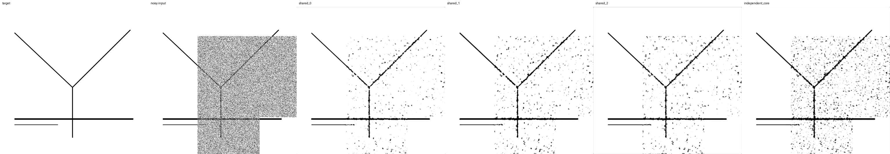
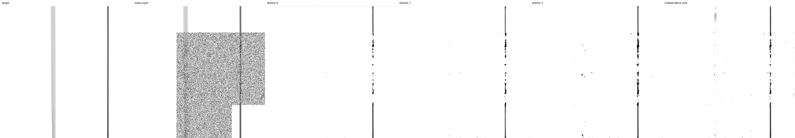
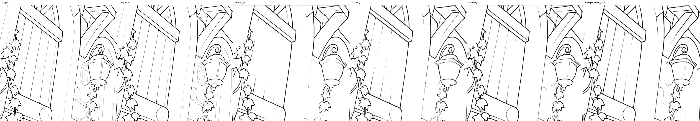

# 入れ子モデルの初期実験 — 2026-09-10

実装・独立性の検証・速度比較と、実データでの 2,000 更新の品質比較を完了した。
最小モデルの品質を確定する実験ではなく、特徴計算の共有と共同学習の成立性を調べる。
共有更新は個別実行の約 2.37 倍速かった。raw 重みでは共同 S が独立 S を上回る条件があるが、
EMA では順位が変わり、強い部分ノイズでの線の切断や強度 0 での細線の消失は未解決。

## 実装と検証

[構造と実行手順](nested-models.md)、[計画](small-model-experiment-plan.md)。
3 サイズは S = 5,933、M = 10,206、L = 17,893 parameters。
小型から大型への接続だけを持ち、decoder・head・低解像度予測の経路もこの制約を守る。
S は普通の U-Net に変換できる。M / L は内部に必要な小型の状態と head も含む。

全 75 テストが成功。内容には 1 / 3 / 6 段の再帰での切り出し一致、
大型専用パラメータ・insert への独立性、禁止経路の微分ゼロ、
一括 Conv と分割 Conv の出力・勾配一致、学習再開、推論用保存・読込、
S の ONNX 出力、データ分割と幾何指標の校正を含む。
2,000 更新の実 checkpoint を ROCm GPU で検証した。固定 512px 入力の 1 / 6 段再帰で、
全体実行と S / M / L の単独切り出しの最大絶対誤差はいずれも 0。
大型専用パラメータを変更しても S / M は全解像度で bitwise 一致し、L だけが変化した。
推論用ファイルの保存・再読込も検証済み。

S の raw / EMA を dynamic ONNX に出力した。JAX と ONNX Runtime の比較は
8×8、16×24、64×64 で成功し、最大絶対誤差は raw が 5.52e-7 未満、EMA が 4.18e-7 未満。
この ONNX 確認は単一段の入出力の検証であり、Krita での組み込み評価は行っていない。

## 速度

Radeon 8060S / ROCm。FP32、512×512、6 段再帰、実効 batch 16、microbatch 4。
同じ実データの GPU 常駐 batch を使用し、OT の準備、勾配計算・蓄積、
clipping・AdamW・EMA 更新を測定。画像復号・評価・保存は除く。
初回更新と追加 warmup 3 回を除外し、10 回測定した。

| 実行方法 | 更新平均 | 更新中央値 | batch 1 の再帰推論中央値 |
| --- | ---: | ---: | ---: |
| 3 サイズの特徴を共有 | 1.233 s | 1.216 s | 7.91 ms |
| 同じ 3 サイズを別々に実行 | 2.923 s | 2.874 s | 17.72 ms |

この条件で共有更新は約 2.37 倍速く、更新時間は約 58% 短縮した。
推論欄も 3 サイズ分の合計であり、denoise を複数回繰り返す sampler 全体の時間ではない。
別々の実行では各 prefix の最終出力を教師で学習し、それぞれ別の optimizer を更新する。
モデルごとに OT を繰り返さず、別々の側にも同じ prepared batch を渡している。

一括 Conv と分割 Conv の初期測定では、一括方式が速かったので今回の学習に採用した。
禁止された接続がゼロであることだけから、GPU の計算量削減を推定していない。
初回更新の時間には既存のコンパイル・driver cache の影響があるため、冷間起動の比較には使わない。

生データとコードの SHA-256 は [JSON](benchmarks/nested-20260910.json)。
完全なソース snapshot と生ログは `runs/nested-20260910/` に保存している。

## 学習比較

`configs/nested.toml` による共同 S/M/L と、同じ初期重みの独立 S を比較する。
元画像 1,019 枚を train 891 / development 64 / final test 64 に分離。
両 run は同じ crop と同じ全 batch の OT 割り当てを使い、optimizer・EMA は独立。
model / data / noise seed は 42、分割 seed も 42。

再帰は元の `original_steps + dataset scale level` による 1〜6 段。
`scale_loss_multiplier = 0` で、最高解像度だけを直接教師で学習し、再帰勾配を保つ。
3 サイズの loss を平均し、実効 batch は 16、peak LR は 4e-4。
LR schedule は最初から 100,000 更新、warmup は 500 更新。
2,000 更新で止めることで schedule の終点を変更しない。

最初の試行は Grain の先読み不足による I/O 待ちを確認したため中断し、
ログを `pilot-prefetch2-aborted/` に保存した。先読み 8 batches / 4 workers に変更し、
両モデルを同じ初期値から開始し直した。101〜2,000 更新の入力待ちは平均 2.46 ms となった。
pixel 値、crop の選択、augmentation、ノイズ条件は変更していない。

両 run は 2,000 更新、各 32,000 学習画像に到達した。101〜2,000 更新の平均更新時間は
共同 S/M/L が 1.175 s、独立 S が 0.694 s。ここは 1〜6 段が混在する実学習であり、
上の 6 段固定ベンチマークとは区別する。両 run を順番に更新するループの実測合計は
約 64.2 分で、初期化・評価・checkpoint 保存時間はこの合計に含まない。
途中停止・再開の smoke 実験では、最終 model / optimizer / EMA が比較経路と完全一致した。

## 品質評価の条件

モデル出力を見る前に、実画像 54 条件と合成 16 条件を固定した。
実画像は 6 scales × (4 強度 × 全体/部分 mask + identity)。
合成は曲線、分岐、意図的な隙間、入り抜きを含む線幅変化。
denoise 1 / 2 / 5 回をサイズごとに独立した sampler で評価した。
条件ごとの実画像と crop は異なり、70 条件は 70 枚の独立した元画像を意味しない。

運用時と同様、画像と強度マップを縮小してから独立 Gaussian を加える。
この評価では OT を使わない。学習時の OT を使った validation loss と区別する。
EMA と raw weights の両方を評価した。各重みにつき 70 条件 × 3 回数 × 4 モデル = 840 件。

一部の高倍率 crop は白地であるため、線を含む実画像と合成条件を別集計した。
以下の「実画像」は、強度 > 0 かつ正解の線領域が 0.1% 以上の 31 条件。
残りは白地に近い実画像 17 条件、強度 0 の実画像 6 条件、合成 16 条件に分けた。
集計の区分は出力ではなく正解画像に基づき、白地を含む全条件の結果も JSON に残す。
線領域は値 < 0（正規化範囲 [-1, 1]）とし、各条件の F1 を単純平均する。
境界 F1 の許容距離は 1.5px、保護領域 MAE は強度マップが 0 の画素で測る。
ink / boundary F1、線領域面積、連結成分数、保護領域の変化と固定比較画像を使う。
連結成分数の差だけで切断・誤接続を判定できるわけではなく、線幅の完全な評価でもない。
この初期実験だけから最小サイズや品質の同等性は断定しない。

## 品質の結果

2,000 更新の raw 重み。表は線領域 F1（%）。

| モデル | 実画像・1 回 | 実画像・5 回 | 合成・1 回 | 合成・5 回 |
| --- | ---: | ---: | ---: | ---: |
| 独立 S | 91.35 | 90.44 | 91.86 | 87.19 |
| 共同 S | 91.64 | 91.09 | 93.16 | 94.10 |
| 共同 M | 91.57 | 90.93 | 92.58 | 91.35 |
| 共同 L | 92.52 | 92.30 | 93.74 | 92.93 |

共同 S と独立 S の差は実画像・5 回で +0.65 ポイント、合成・5 回で +6.91 ポイント。
同じ条件の境界 F1 は、実画像で 95.58% 対 94.69%、合成で 96.70% 対 86.30%。
共同 S はこの初期実験で有望だが、1 seed の途中経過であり、有意差や優越性は断定しない。
M が S を常に上回るわけでもなく、容量・最適化・共同学習の影響はまだ分離できていない。

EMA 重みでの線領域 F1（%）、denoise 5 回:

| モデル | 実画像 | 合成 | 強度 0 |
| --- | ---: | ---: | ---: |
| 独立 S | 89.76 | 90.55 | 93.39 |
| 共同 S | 89.10 | 92.00 | 91.68 |
| 共同 M | 85.03 | 91.91 | 87.58 |
| 共同 L | 90.91 | 93.02 | 94.95 |

EMA では実画像の共同 S と独立 S の順位が逆転する。
固定 decay 0.999 の EMA には、2,000 更新でも初期重みの係数が約 13.5% 残る。
これが差の原因と確定したわけではないため、同じ schedule で学習を続けて確認する。
OT を使う validation loss も 1,000 → 2,000 更新で共同 S は 1.364 → 0.969、
独立 S は 1.121 → 0.697 と改善中で、収束後の評価ではない。

入力保持には課題がある。raw・5 回の強度 0 の F1 は共同 S 93.89%、独立 S 94.76%。
実画像の部分ノイズでの保護領域 MAE は共同 S 0.01205、独立 S 0.01104 だった。
現行の identity loss は、強度 0 の画素の完全保持を保証しない。

## 比較画像

以下は raw・5 回。列は左から正解、ノイズ入力、共同 S、共同 M、共同 L、独立 S。
改善例と失敗例を併記するため、共同 S と独立 S の F1 差の最大・最小の条件と、
強度 0 の劣化例を選んだ。代表的な平均ケースを意味するものではない。



case 061: 分岐・部分ノイズ。共同 S は独立 S より残留する黒い点が少ないが、完全には除去できていない。



case 043: 拡大された縦線・部分ノイズ。全モデルでノイズ領域内の線に切断が残り、
共同 S の F1 は独立 S より約 5.43 ポイント低い。



case 017: ノイズを加えていない入力でも、板の細い境界や照明器具周辺の細部が消える。
指標の平均値だけでは十分な品質判断にならない例。

## 成果物と次の実験

実装 commit は `370932351db1d93372d292bc3842c55c50a45f41`、branch は `rewrite/jax`。
[計測 JSON](benchmarks/nested-20260910.json) に実行環境、ソース SHA、学習集計、
固定ケース、raw / EMA の全評価値、実機検証、ONNX 検証と成果物 SHA を保存した。
元のソース snapshot は測定時の版を保持し、集計処理の追加を含む最終版は上記 commit で参照する。
checkpoint とモデル本体は Git 管理対象外の `runs/nested-20260910/` にある。

| 相対パス（run root 以下） | 内容 |
| --- | --- |
| `pilot/shared/`、`pilot/independent_core/` | step 2,000 の再開可能な checkpoint・ログ・設定 |
| `evaluation/cases.json`、`evaluation/case-*.npz` | 固定評価の元画像・crop・seed・入力配列 |
| `evaluation/step-2000-{raw,ema}/` | 全評価値と各 210 枚の比較 panel |
| `extracted-{0,1,2}/`、`extracted-{0,1,2}-raw/` | 各サイズの単独推論用 config・weights・metadata |
| `small-raw.onnx`、`small-ema.onnx` | 既存 1ch insert 契約に対応した S のモデル |

M / L の単独推論は JAX に対応し、既存 ONNX 契約への対応は S のみ。
Krita plugin と runtime は変更していない。

次は構造を固定して共同 S/M/L と独立 S を 10,000 更新まで比較する。
EMA と raw の順位、強い部分ノイズ、細線を同じ固定条件で追う。
それと分けて、強度 0 で元入力を通す残差出力の実験を行い、
入力保持を構造で保証する効果を測る。今回の結果にこの補正を後から適用していない。
さらに小さい幅への削減や「最小サイズ」の判断は、品質が安定してから複数 seed で行う。
最終 test 64 元画像は今回未使用。

作業ディレクトリを JAX worktree として、今回の run を 2,000 → 10,000 更新へ再開するコマンド:

```sh
JAX_PLATFORMS=rocm,cpu XLA_PYTHON_CLIENT_PREALLOCATE=false \
  .venv/bin/python scripts/compare_nested_training.py \
  --config configs/nested.toml --run-dir runs/nested-20260910/pilot \
  --resume --stop-after 8000
```

評価の再実行方法は [実行手順](nested-models.md#再現する) を参照。
今回の固定入力は `--cases runs/nested-20260910/evaluation`、
学習グループは `--run-group runs/nested-20260910/pilot`、checkpoint は `--step 2000`。
raw は `--raw` を付け、EMA は付けずに評価する。
