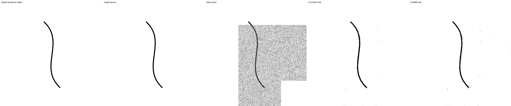
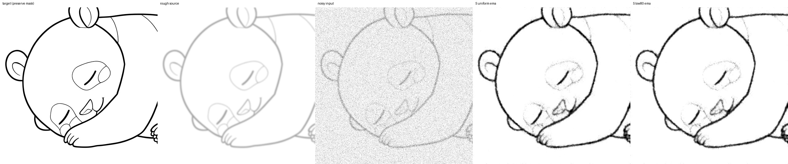
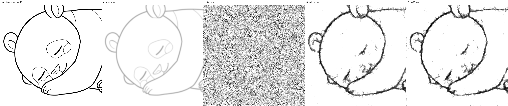
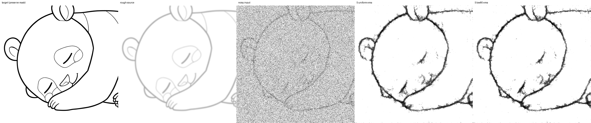
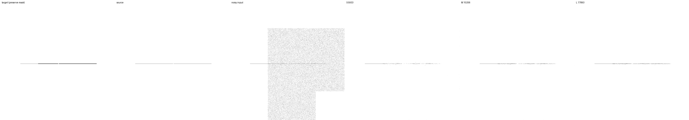
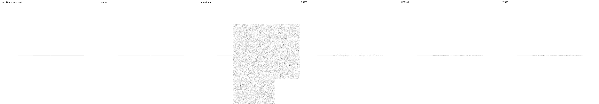

# ノイズ強度の学習分布比較（N1）

2026-09-17完了。両条件を追加10,000更新まで学習し、計51,414出力を検証した。
**低〜中強度80%の案は既定設定に採用しない。** 低強度のclean保持には小さな改善が
あるが、強い下描きでは細線消失・切断が増え、高強度の復元も悪化した。
2,000更新でのrawの切断改善は最終時点には残らなかった。

利用時に入力の線画情報が残ることを踏まえ、低〜中強度の学習頻度を増やす比較を行った。
[前回の中心線loss](cldice-loss-experiment-20260915.md)は採用せず、補助lossなしで比較する。
以下に学習前の固定計画、途中結果、最終結果を記す。

## 比較する分布

ここでのtはnoise_levelで、入力は `source*sqrt(1-t) + Gaussian*sqrt(t)`。
標準偏差そのものではない。両条件とも各解像度へ縮小してから独立Gaussianを加える。

- `control`: tを[.001,1)から一様に選ぶ。従来どおり。
- `low80`: 80%を[.001,.5)、20%を[.5,1)からそれぞれ一様に選ぶ。

同じ一様乱数uを逆CDFで写像する。追加の乱数は消費しない。
u<.8なら `.001+(u/.8)*(.5-.001)`、それ以外は `.5+((u-.8)/.2)*.5`。
全面identityの確率10%は別の既存乱数で決め、両条件で完全に共通とする。
mask形状・元画像・幾何生成・下描き拡張・Gaussianの値・再帰段数も共通にする。

identityを除くtの平均は.5005→.3504、t≤.5の頻度は約49.95%→80%、
t>.9は約10.01%→4%となる。高強度の学習を残しながら利用域へ配分する一つの候補であり、
80%や境界.5が最適だとは仮定しない。今回はこの2値を評価結果で調整しない。
既存lossのt依存の重みを維持し、逆確率による補正は行わない。
したがって学習分布に応じた期待目的関数も変わる。単に同じ目的関数の分散を変える実験ではない。

## 固定する学習条件

共通初期値は `runs/geometry-data-20260914/snapshots/step-10000/geometry20/raw`。
2条件を新たに学習し、optimizerをリセット、EMAも同じraw重みから開始する。
追加10,000更新（通算50,000更新相当）。seed46、split42。

- nested S/M/L: 5,933 / 10,206 / 17,893 parameters、チャンネル[4,6,8] / [6,8,12] / [8,12,16]。
  内部3段、各block2畳み込み、fused実行、residual出力。
- crop512、FP32、micro4×蓄積4=実効batch16。LR1e-4×sqrt(16)=4e-4、warmup500、
  schedule終点100,000。空間再帰1〜6と段間loss係数0を維持。
  直接lossは最高解像度にかかり、下位段には再帰を通じて勾配が流れる。
- 生成線画20%（生成枠の5%は白背景）、strokes拡張50%。opacity .25〜1、blur sigma0〜2、
  dilation最大2px、displacement最大2px。補助lossはどちらも0。
- 学習891 / dev64 / final64。final64は使用しない。合成下描きだけで進める。
- 定期validationは両条件に同じcontrol分布の入力を渡す。
  主な品質判断は別途固定した推論評価で行い、異なる強度分布のtrain loss同士は順位付けしない。

比較runnerは同じgeometry設定の教師生成を1回で共有し、強度分布ごとに入力を作る。
この共有でデータを変えず、同じ幾何形状を2回描画する処理を省く。
各更新で画像ごとの最大tを保存し、全更新の乱数を独立したNumPyの逆CDF式で監査する。

## 事前検証と評価

テストでは混合分布・identity頻度、maskと教師の一致、下描き拡張とGaussianの完全一致、
6解像度で強度だけが変わること、checkpointのモデル・optimizer・EMAの再開一致を確認する。
実GPUで両条件×再帰1〜6、実効batch16の12更新を行ってから本学習を始める。

主評価は前回とbyte単位で同じ1,562ケース、runtime再帰3段、NumPy noise、denoise1回。
初期raw、2,000/10,000更新のraw/EMAをS/M/L全てで測る（42,174出力）。
2,000更新で全出力有限・保護画素誤差0・raw clean F1が `min(.30, initialの半分)` 以上なら
10,000更新へ継続する。これは学習崩壊の検知であり、採用基準ではない。

重点はt=.1/.5の強い下描きのF1・切断・細線消失・線幅・背景残留とclean保持。
全体集計に加え、強度・全面/部分編集別に結果を示す。
既存clean suiteのt=.3/.7も分離して確認する。
改善が切断・誤接続やclean保持の悪化を伴わないかを検討し、単一指標だけで採用しない。
対応付き95%区間は元画像／幾何形状variantを単位にbootstrapする。
単一seedの学習済みモデルに条件付けた区間であり、seed間の不確実性を表さない。

高強度の代償は、主suiteでt=.5だった非legacyの616ケースから別途固定したt=.9で診断する。
画像・下描き・mask・Gaussian seedは同じにし、編集画素のtだけを.9へ変更する。
内訳はclean実画像24、clean幾何形状64、下描き実画像由来144、下描き幾何形状384。
初期rawと最終raw/EMAを全S/M/Lで測る（9,240出力、主評価との合計51,414出力）。
clean幾何形状のこの診断は元のt=.5ケースと同じ部分編集に限る。
これは同じdevelopment素材を使った強度診断で、独立testや純ノイズ生成の評価ではない。

例示画像は過去と同じcase256、479、480、1376を学習前に指定する。
checkpoint、S/M/L切り出し、S ONNX、既存runtime3段、BGRA APIの互換性を確認する。
Kritaと配布モデルは変更しない。

## 再現

設定 `configs/noise-strength.toml`、実行root `runs/noise-strength-20260917`。
学習前にsource commit/archive、設定、初期重み、評価入力のhashを固定する。

```bash
JAX_PLATFORMS=cpu OPENBLAS_NUM_THREADS=1 .venv/bin/python scripts/strength_diagnostics.py \
  --root runs/noise-strength-20260917 --prepare-from runs/geometry-data-20260914/evaluation
JAX_PLATFORMS=rocm,cpu XLA_PYTHON_CLIENT_PREALLOCATE=false OPENBLAS_NUM_THREADS=1 \
.venv/bin/python scripts/run_geometry_data.py --study noise_strength \
  --root runs/noise-strength-20260917 --reference-root runs/geometry-data-20260914
```

稼働中controllerを重複起動しない。停止はrootの`stop`ファイルで更新・保存後に行う。
`summarize_geometry_data.py` / `audit_geometry_data.py` に `--study noise_strength` を指定して
主評価を集計・監査する。`strength_diagnostics.py --root ... --output ...` で
実際の強度分布・高強度診断・主評価の強度別区間を保存する。

## 開始前の確認

CPUの既存・追加テスト150件が通過し、追加したsampling監査のテストを含む
`tests/test_noise_strength.py` 4件も通過した。GPUでは両条件の再帰1〜6段が
finiteなloss・gradientを返し、保護領域の一致を確認した。
一様分布の入力生成は直前commit `d53b6c8` と、3 seed×6段×3配列の54配列で
bit exactだった。実測ログはrun内の `tests.log`、`strength-tests.log`、
`preflight.json`、`uniform-equivalence.json` に保存する。

## 2,000更新の途中結果（2026-09-17）

固定1,562ケース×2条件×S/M/L×raw/EMAの18,744出力がfinite、
保護画素は全て完全一致し、崩壊判定を通過した。条件・停止位置を変更せず10,000更新へ進む。

強いstrokesを加えた幾何線画、Sの対照→low80：

| 指標 | raw | EMA |
| --- | --- | --- |
| ink F1 ↑ | .510974 → .502147 | .511571 → .514094 |
| 線幅MAE px ↓ | 2.954997 → 3.615783 | 2.759652 → 2.758884 |
| 消失プロファイル率 ↓ | .079720 → .049870 | .094434 → .094857 |
| 切断率 ↓ | .364583 → .280208 | .370312 → .380729 |
| 誤接続率 ↓ | .645833 → .687500 | .625000 → .645833 |
| 背景MAE ↓ | .013355 → .017461 | .012087 → .012103 |

rawではM/Lも切断・消失が減る一方、線幅・背景が悪化した。Sの切断率差は
−.084375（source cluster 95%区間 −.128125〜−.043750）、線幅差は
+.660785 px（+.537040〜+.781342）。EMA Sの切断差+.010417は区間が0を跨ぐ。
実線画由来の強いblurに対するraw S F1は .770171→.793434、
強いstrokesでは .776670→.762080。この時点で全面的な改善とは判定しない。

実測32,000例のうちidentityは両条件とも3,231例。編集対象に限った強度≤.5の割合は
対照50.2485%、low80 80.4129%、強度>.9は9.8161%→3.8792%。
学習の0始まり更新indexから全乱数を再生成し、記録値との差は最大2.98e−8だった。
開始前評価中に監査側のindex解釈とテストfixtureを修正し、学習開始前に
`7d522f613368e2939aec3631d5b9c242c5bff9dc` でsourceを再固定した。
学習・推論コードにはこの修正による変更がない。元の固定記録も `startup-source.json` に保持する。

機械可読結果は `benchmarks/noise-strength-20260917-pilot.json`、
乱数監査は `runs/noise-strength-20260917/sampling-through-2000.json`。

## 10,000更新の結果

両条件で同じ初期重みから10,000更新を完了した。主評価42,174出力と高強度診断
9,240出力は全てfinite、保護画素の誤差は0。対照の重みは以前のL2実験の同設定と
2,000・10,000更新のraw/EMA全てで84配列がbit exactだった。比較に使った対照は
今回新たに学習したもので、この一致は実装の整合確認である。

### Sの主評価

各セルは対照→low80。F1以外は低いほどよい。

| 指標・対象 | raw | EMA |
| --- | --- | --- |
| clean実画像 ink F1 | 0.917669 → 0.916046 | 0.923243 → 0.921603 |
| clean幾何線画 ink F1 | 0.812964 → 0.810798 | 0.826384 → 0.826381 |
| 強いblur・実画像由来 ink F1 | 0.779711 → 0.763109 | 0.777484 → 0.778701 |
| 強いstrokes・実画像由来 ink F1 | 0.775739 → 0.769732 | 0.779960 → 0.775944 |
| 強いstrokes・幾何線画 ink F1 | 0.520568 → 0.515998 | 0.517613 → 0.518854 |
| 同・線幅MAE px | 2.887975 → 2.836333 | 2.824338 → 2.769956 |
| 同・消失プロファイル率 | 0.076931 → 0.089789 | 0.082259 → 0.089844 |
| 同・切断率 | 0.334896 → 0.389062 | 0.335938 → 0.354687 |
| 同・誤接続率 | 0.666667 → 0.729167 | 0.666667 → 0.687500 |
| 同・背景MAE | 0.013387 → 0.012884 | 0.012617 → 0.012283 |

EMA Sの幅差は−.054382 px（対応差の95%区間 −.095631〜−.015523）だが、
消失率差+.007585（+.000597〜+.016418）、切断率差+.018750（+.002083〜+.038542）
も同時に出た。raw Sでは切断差+.054167（+.026042〜+.087500）、
消失差+.012858（+.004405〜+.023319）、誤接続差+.062500（+.020833〜+.125000）。
幅指標には濃度も影響するため、幅・背景の減少だけでは改善と判定しない。

強いstrokes・幾何線画で、M/Lを含むEMAの傾向：

| サイズ | ink F1 ↑ | 消失率 ↓ | 切断率 ↓ |
| --- | --- | --- | --- |
| S | 0.517613 → 0.518854 | 0.082259 → 0.089844 | 0.335938 → 0.354687 |
| M | 0.541022 → 0.537129 | 0.078592 → 0.085221 | 0.291667 → 0.330729 |
| L | 0.553161 → 0.550408 | 0.073438 → 0.084093 | 0.296875 → 0.317708 |

消失率は全サイズでraw/EMAとも増加し、いずれも対応差の95%区間が0より上だった。
EMA Mの切断差は+.039063（+.017188〜+.063021）、Lは+.020833（−.003125〜+.050000）。
実画像由来の強いblurではEMA LのF1が .798646→.814919と上がるが、
対応差の区間は−.010282〜+.062273で0を跨ぎ、全条件での改善ではない。

### 強度を分けても利用域全体の改善は確認できない

S EMA、同じ画像・maskを用いた主評価の強度別結果：

| 対象・指標 | t=.1 | t=.5 |
| --- | --- | --- |
| clean実画像 ink F1 | 0.954340 → 0.955197 | 0.919226 → 0.919077 |
| 強いblur・実画像由来 ink F1 | 0.843094 → 0.842285 | 0.711874 → 0.715117 |
| 強いstrokes・実画像由来 ink F1 | 0.825051 → 0.823401 | 0.734868 → 0.728486 |
| 強いstrokes・幾何線画 ink F1 | 0.568372 → 0.569572 | 0.466854 → 0.468137 |
| 同・線幅MAE px | 2.595388 → 2.493855 | 3.053289 → 3.046057 |
| 同・消失プロファイル率 | 0.032878 → 0.044922 | 0.131641 → 0.134766 |
| 同・切断率 | 0.230208 → 0.244792 | 0.441667 → 0.464583 |

clean実画像のt=.1 F1差は+.000857（+.000519〜+.001262）と小さい改善がある。
t=.3でも .939020→.940124だが、t=.7では .880385→.872016、
差−.008369（−.012879〜−.005116）と悪化する。強い下描きの細線消失・切断は
t=.1でも改善していない。tごとの小さい標本では区間が0を跨ぐ比較もある。

部分編集について、強いstrokes・幾何線画のS EMA F1：

| t | 全面 | 部分 |
| --- | --- | --- |
| 0.1 | 0.568211 → 0.568407 | 0.568534 → 0.570736 |
| 0.5 | 0.464196 → 0.463451 | 0.469511 → 0.472823 |

この部分編集のF1は僅かに上がるが、境界MAEの全強度平均は .006155→.006197で、
境界品質の改善は確認できない。保護画素が完全一致することと、編集領域側の線の品質は
区別している。線幅・消失・切断の幾何プロファイル集計は全面編集を対象とする。

### t=.9での代償

Sのink F1。同じdevelopment素材の診断であり、独立testではない。

| 対象 | raw | EMA |
| --- | --- | --- |
| clean実画像 ink F1 | 0.712200 → 0.698698 | 0.773638 → 0.761875 |
| clean幾何線画 ink F1 | 0.364275 → 0.348219 | 0.446936 → 0.420799 |
| 強いblur・実画像由来 ink F1 | 0.491343 → 0.464046 | 0.465049 → 0.425224 |
| 強いstrokes・実画像由来 ink F1 | 0.539518 → 0.516480 | 0.542551 → 0.499369 |
| 強いstrokes・幾何線画 ink F1 | 0.164277 → 0.136688 | 0.148288 → 0.114270 |

EMA Sの強いstrokes・実画像由来の差は−.043183（−.056979〜−.029591）、
幾何線画では−.034018（−.044328〜−.024653）。強いblur/strokesのF1は
S/M/L・raw/EMAの全てで低下した。高強度の強いstrokes・幾何線画はもともと
難しく、EMAの切断率は両条件とも1.0に飽和する。誤接続率だけが下がる場合も、
線そのものの消失が増えているため改善とは解釈しない。

### 比較画像と残る失敗

事前指定のcaseを用い、表示用の画素値を拡大縮小せずに並べた。最初の3列は
正解・下描き・noisy入力、後ろ2列はSの対照・low80で、入力3列は完全一致を確認した。
case256はclean曲線へのt=.5部分編集、case479/480は同じ強いblur下描きへの
t=.1/.5全面編集。曲線の揺れや細部の欠落が残り、分布変更だけでは解消していない。






case1376は強いtone拡張で薄くしたgap線画、t=.1部分編集。low80のF1は
raw S/M/L=.030418/.102564/.156584、EMA=.045283/.136691/.244068。
対応する対照はraw=.059925/.150000/.226027、EMA=.059925/.188811/.273333で、
この失敗例でも改善していない。後ろ3列をS/M/Lとして示す。




### 分布・速度・互換性の確認

各条件160,000例のうちidentityは共通の16,148例。残る143,852例について、
t≤.5は49.9882%→80.1560%、t>.9は9.9707%→3.8991%、
平均tは.499841→.349662。全10,000更新の乱数再生成と記録値の最大差は
対照0、low80 2.98e−8で、identityはbit exactだった。

学習区間の記録時間は25,938.55秒（7.21時間、固定評価などを除く）。
最初の100更新を除く更新処理は対照1.13140秒、low80 1.13127秒で、
速度の差は実質的にない。これは同一マシン上の交互実行で、独立反復による速度推定ではない。

checkpointとoptimizerは両条件10,000更新。raw/EMAのS/M/L切り出し12モデルを保存し、
再帰1・6段のprefix比較24件の最大誤差は0。S ONNXを4本保存し、
可変サイズと512pxを確認した。512pxの最大誤差は3.58e−6、
既存runtime3段との16比較は最大3.87e−6、保護画素は完全一致。BGRA APIの16比較で
identity・保護画素・決定性を確認した。CPU ONNX Runtimeでの検証であり、
DirectMLやKrita UIを実行した検証ではない。Krita、推論runtime、配布モデルは変更していない。

主評価の148 artifact、616件の高強度入力とmanifest、6枚の報告用図をhashで監査した。
実装sourceは `7d522f6`（archive SHA256
`f978471f2afabfda513af2dcec789ab2a1b87c6155869ea7ed12163fd719f9b9`）。
開始時の `cb763bf` と監査index修正の履歴も保持する。

機械可読結果は `benchmarks/noise-strength-20260917.json` と、同prefixの
`-strengths.json` / `-runtime.json` / `-bgra.json` / `-diagnostics.json` /
`-illustrations.json` / `-artifacts.json` / `-report-images.json`。
後処理は `scripts/render_strength_comparison.py` を含めて保存した。

## 判断と次の比較

この80%・境界.5・既存loss重み・追加10,000更新の組合せは採用しない。
一様分布を対照として維持する。低強度sampling一般を否定する結果ではないが、
今回の弱い改善から比率をさらに探索するより、計画N2のmask／線の境界を含む例の
samplingを独立に比較する。画像情報からmaskを選ぶ場合も、推論時に正解線画を必要とする
前提を持ち込まず、評価maskとケースを固定して過剰適合を確認する。

学習seedは1つ、評価は同じdevelopment素材を繰り返し使っている。対応差の区間は
学習済みモデルに条件付けたsource cluster bootstrapであり、学習seed間の不確実性や
多重比較を補正した検定ではない。強いstrokes・幾何線画のF1は128ケース/32 cluster、
プロファイル系は全面64ケース/32 cluster、誤接続は16ケース/8 clusterと少ない。
結論はこれらの測定範囲に限る。

N2、複数seed、独立Sの長期比較、final test、実下描きでの確認、
最小十分サイズの確定は未実施。合成下描きのみという現在の範囲を維持する。
