# 合成下描きからの線画復元実験

2026-09-11開始。既存のclean線画から合成した下描きだけを使用する。実際の手描き下描きに対する性能は、この実験の結論に含めない。

2026-09-12完了。4条件とも追加10,000更新まで学習・評価した。薄い下描きの復元は改善し、太線・重ね描きまで含む条件が今回の比較では背景の汚れとのバランスが良かった。ただしclean入力の性能低下と細線・接続の問題は残り、この設定をそのまま完成版として採用する結論にはしていない。Sの5,933パラメータでも復元を学習できたが、最小十分サイズは未確定。最終結果と保存先は末尾にまとめる。

## 比較するもの

全条件を前回のresidualモデルのraw 10,000更新重みから開始し、optimizerとEMAを同じ方法でリセットする。各条件で追加2,000更新を確認後、追加合計10,000更新まで進める。従って最終モデルは事前学習10,000＋今回10,000更新であり、ゼロからの学習比較ではない。

| 条件 | cleanから入力だけに施す処理 |
|---|---|
| control | 変更なし |
| tone | 不透明度を下げる |
| blur | Gaussian blur＋不透明度 |
| strokes | 線の膨張＋局所変位した2本の重ね描き＋blur＋不透明度 |

処理順は表の記載順。画像ごとに75%の確率で適用し、25%はclean入力を残す。不透明度0.25–1.0、blurのσ 0–2px、膨張半径0–2px、変位上限2px。重ね描きは8×8の変位場を補間して局所変位を作り、元の線と2つのコピーをinkのalpha合成で重ねる。色調変化は背景の白を維持する。各処理には固定の別乱数キーを使い、累積した条件間で不透明度・blur・適用判定の乱数を揃える。

S/M/Lの入れ子構造は5,933 / 10,206 / 17,893パラメータ、チャンネル[4,6,8] / [6,8,12] / [8,12,16]、各block 2convで固定。3サイズのloss平均、実効batch16＝micro4×4、学習率1e-4×√16＝4e-4、warmup500、固定100,000更新のscheduleを使う。再帰はデータセットscaleに応じて1–6段、scale loss倍率0で最高解像度の教師から低解像度の予測へも逆伝播する。

前回の結果を踏まえ、全条件をresidual出力＋独立Gaussian noiseとする。この組み合わせ自体は前回のresidual＋OTとは異なるため、今回のcontrolで追加学習の影響を分離する。データ乱数seed43、初期化seed42、元画像の分割seed42。全条件で同じ画像・crop・マスク・Gaussian乱数を使う。

## 教師と保護領域

cleanを`y`、合成下描きを`x=D(y)`、ノイズ強度を`t`とする。

1. crop解像度で`x`を一度作る。
2. 入力`x`と`t`を各再帰段の解像度へ縮小する。
3. 各段で独立Gaussian `eps_l`を作り、`x_l * sqrt(1-t_l) + eps_l * sqrt(t_l)`を入力する。
4. 教師はcrop解像度で`where(t>0, y, x)`を作り、そのpyramidを使う。

強度0の領域では実際の下描き入力を維持する。低解像度予測は別のinsert経路に入り、入力画像の置き換えには使わない。マスクは全体・帯・矩形を1:1:1とし、cleanの線の位置を使う保護パターンを比較実験では除外する。

固定の下描き変形量はGaussian分散`t`に比例しないため、denoise lossの`1/t`を`1/max(t, .05)`にする。contrast lossは編集対象だけに適用し、保護された灰色の下描きを黒白化する矛盾を避ける。この2設定もcontrolを含め共通。通常設定では拡張off・従来lossを維持する。

## 固定評価

`runs/sketch-20260911/evaluation/`の入力を生成後に固定し、SHA256を保存する。既存の元画像分割train891/dev64/final64を維持し、今回はdevだけを評価に使用する。finalは使用しない。

- 前回のclean評価434件をNPZ・seed・maskともそのまま再使用。
- clean実画像由来の12crop × 3変形 × 2強度 × 5操作条件＝360件。
- 線の幾何形状32種 × 3変形 × 2強度 × 4操作条件＝768件。
- 合計1,562件。各checkpointで4条件×3サイズ×推論1/5回×raw/EMAを評価する。共通初期重みも同じ全ケースで評価する。

操作条件はノイズ強度0.1/0.5の全面・部分編集、実画像cropは強度0も含む。幾何形状は直線、細線、曲線、角、交点、平行線、途切れ、先細りの8種類、variant 0/1/6/7（太さと角度を含む）。太い正解線や接近した平行線もあり、過度な細線化・融合を評価する。

| 変形の強さ | 不透明度 | blur σ | 膨張半径上限 | 変位上限 |
|---|---|---|---|---|
| mild | .55–.9 | .5–1px | 1px | 1px |
| strong | .2–.45 | 1.5–2.5px | 2px | 3px |

strongは一部が学習範囲外であり、難しい条件の耐性を見る。失われた線間の情報が一意に復元できない場合も含む。変形の種類は学習と共通なので、未知の下描き分布への一般化を証明する評価ではない。

編集対象のF1/MAEをcleanに対して測り、保護領域誤差を実際の下描きに対して測る。境界誤差は合成教師に対して測る。下描きの部分編集では保護領域に粗い線を残すのが正しいため、全体をcleanにする前提の線幅・接続probeは全面編集だけで集計する。cleanの既存probeは従来どおり。比較の主指標は推論1回、5回は反復による変化の診断。

ここでいう推論1/5回はdenoising反復数で、空間方向の再帰段数とは別。固定suiteの再帰段数は実画像cropでscaleに応じた1–6段、幾何形状では1段である。既存runtimeの`stop_size=128`なら512×512入力は3段になるため、特に幾何形状の値をそのままKritaでの画質と同一視しない。この実験は学習条件を揃えたモデル比較であり、Krita上の全描画条件を測ったものではない。

集計では元画像（実画像12source）または幾何形状(kind, variant)を単位にした対応付き比較を行い、同一画像のノイズ強度・マスク違いを独立画像として数えない。

## 実行と確認

設定は`configs/sketch.toml`。通常Trainerと比較実行の両方で`sketch`設定が使える。Kritaやモデル入出力形式の変更は含まない。

```bash
export JAX_PLATFORMS=rocm,cpu
export XLA_PYTHON_CLIENT_PREALLOCATE=false
export JAX_COMPILATION_CACHE_DIR="$PWD/runs/sketch-20260911/jax-cache"
.venv/bin/python scripts/prepare_sketch_experiment.py --output runs/sketch-20260911/evaluation
.venv/bin/python scripts/run_sketch_experiment.py \
  --root runs/sketch-20260911 \
  --initialize-from runs/methods-20260911/snapshots/step-10000/residual/raw
```

事前に`configs/sketch.toml`をrunの`config.toml`にコピーし、実装のcommit・source hashを保存する。既存runは上書きしない。中断はrun直下の`stop`ファイルで要求し、全条件の更新・checkpoint保存が揃ってから止まる。再実行は前のprocessが終了したことを確認してから行う。

2,000更新時のgateは評価全組合せの完了、有限値、保護領域誤差0、clean入力のF1が.30以上であること。拡張の順位では打ち切らない。学習中の共通validation lossはstrokes入力で測り、Trainerの簡易sample画像はclean入力の診断として保存する。下描きの実運用評価は固定suite側で行う。

最終checkpointはoptimizer更新数と保存重みの一致、S/M/Lの単独抽出、L専用重みを変更してもS/Mが変わらないこと、保存・再読み込み、ONNXの動的サイズと512px入力を検証する。

ONNXの検証対象は各条件のSモデル（raw/EMAの計8個）。M/Lの抽出モデルは複数prefixの再帰状態を内部で必要とするため、現行の1チャンネル`insert`契約ではexport対象外で、JAXの保存モデルとして評価・提供する。この制約は今回の拡張で追加したものではない。Krita側の変更や同梱モデルの差し替えは行わない。

事前検証: CPU全108テスト成功。4条件の共通初期重みと、3連続更新と1＋再開2更新のmodel・optimizer・EMAが完全一致。Radeon 8060Sでも実効batch16・512px、4条件×再帰1–6段の24更新で有限なloss/勾配、共通マスク、保護領域の教師一致を確認した。記録は`benchmarks/sketch-20260911-preflight.json`。これは実行確認であり、学習後の品質評価ではない。

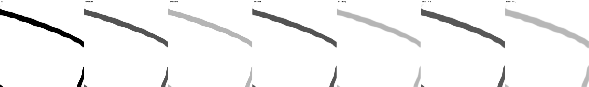

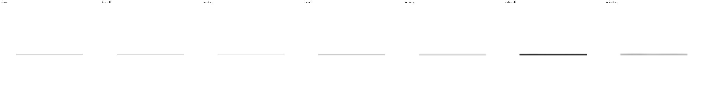

## 共通初期モデルの評価

1,562件×3サイズ×推論1/5回＝9,372出力を評価した。cleanの既存434件に対する2,604比較では、前回residual raw 10,000更新のF1・MAE・線幅誤差・保護領域誤差が完全一致した。新しい下描き入力を含め、保護領域の最大誤差は0。

推論1回、強いblur＋不透明度低下のclean実画像由来12cropでは、編集対象F1はS=.2301、L=.2160。強い太線・重ね描きまで含む幾何形状ではS=.1675、L=.1448だった。既存のノイズ除去モデルだけではこの変形の復元が難しく、追加学習の比較対象となる。詳細は`benchmarks/sketch-20260911-initial.json`。これらは追加学習前の値であり、拡張による改善はまだ判断しない。

## 2,000更新の結果

2026-09-11 20:05 UTCにraw/EMAの固定評価が完了した。1,562件×4条件×3サイズ×推論1/5回×raw/EMA＝74,976出力、全て有限値で、保護領域の最大誤差は0。8個の入れ子モデルsnapshotを保存し、各17,893パラメータ・有限値を確認した。`benchmarks/sketch-20260911-pilot.json`に全サイズの集計、元画像単位の対応付きbootstrap、ノイズ強度別の集計、45個の関連artifactのhashを保存している。

薄くぼけた入力から黒い線を復元する能力は上がったが、clean入力の背景に偽線や灰色の汚れが増えた。学習中の共通validation lossの低下だけでは、画質改善を判断できない。以下は推論1回のSモデルの編集領域F1。clean実画像は編集領域に線があるケース、下描き実画像は固定12cropの全面・部分編集を集計しているため、列の値そのものではなく同じ列の条件間で比較する。

| raw重み | clean実画像 | clean幾何形状 | 強いblur下描き | 強い太線・重ね描き下描き |
|---|---:|---:|---:|---:|
| control | .9409 | .8480 | .2170 | .2902 |
| tone | .8418 | .3817 | .7270 | .6856 |
| blur | .8497 | .3573 | .7488 | .6926 |
| strokes | .8829 | .5799 | .7138 | .7632 |

EMAでは副作用が緩和されているが、cleanの性能低下は残る。

| EMA重み | clean実画像 | clean幾何形状 | 強いblur下描き | 強い太線・重ね描き下描き |
|---|---:|---:|---:|---:|
| control | .9394 | .8458 | .2473 | .3028 |
| tone | .8889 | .6418 | .7068 | .7621 |
| blur | .8832 | .6244 | .7330 | .7624 |
| strokes | .9122 | .7261 | .6597 | .7780 |

F1だけでなく画素誤差も重要だった。raw Sの強いblur下描きでは、blur条件のF1は.7488まで上がる一方、MAEはcontrolの.0880に対して.0894だった。strokes条件はF1=.7138、MAE=.0504で、背景の汚れは比較的小さい。ノイズ強度が高いほどclean幾何形状の悪化が大きく、raw Sの強度.7ではF1がcontrol=.6726、tone=.0810、blur=.0928、strokes=.1523だった。強度.1でも、F1の低下より灰色の汚れに対するMAEの悪化が目立つケースがある。

元画像12sourceを単位にした対応付き95%bootstrap区間でも、この両面が見られた。EMA Sのblur条件は、強いblur下描きのF1差がcontrol比+.4857［+.3523, +.5982］。EMA Sのstrokes条件は、強い太線・重ね描き下描きで+.4752［+.3910, +.5558］だが、clean実画像では−.0272［−.0488, −.0105］。区間は今回の学習済みモデルと合成評価分布に条件付きで、学習seedや実下描きへの不確実性を含まない。

gateは実行の健全性を確認するための基準であり、画質の合格判定ではない。条件を満たしたため、途中で拡張率・loss・モデル構造を変えず、4条件とも追加合計10,000更新まで継続する。現段階では拡張をそのまま採用できるとも、Sで十分とも判断しない。

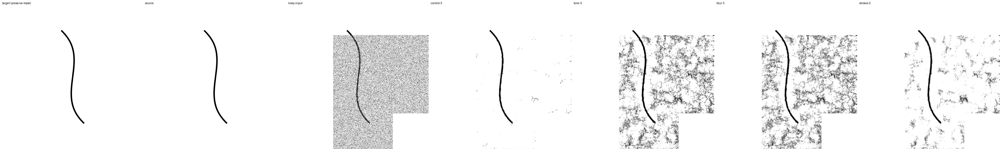

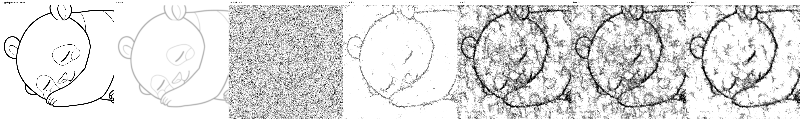

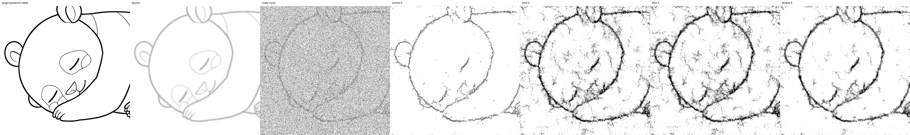

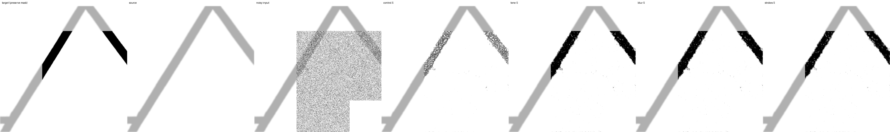

## 10,000更新の最終結果

4条件とも追加10,000更新に到達し、raw/EMAの全固定評価、保存・抽出・ONNX検証まで完了した。前回の10,000更新から開始したため、各最終モデルは合計20,000更新相当。今回の追加学習は各条件160,000cropで、元画像数や3サイズ分を水増しして数えていない。

以下はS、denoising反復1回の編集領域F1。列の評価集合は2,000更新表と同一。

| raw重み | clean実画像 | clean幾何形状 | 強いblur下描き | 強い太線・重ね描き下描き |
|---|---:|---:|---:|---:|
| control | .9467 | .8837 | .2191 | .2687 |
| tone | .9034 | .6053 | .7430 | .7119 |
| blur | .9047 | .6026 | .7602 | .7207 |
| strokes | .9219 | .7964 | .6630 | .7921 |

| EMA重み | clean実画像 | clean幾何形状 | 強いblur下描き | 強い太線・重ね描き下描き |
|---|---:|---:|---:|---:|
| control | .9428 | .8639 | .2315 | .2806 |
| tone | .8895 | .5461 | .7457 | .7094 |
| blur | .8875 | .5287 | .7652 | .7145 |
| strokes | .9107 | .7096 | .7292 | .7647 |

不透明度の拡張だけで改善の多くが得られた。raw Sの強いblur下描きではcontrol→toneでF1が+.5238、さらにtone→blurで+.0173［対応付き95%区間 +.0064, +.0331］。blur追加にも改善が見られたが、不透明度への適応より増分は小さい。

太線・重ね描きまで含むstrokes条件は、強い太線・重ね描き下描きでblur条件より+.0714［+.0191, +.1348］、clean幾何形状では+.1938［+.1819, +.2063］だった。一方、純粋な強いblur下描きの平均F1はblur条件の方が高く、全条件で一つの方法が勝ったわけではない。strokesは膨張・変位・重ね描きをまとめた条件であり、それぞれ単独の寄与は分離していない。

F1と画素誤差も分けて判断する必要がある。raw Sの強いblur下描きのMAEはcontrol=.08739、tone=.04913、blur=.05258、strokes=.04061。F1ではblurが高くても、strokesの方が灰色の汚れを抑えた例がある。強い太線・重ね描き下描きのMAEはcontrol=.08650、strokes=.04077だった。

cleanへの副作用は追加学習で縮小したが、解消していない。raw Sのstrokesは2,000→10,000更新でclean幾何形状F1が.5799→.7964、MAEが.11637→.01839に改善した。それでも最終controlのF1=.8837、MAE=.00753には届かない。clean実画像のstrokes対controlのF1差は−.0248［−.0465, −.0087］。なおstrokesの強いblur下描きF1は同じ期間に.7138→.6630と下がっており、追加学習で全項目が単調に改善したとは言えない。

2,000更新時点とは異なり、最終時点ではrawがclean・幾何形状系でEMAを上回った。EMAを常に優先する根拠はなく、両方を保存する価値があった。

### サイズによる違い

rawのstrokes条件、denoising反復1回を比較する。

| 指標 | S: 5,933 | M: 10,206 | L: 17,893 |
|---|---:|---:|---:|
| clean実画像・編集F1 | .9219 | .9266 | .9297 |
| clean幾何形状・編集F1 | .7964 | .8348 | .8505 |
| 強い太線・重ね描き下描き（実画像由来）・編集F1 | .7921 | .7967 | .7971 |
| 強い太線・重ね描き下描き（幾何形状）・編集F1 | .5288 | .5507 | .5562 |
| 同・全面編集での線幅誤差px | 2.644 | 2.000 | 1.829 |

実画像由来の強い太線・重ね描きではS→LのF1差は+.0051［−.0010, +.0117］と小さかった。一方、clean幾何形状ではS→Mで+.0384［+.0338, +.0431］、M→Lで+.0157［+.0127, +.0192］。幾何形状の強い下描きではM→L差は+.0055［−.0010, +.0117］だった。これらは学習seed差を含まない、固定した画像・形状の条件付き比較である。

Sでも下描き復元は学習できたが、細線の切れや背景の汚れは残った。Lにしても全ては解消せず、実画像由来の下描きでは増加パラメータに対するF1の増分も小さい。現時点で最小十分サイズを確定するより、S/M/Lを固定したままデータ分布とlossを詰めるのが次の課題となる。

### 反復回数

反復を増やして補う方法は、今回の結果では支持されなかった。例えばraw Sのclean幾何形状F1は1→5回でtone=.6053→.0686、blur=.6026→.0509、strokes=.7964→.6986。strokesの強い太線・重ね描き下描きでも.7921→.7867だった。検証した1/5回では1回を次の比較基準にする。空間再帰の段数とは別であり、既存Krita設定に揃えた段数での追加評価は別途必要。

### 比較画像

全て最終raw重み。統計評価後に改善例と失敗例を選んだ図であり、追加の独立評価データではない。

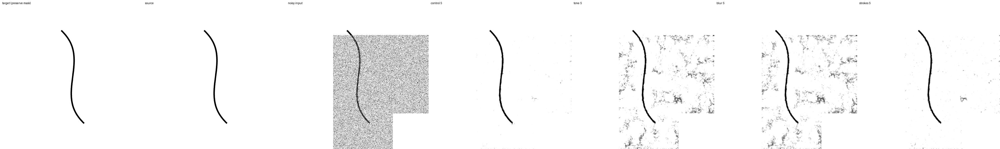

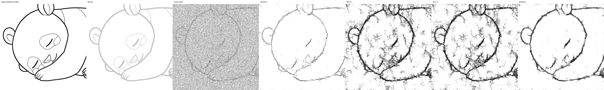

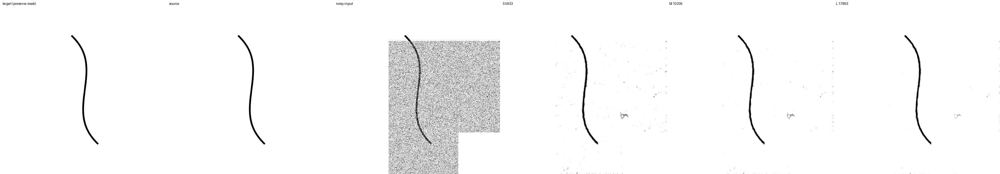

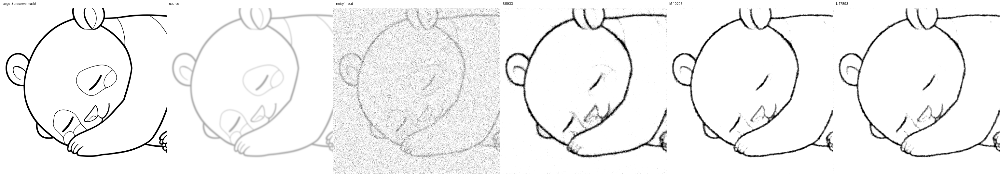

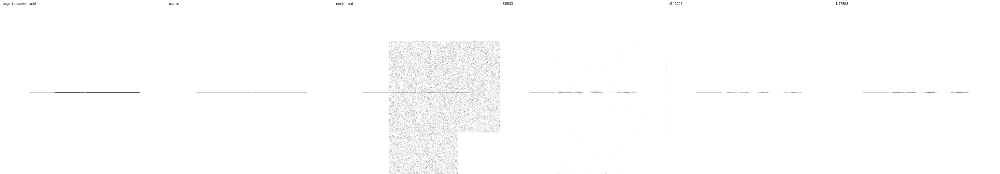

S/M/L図は`scripts/render_sketch_widths.py`で再生成できる。4case×3サイズを再推論し、編集F1・MAE・保護誤差が主評価と一致することを確認した。

### 保存物と検証範囲

- `benchmarks/sketch-20260911.json`: 初期・2,000・10,000更新の集計、対応付き区間、強度・マスク別の値、211artifactのhash。主評価は合計159,324出力。
- `benchmarks/sketch-20260911-contrasts.json`: 拡張の隣接条件とサイズ間の1,176比較。重複するtone/control比較は主集計と完全一致を確認。
- `benchmarks/sketch-20260911-artifacts.json`: 追加の比較画像・runtime検証・source archiveを含む保存物のhash一覧。
- `runs/sketch-20260911/training/{control,tone,blur,strokes}/checkpoints/10000/`: optimizer・EMAを含む最終checkpoint。実際のoptimizer counterも全て10,000。
- `runs/sketch-20260911/snapshots/step-{2000,10000}/{condition}/{raw,ema}/`: 入れ子モデルの独立保存16個。各17,893パラメータ、全て有限値。
- `runs/sketch-20260911/extracted/step-10000/{condition}/{raw,ema}/{0,1,2}/`: S/M/LのJAX用保存24個。
- `runs/sketch-20260911/exports/step-10000/{condition}-{raw,ema}.onnx`: SのONNX 8個。例えば`strokes-raw.onnx`が上記raw S候補。

最終8モデルについて再帰1/6段×3サイズの48比較で、入れ子と抽出モデルの出力差は0。L専用重みを変更しても全段のS/M出力は完全一致し、Lだけが変化した。保存・再読み込みのパラメータも完全一致した。

ONNXは動的な小サイズ・非正方形・大サイズに加え、512pxの入力で検証した。512pxにおけるJAXとの差の最大値は2.9802322387695312e-6。さらに全8個を既存の`LineartModel.infer`へ渡し、33×17と512×512、反復1/5回の32条件でBGRA契約・決定性・強度0・保護領域を確認した。512pxでは既存metadataに従い再帰3段になる。記録は`benchmarks/sketch-20260911-runtime.json`。保護の一致は既存の正規化・量子化・alpha閾値を含む前後処理に対する一致であり、元BGRA byte列の無変換コピーという意味ではない。CPU runtimeの検証で、実際のKrita画面やWindows/DirectMLでの検証ではない。

固定入力1,573ファイルのhash、学習source hash、元画像分割の一致を再確認した。train891/dev64/final64の分割を維持し、評価に使った実画像sourceはdev内で、finalは使用していない。学習実装は108テスト、追加の統計関連は3テストが成功しており、学習sourceは開始時から変えていない。

記録された4条件分の学習時間は合計約12.68時間（更新・準備・入力待ちを含むが、別途行った評価・初期化・保存時間を除く）。定常時の1条件あたり更新は平均約1.13秒、4条件分の入力準備は平均約0.017秒だった。単独のハードウェア速度比較ではない。

### 次に優先する検証

今回の合成拡張の効果は確認できたが、75%適用・現行lossが最適とは確認していない。次の比較の候補はstrokesのraw 10,000更新で、完成版としての採用ではない。

1. 同じ画像・ノイズを使い、既存runtimeに揃えた再帰段数で背景・細線・接続を再評価する。今回の幾何形状1段という条件の影響を分離する。
2. S/M/Lと他の設定を固定し、拡張確率75%対50%対25%を比較する。clean入力の性能低下を抑えつつ、薄い下描きへの改善を残せるかを見る。
3. 背景の誤差を明示して重くするloss、または背景・細線を含むcropの割合を別々に比較する。F1だけで選ばず、灰色の汚れ、切断、誤接続、線幅も継続して確認する。

これらは未実施の候補であり、今回の結果だけで有効性を断定しない。Krita側と同梱モデルは変更していない。
