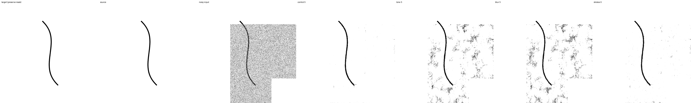
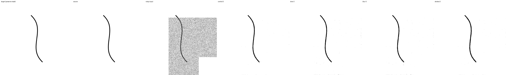
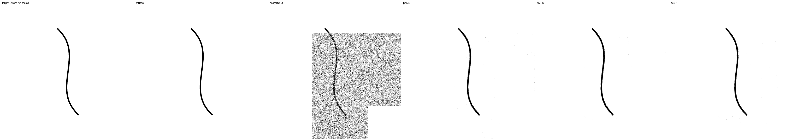
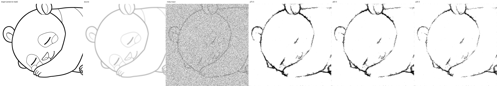
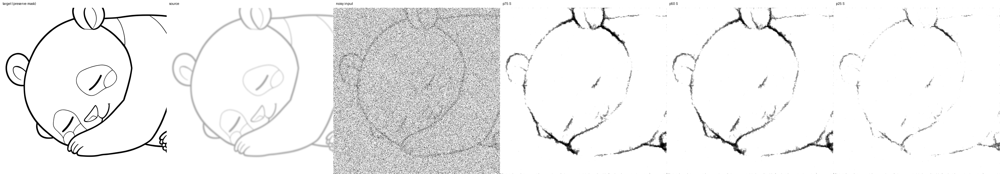
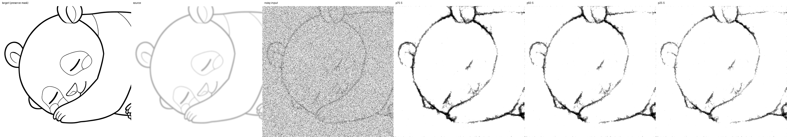
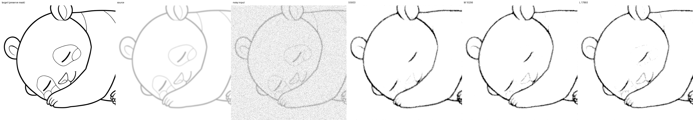
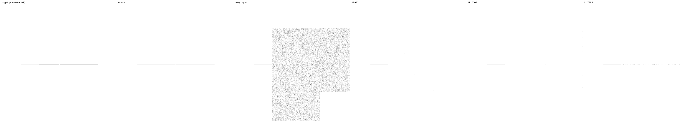

# 合成下描きの再帰条件と拡張率の比較

2026-09-12開始・完了。再帰条件の全件比較と、拡張率3条件それぞれ10,000追加更新の学習・評価を終えた。25%はclean保持を改善するが強いblur復元を悪化させ、50%は次の比較の基準候補となる。十分な画質や最小モデルサイズを確定した結果ではない。

合成下描きのみ。前回のclean線画由来の入力1,562件をbyte単位で再使用し、final testは使用しない。Krita側と同梱モデルは変更しない。

## 1. 再帰段数の影響を分離する

前回のcontrol / tone / blur / strokes、raw / EMA、S/M/Lの保存済み10,000追加更新重みを使用する。denoise反復は1回に固定する。

- 対照: 前回と同じ、dataset scaleに応じた1–6段。幾何形状は1段。
- runtime条件: 既存の`pyramid_plan`と`stop_size=max(128, minimum_size)`に従う。今回の512×512入力は全件3段。
- 両条件で既存runtimeのNumPy Gaussian生成手順を使う。同じseedから高解像度→低解像度の順に生成するため、共通解像度の入力とノイズが完全一致する。
- 前回のJAX乱数による数値と直接差を取って段数の効果としない。今回新たに作る対照とruntime条件の対応付き差を使う。

入力は正規化済みの固定配列で、BGRA前後処理による量子化は含めない。Sでは既存runtimeの計算との照合が可能。M/Lは下位prefixの状態も保持するJAX計算であり、既存1ch insert ONNXへの対応は引き続きSのみ。

## 2. 拡張率だけを変える

前回の`strokes` raw 10,000追加更新重みを共通初期値とする。これは最初の事前学習10,000＋下描き適応10,000の重みであり、ゼロからの比較ではない。optimizerをリセットし、EMAは初期パラメータをコピーする。

| 条件 | strokes拡張の確率 | clean入力の割合 |
|---|---:|---:|
| p75 | 75% | 25% |
| p50 | 50% | 50% |
| p25 | 25% | 75% |

S/M/Lは5,933 / 10,206 / 17,893パラメータで固定。拡張の種類・強度、loss、noise、mask、optimizerなどは前回のstrokes条件と同じ。データ・noise seedは新しい44、初期化seed42、元画像の分割seed42。3条件で同じcrop・mask・Gaussianを使い、適用される画像では変形も同じ。適用対象はp25⊆p50⊆p75となる。

学習時の再帰`original_steps + scale_level`は1–6段、各段loss倍率0、最高解像度のlossから再帰を通る勾配を維持する。実効batch16（micro4×蓄積4）、base LR1e-4×sqrt(16)=4e-4、warmup500、100,000更新を終点とする固定scheduleを維持する。noise weight floor .05、編集領域のみcontrast、独立Gaussian、マスクは全体・帯・矩形1:1:1。

2,000追加更新でraw/EMA全件評価後、健全なら追加合計10,000まで継続する。継続判定は有限な全件評価、保護領域誤差0、rawのclean実画像・幾何形状F1が`min(.30, 初期値の半分)`以上。これは崩壊の検出であり、画質の採用基準ではない。低順位だけでは条件を打ち切らない。

## 評価と判断

拡張率比較はruntimeと同じ3段・denoise1回・固定NumPy noiseを主評価とする。共通初期値も同じ条件で評価する。

- clean実画像 / clean幾何形状 / 合成下描きの種類・強さごとの編集領域F1とMAE。
- 白背景（正解の正規化値≥.99、編集対象のみ）のMAEと黒い画素の比率。
- 細線の消失、線幅、位置、切断、誤接続、保護領域、mask境界。
- 下描き部分編集の幾何probeは引き続き除外し、保護領域に下描きを残す正解と混同しない。
- 元画像または(kind, variant)を単位とする対応付きbootstrap。単一の学習seedであり、学習seed間の不確実性は評価しない。

cleanの回復と下描き復元の低下を両方示す。F1だけの平均で採用せず、背景・切断・誤接続・線幅の悪化を併記する。改善が明確でなければ拡張率を確定しない。幾何形状の学習への追加、loss変更、モデルサイズ探索はこの比較に混ぜない。

## 実行・成果物

設定: `configs/sketch-rates.toml`。run root: `runs/sketch-rates-20260912/`。

```bash
export JAX_PLATFORMS=rocm,cpu
export XLA_PYTHON_CLIENT_PREALLOCATE=false
export JAX_COMPILATION_CACHE_DIR="$PWD/runs/sketch-rates-20260912/jax-cache"
.venv/bin/python scripts/run_sketch_rates.py --root runs/sketch-rates-20260912 --phase recursion
# 再帰比較の結果を確認してから実行する。
.venv/bin/python scripts/run_sketch_rates.py --root runs/sketch-rates-20260912 --phase training
```

準備済みのsource hashと固定入力を各phaseの開始時に検査する。再開は前のプロセス終了を確認した後に限る。`stop`ファイルは完全な更新単位で停止する。完了済み評価は上書きしない。2,000/10,000更新のraw/EMA archive、最終optimizer checkpoint、S/M/L抽出重み、S ONNXと数値照合結果を保存する。

## 再帰比較の結果（完了）

4条件×3サイズ×2重み×2再帰条件×1,562件＝74,976出力を評価した。全出力が有限で、保護画素の最大誤差は0。全116テストと、実batch16・全6再帰段×3条件のGPU事前確認18更新が成功した。実S重みの32条件でJAXと既存ONNX runtimeも一致し、最大絶対差は1.4931e-5だった。

runtimeの3段に揃えたraw Sの編集領域F1:

| 学習条件 | clean実画像 | clean幾何形状 | 強いblur下描き | 強い太線・重ね描き下描き |
|---|---:|---:|---:|---:|
| control | .9485 | .9061 | .2274 | .2718 |
| tone | .9196 | .8285 | .7757 | .7595 |
| blur | .9192 | .8162 | .7851 | .7693 |
| strokes | .9226 | .8119 | .6460 | .7983 |

同じNumPy noiseで比べたraw Sのclean幾何形状F1は、dataset段数→runtime段数でtone .6075→.8285、blur .6043→.8162、strokes .7960→.8119となった。前回のtone/blurの大きな悪化には1段評価の影響が含まれる。strokesが全ての指標で最善とはいえない。

strokes Sのclean幾何形状に対する3段化の対応付きF1差はraw +.0160（95% source-cluster interval [.0082,.0237]）、EMA +.0841（[.0730,.0949]）。rawの白背景MAEは約.01564→.00477に減った。ただしruntime条件のcontrolは.00147であり、背景の誤差は残る。強い太線・重ね描きではrawの白背景MAEがstrokes .01272、blur .03620、tone .03764で、strokesを拡張率調整の出発点にする判断は維持する。

実画像由来の強い下描きで、strokesの3段化によるF1差の区間は0を含む。平均F1の小差だけで改善を断定しない。これらは合成入力・単一学習seedのdev評価であり、最終画質の採用判定ではない。

比較画像（上: dataset段数、下: runtime段数。列は教師・入力・ノイズ入力・control・tone・blur・strokesのS）:




集計: `benchmarks/sketch-rates-20260912-recursion.json`。全metricsとその他の比較画像はrun rootの`recursion/{dataset,runtime}-{raw,ema}/`。runtimeとの照合記録は`runtime-parity.json`。

## 拡張率比較

上記の結果を確認し、事前に固定した3条件の学習へ進んだ。2,000追加更新のraw/EMAを全件評価し、3条件とも健全性確認を通った。予定どおり追加合計10,000更新まで継続する。

### 2,000追加更新の途中結果

raw Sの編集領域F1:

| 条件 | clean実画像 | clean幾何形状 | 強いblur下描き | 強い太線・重ね描き下描き |
|---|---:|---:|---:|---:|
| 共通初期値 | .9226 | .8119 | .6460 | .7983 |
| p75 | .9138 | .7892 | .6436 | .7965 |
| p50 | .9182 | .8074 | .6722 | .7913 |
| p25 | .9274 | .8444 | .5943 | .7807 |

p25−p75のraw Sの対応付きF1差はclean実画像+.0136（95% interval [.0065,.0217]）、clean幾何形状+.0552（[.0464,.0644]）だが、強いblur下描きは−.0492（[−.0916,−.0151]）。EMAでも同じトレードオフがあり、強いblurでは−.0523（[−.0872,−.0201]）だった。背景の改善だけを見て25%を採用する結論にはしない。

raw Sのclean幾何形状の白背景MAEはp75 .00621、p50 .00512、p25 .00419。強い太線・重ね描きではp75 .01610、p50 .01634、p25 .01252。F1と背景汚れの両方を引き続き測る。




集計・対応付き区間・強度とmask別の結果: `benchmarks/sketch-rates-20260912-pilot.json`。この時点でのraw/EMA archiveは`runs/sketch-rates-20260912/snapshots/step-2000/`に固定保存済み。

### 最終結果

3条件とも10,000追加更新まで到達し、raw/EMA全件評価、checkpoint・抽出モデル・ONNXの検証を完了した。この最終重みは初期の事前学習10,000＋前回下描き適応10,000＋今回10,000更新の履歴を持つ。今回のp75対照を含め、optimizerとEMAを同じ条件でリセットしている。

raw Sの編集領域F1:

| 条件 | clean実画像 | clean幾何形状 | 強いblur下描き | 強い太線・重ね描き下描き |
|---|---:|---:|---:|---:|
| 共通初期値 | .9226 | .8119 | .6460 | .7983 |
| p75 | .9202 | .8027 | .6794 | .7979 |
| p50 | .9268 | .8325 | .6553 | .8002 |
| p25 | .9352 | .8562 | .5378 | .7332 |

EMA Sも同じ順序で比較する:

| 条件 | clean実画像 | clean幾何形状 | 強いblur下描き | 強い太線・重ね描き下描き |
|---|---:|---:|---:|---:|
| p75 | .9186 | .7928 | .7303 | .7973 |
| p50 | .9241 | .8242 | .7071 | .7965 |
| p25 | .9300 | .8577 | .6590 | .7952 |

25%のトレードオフは長く学習しても消えなかった。raw Sのp25−p75のF1差は、clean実画像+.0150（95% source-cluster interval [.0056,.0276]）、clean幾何形状+.0535（[.0409,.0660]）に対し、強いblurでは−.1415（[−.2491,−.0494]）、強い太線・重ね描きでは−.0648（[−.1376,−.0058]）。EMAは太線・重ね描きの低下を緩和し、その差の区間は0を含むが、blurの差は−.0712（[−.1153,−.0303]）と残る。rawだけの悪化をEMAにもそのまま当てはめない。

50%は中間の候補になる。raw Sのp50−p75はclean実画像+.0066（[.0035,.0101]）、clean幾何形状+.0298（[.0248,.0350]）。強い太線・重ね描きは+.0023（[−.0058,.0102]）で明確な差は見られない一方、強いblurでは−.0241（[−.0393,−.0112]）。EMAでもblurでは−.0232（[−.0404,−.0084]）と低下するため、50%が全条件で最適とはいえない。

共通初期値に対するp50 raw Sの差はclean実画像+.0042、clean幾何形状+.0206。強いblurは+.0093、太線・重ね描きは+.0019だが、両者の区間は0を含む。今回の追加学習だけで強い下描きの復元が改善したと断定しない。

### 背景と細線

raw Sの白背景MAE:

| 条件 | clean実画像 | clean幾何形状 | 強いblur下描き | 強い太線・重ね描き下描き |
|---|---:|---:|---:|---:|
| p75 | .00518 | .00465 | .00352 | .01541 |
| p50 | .00468 | .00419 | .00320 | .01443 |
| p25 | .00357 | .00245 | .00104 | .00760 |

25%は背景の誤差が小さいが、強い下描きでは線そのものが薄くなり消える例がある。背景MAEだけなら良く見えても復元としては失敗し得る。背景を白くするlossだけを強める方向には進まず、線を残す評価と学習信号を併せて検討する。





case480は強いblur・不透明度低下にノイズ強度.5を加えた全面編集。p75/p50にも切断があり、p25では線の消失がさらに目立つ。強い変形は一部が学習範囲外である。強度別のp50 raw Sの強いblur F1は全面編集.1で.6783、.5で.5992、EMAでは.7493/.6373。弱ノイズでも問題が全て解消したわけではない。

### モデルサイズ

p50 rawの比較。幅・モデル構造は全期間固定した。

| 指標 | S 5,933 | M 10,206 | L 17,893 |
|---|---:|---:|---:|
| clean実画像 F1 | .9268 | .9292 | .9329 |
| clean幾何形状 F1 | .8325 | .8429 | .8606 |
| 強い太線・重ね描き実画像由来 F1 | .8002 | .8066 | .8098 |
| 強い太線・重ね描き幾何形状 F1 | .3856 | .4219 | .4405 |
| clean幾何形状 線幅MAE px | .950 | .853 | .755 |
| 強い太線・重ね描き幾何形状 線幅MAE px | 2.009 | 1.844 | 1.747 |
| clean幾何形状 切断率 | .130 | .086 | .066 |
| clean幾何形状 誤接続率 | .361 | .367 | .378 |

線幅・切断の平均は大きいサイズで改善するが、誤接続は一様には改善しない。強い下描き幾何形状のprobeは全面編集だけで集計しており、F1の集計対象とは異なる。線種・閾値に依存する診断指標で、全接続の保証ではない。





case1376は薄くした意図的な隙間を持つ線への部分編集（ノイズ.1）。Lでも線の消失が残る例で、最小十分サイズの確定には至らない。比較画像4件は主評価と同じ入力・noise・再帰を使い、編集領域F1/MAEと保護領域誤差の再現を確認した。

### 保存物と検証

run root以下:

- `training/{p75,p50,p25}/checkpoints/10000/`: optimizer・EMAを含む再開可能な最終checkpoint。
- `snapshots/step-{2000,10000}/{p75,p50,p25}/{raw,ema}/`: 評価時点を保持する入れ子モデル12個。
- `extracted/step-10000/{p75,p50,p25}/{raw,ema}/{0,1,2}/`: 単独推論用S/M/Lの18 archive。
- `exports/step-10000/{p75,p50,p25}-{raw,ema}.onnx`: SのONNX 6個。
- `evaluation/step-{2000,10000}-{raw,ema}/`: 全評価値と比較画像。
- `evaluation/widths-10000-p50-raw/`: p50のサイズ比較画像と照合値。

最終6モデルのoptimizer counterは10000。入れ子と抽出モデルは再帰1/6段×3サイズの36比較で出力差0、L専用重みを変えても全段S/M出力は完全一致し、Lのみ変化した。保存・再読み込み後のパラメータも一致した。

S ONNXは動的な小サイズ・非正方形・大サイズと512pxで検証し、512pxの最大差は1.3709e-6。さらに実runtimeの3段・共通ノイズによる24比較でJAXとの差は最大3.5316e-6、保護画素は完全一致した。既存BGRA APIも6モデル×2サイズ×denoise1/5回の24条件で決定性・強度0・保護領域を確認した。1/5回のチェックはAPI検証であり、今回の画質比較は1回に固定している。

BGRAの一致は既存の正規化・量子化・alpha閾値を含む前後処理に対しての一致。Krita画面やWindows/DirectMLの実測ではない。M/Lの既存1ch insert ONNX対応は行っていない。

記録された3条件の学習時間は合計35,693秒（約9.91時間）。定常更新は各条件平均約1.132秒。評価・初期化・checkpoint保存などの別区間を除く値で、独立した速度ベンチマークではない。開始時から学習source・設定が不変であること、全10,000更新の連続性と全6再帰段の出現を確認した。

全集計: `benchmarks/sketch-rates-20260912.json`。追加照合は同prefixの`-runtime.json`、`-bgra.json`、`-illustrations.json`、成果物hash一覧は`-artifacts.json`。元画像分割train891/dev64/final64を維持し、fixed入力は前回と同じ1,563ファイル（case1,562件＋manifest）。final64は使用していない。

### 次の比較に残すこと

50%を次の学習条件の基準候補とし、raw/EMAの両方を評価に残す。25%へ下げるだけでは、下描き復元を維持しながらclean保持を改善する解決にはならなかった。

次は曲線・細線・近接線・意図した隙間を生成する幾何形状を学習へ追加するD1を優先する。改善が不足する場合に、境界・距離場loss（L1）や接続を扱うloss（L2）を個別に比較する。背景の誤差を減らすだけでは線の消失を選び得ることが、今回の結果から分かったためである。これらの追加学習は今回は未実施。

複数seed、独立Sとの比較、長期収束、最終test、最小モデルサイズの確定も引き続き未実施。この結果を配布モデルの採用やKritaへの反映には用いていない。
